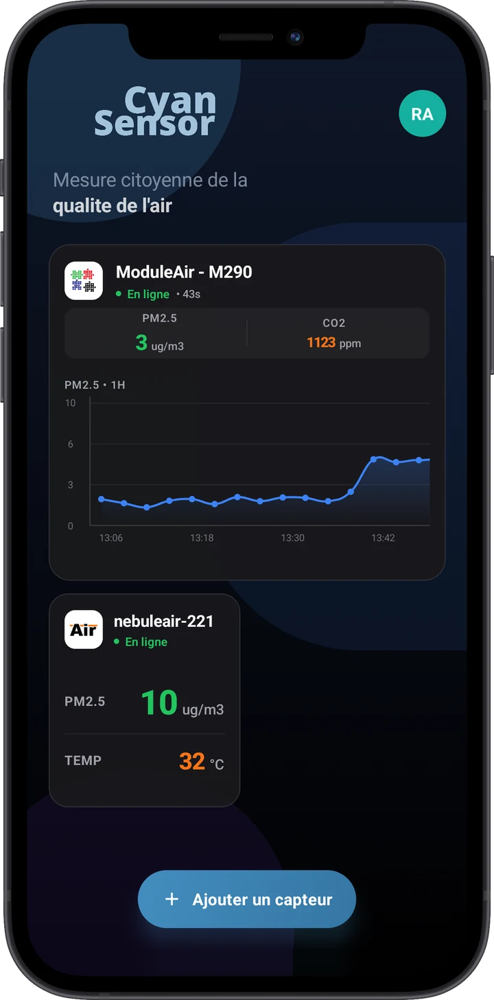
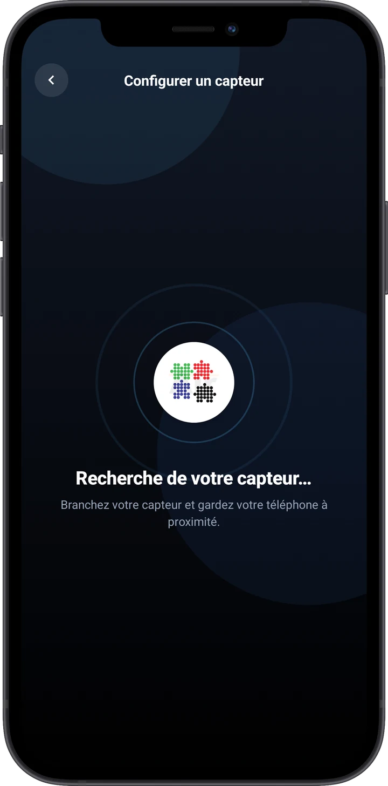
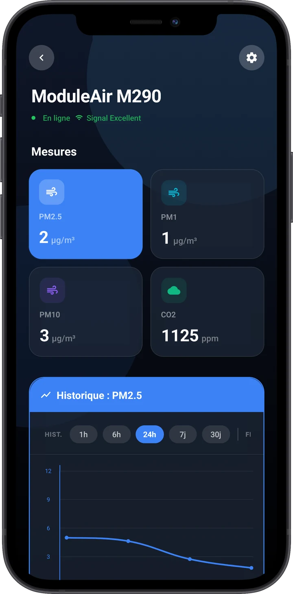
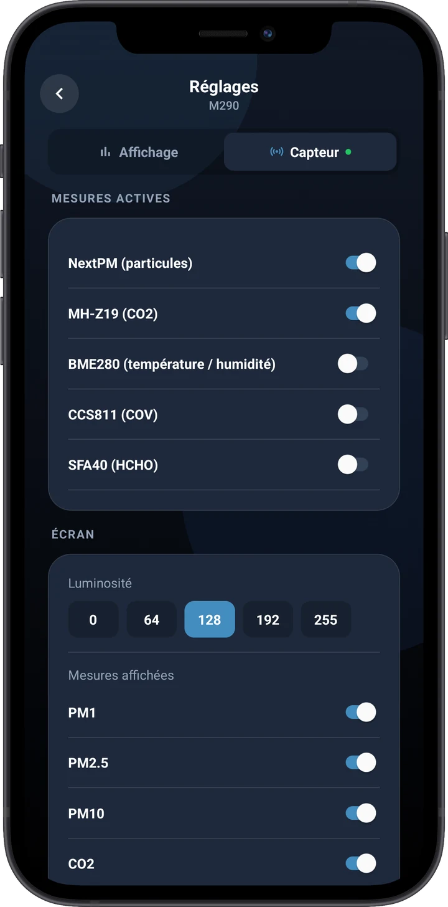

# Cyan Sensor

{ width="96" }

## Présentation

**Cyan Sensor** est l'application mobile compagnon des capteurs AirCarto. Elle regroupe ses capteurs dans une seule application : **mesures en direct**, **historique**, **configuration WiFi par Bluetooth** et **réglages à distance**. Elle reprend le service de [Mon ModuleAir](https://moduleair.fr/monModuleAir/) et de [Mon NebuleAir](https://nebuleair.fr/monNebuleAir.html), avec en plus la configuration du matériel.

| | |
|---|---|
| Plateformes | **iPhone / iPad** (App Store) et **Android** (Google Play) |
| Prix | gratuite |
| Compte | **facultatif** (mode invité) |
| Langue | français |
| Éditeur | AirCarto SAS |
| Identifiant | `fr.aircarto.app` |

[:material-apple: Télécharger sur l'App Store](https://apps.apple.com/app/cyansensor/id6757758735){ .md-button } [:material-google-play: Disponible sur Google Play](https://play.google.com/store/apps/details?id=fr.aircarto.app){ .md-button }

Page de présentation : [aircarto.fr/cyan-sensor](https://aircarto.fr/cyan-sensor/)

## Capteurs pris en charge

| Capteur | Ajout dans l'app | Ce que l'app permet |
|---------|------------------|---------------------|
| [ModuleAir WiFi](../moduleair-wifi/index.md) | Bluetooth (Improv) ou identifiant + token | Mesures, historique, réglages à distance sur le réseau local, alertes |
| [ModuleAir Mini](../moduleair-mini/index.md) | Bluetooth (Improv) ou identifiant + token | Mesures, historique, réglages à distance, alertes, **téléversement Bluetooth** des mesures hors ligne |
| [NebuleAir WiFi](../nebuleair-wifi/index.md) | Bluetooth (Improv) ou identifiant | Mesures, historique, position, **publication sur OpenAirMap**, alertes |
| [NebuleAir Pro](../nebuleair-pro/index.md) | identifiant ; panneau Bluetooth « état & paramètres » | Mesures, historique, état et paramètres par Bluetooth |
| [MobileAir](../mobileair/index.md) | Bluetooth | Relevés et trajets, réglages de l'anneau lumineux, publication sur OpenAirMap |
| [ModuleTraffic](../moduletraffic/index.md) | Bluetooth ou identifiant (ex. `ModuleTraffic_002`) | Comptage du trafic |

!!! info "Capteurs WiFi et capteurs 4G"
    Un capteur **WiFi** neuf se configure depuis l'app, par Bluetooth. Un capteur **déjà en ligne** — en 4G, ou en WiFi configuré par un autre moyen — s'ajoute simplement avec les informations de son étiquette.

## Premier lancement : avec ou sans compte

Au premier lancement, l'application propose trois choix :

| Choix | Effet |
|-------|-------|
| **Créer un compte** | La liste des capteurs est sauvegardée et **synchronisée** : on la retrouve sur un autre téléphone |
| **Se connecter** | Récupère la liste de capteurs d'un compte existant |
| **Continuer en tant qu'invité** | Aucune inscription : les données **restent sur le téléphone** |

!!! note "Vérification de l'adresse e-mail"
    Une inscription libre crée un compte **inactif** : un e-mail de confirmation est envoyé, et le compte s'active en cliquant sur le lien qu'il contient.

Un utilisateur invité qui se connecte plus tard conserve les capteurs déjà ajoutés sur son téléphone : ils sont fusionnés avec ceux du compte.

Les **alertes** (voir plus bas) nécessitent un compte.

## Le tableau de bord

{ width="300" }

L'écran **Dashboard** affiche une carte (tuile) par capteur : nom, état de connexion, dernières mesures.

- Chaque tuile existe en **petite** taille (deux mesures) ou en **grande** taille (deux mesures et un graphique).
- Les tuiles se **réorganisent par glisser-déposer**.
- Les mesures s'actualisent automatiquement ; tirer l'écran vers le bas force l'actualisation.

L'apparence d'une tuile (taille, valeurs affichées, donnée tracée) se règle dans l'onglet **Tuile** des réglages du capteur, avec un aperçu.

## Ajouter un capteur

Le bouton **+** ouvre trois options :

| Option | Pour quel capteur |
|--------|-------------------|
| **Ajouter mon capteur WiFi** | Un capteur à configurer : détection Bluetooth, puis WiFi guidé. Le MobileAir apparaît aussi dans cette liste. |
| **Ajouter mon capteur 4G** | Un capteur 4G, avec son identifiant |
| **Ajouter un capteur déjà connecté** | Un capteur déjà en ligne, avec son étiquette |

### Configurer un capteur WiFi par Bluetooth (Improv)

{ width="300" }

La configuration WiFi repose sur **[Improv Wi-Fi](https://www.improv-wifi.com/)**, un protocole ouvert de configuration WiFi par Bluetooth. Le téléphone ne change pas de réseau et aucun navigateur n'est nécessaire.

1. Branchez ou allumez le capteur et gardez le téléphone **à proximité**, Bluetooth activé.
2. **+** → **Ajouter mon capteur WiFi** : la recherche démarre seule.
3. Le capteur apparaît sous **CAPTEURS DÉTECTÉS**. Touchez-le.
4. L'application affiche les **réseaux WiFi détectés par le capteur**, avec la force du signal (Excellent, Bon, Faible).
5. Choisissez votre réseau, saisissez le **mot de passe** sur le téléphone, puis **Connecter**.
6. Le capteur rejoint le réseau ; il est ajouté au tableau de bord.

!!! success "Le mot de passe WiFi ne quitte pas le capteur"
    Le mot de passe est transmis **directement au capteur** par Bluetooth. Il n'est ni conservé dans l'application, ni envoyé aux serveurs AirCarto.

!!! warning "Ne pas débrancher pendant la configuration"
    Pendant l'étape « Configuration en cours… », le capteur se connecte au WiFi : ne le débranchez pas.

Les capteurs reconnus dans la liste de détection sont le **ModuleAir**, le **ModuleAir Mini**, le **NebuleAir**, le **NebuleAir Pro**, le **ModuleTraffic** et le **MobileAir**. Selon le cas, la ligne mène à un parcours différent :

| Capteur détecté | Ce que fait l'app |
|-----------------|-------------------|
| ModuleAir, ModuleAir Mini, NebuleAir, ModuleTraffic | Configuration WiFi (étapes ci-dessus) |
| NebuleAir Pro | Ouvre le panneau **état & paramètres** du capteur, qui montre son état avant de proposer un changement de réseau |
| MobileAir | Ouvre le parcours d'ajout du MobileAir (pas de WiFi à configurer) |
| ModuleAir Mini en mode téléversement | Section **TÉLÉVERSEMENT** à part (voir [ci-dessous](#televerser-les-mesures-dun-moduleair-mini)) |

Le détail côté capteur (messages à l'écran, comportement du Bluetooth) est décrit sur la page du [ModuleAir Mini](../moduleair-mini/index.md#3-connecter-le-capteur-au-wifi).

### Si le WiFi change : reconfigurer

Quand un capteur déjà enregistré perd son réseau (box changée, mot de passe modifié), sa fiche indique **Réseau WiFi perdu** et propose **Reconfigurer**. L'application retrouve ce capteur précis en Bluetooth et lui transmet le nouveau réseau : la tuile, sa place sur le tableau de bord et l'historique sont conservés, sans supprimer ni ré-ajouter le capteur.

### Ajouter un capteur déjà en ligne : l'étiquette

Pour un capteur 4G, ou déjà connecté au WiFi par un autre moyen : en bas de l'écran de détection, **Mon capteur est déjà configuré**, puis choisissez sa famille (NebuleAir ou NebuleAir Pro, ModuleAir, ModuleTraffic).

Saisissez ensuite les informations de l'**étiquette** du capteur, ou utilisez **Scanner l'étiquette** pour les lire avec l'appareil photo.

| Famille | Identifiant (exemple) | Token |
|---------|-----------------------|-------|
| NebuleAir / NebuleAir Pro | `nebuleair-025` | facultatif |
| ModuleAir (dont Mini) | `E99` ou `MINI001` | **obligatoire** |
| ModuleTraffic | `ModuleTraffic_002` | — |

!!! tip "Saisir le token, même s'il est facultatif"
    Pour un NebuleAir, dont les mesures sont publiques, le token n'est pas exigé. Il reste la preuve que l'on possède le capteur : sans lui, impossible par exemple d'ajouter des photos du capteur.

L'application vérifie le capteur au moment de l'ajout : un identifiant ou un token erroné est refusé, et un capteur déjà présent sur le tableau de bord n'est pas ajouté deux fois.

### Ajouter un MobileAir

Le [MobileAir](../mobileair/index.md) se connecte en Bluetooth et n'a pas de WiFi à configurer : il apparaît dans la même liste de détection, et sa ligne mène à son propre parcours d'ajout. À l'ajout, l'application **règle l'horloge** du capteur, qui n'en a pas de sauvegardée.

## Consulter un capteur

{ width="300" }

Toucher une tuile ouvre la fiche du capteur :

- l'**état** : en ligne ou non, qualité du signal WiFi ;
- les **mesures** en cours (selon le capteur : PM₁, PM₂.₅, PM₁₀, CO₂, température, humidité, COV…) ; toucher une mesure l'affiche dans l'historique ;
- l'**historique** de la mesure choisie, avec un code couleur de qualité de l'air ;
- la **position** du capteur, ses **photos** et ses **signalements**.

### L'historique

| Période | Résolutions proposées |
|---------|-----------------------|
| 1 h, 3 h | Scan, 2 min, 15 min, 1 h |
| 24 h, 48 h | 15 min, 1 h, 24 h |
| 1 semaine, 1 mois | 1 h, 24 h |
| 3 mois, 1 an | 24 h |

Une période personnalisée (début et fin) peut aussi être choisie.

### Signaler un événement

Un pic sur la courbe a souvent une cause identifiable. Le signalement l'enregistre **directement sur le graphique** : on délimite la plage horaire de l'événement, on choisit sa nature et on ajoute un commentaire (1 000 caractères au plus).

| | | | | |
|---|---|---|---|---|
| Incendie | Industriel | Trafic | Voisinage | Travaux |
| Ménage | Cuisson | Réunion | Défaut capteur | Divers |

Les signalements s'affichent ensuite sur les courbes, et l'historique des signalements d'un capteur se consulte sous forme de frise chronologique (nature, plage horaire, durée, commentaire).

!!! tip "Signaler un défaut du capteur"
    La nature **Défaut capteur** indique que des valeurs viennent d'un dysfonctionnement (encrassement, insecte…) et non de la qualité de l'air réelle. Voir par exemple [l'entretien du NebuleAir WiFi](../nebuleair-wifi/index.md#entretien-et-depannage).

### Position et photos

- **Position** : on place le capteur en recherchant une adresse, en se géolocalisant, puis en ajustant à la main (le repère reste au centre, c'est la carte qui bouge). Rien n'est envoyé avant **Enregistrer la position**. C'est l'équivalent de la carte « Géolocaliser mon capteur » de Mon NebuleAir et Mon ModuleAir.
- **Photos** : deux emplacements, le capteur en situation et l'environnement vu depuis le capteur. Les photos sont publiques. Leur ajout, remplacement ou suppression demande le **token** du capteur ; les métadonnées (dont la position GPS) sont retirées de l'image avant l'envoi.

## Régler le capteur à distance

{ width="300" }

L'icône des réglages, dans la fiche d'un capteur, ouvre deux onglets :

- **Tuile** : l'apparence de la tuile sur le tableau de bord ;
- **Capteur** : l'appareil lui-même, sur le réseau local (ModuleAir, ModuleAir Mini) ;
- **Alertes** : les notifications (voir [Alertes](#alertes)), pour les ModuleAir et les NebuleAir.

!!! note "Le téléphone et le capteur doivent être sur le même réseau"
    L'onglet Capteur dialogue avec l'appareil **sur le réseau local** : l'application le découvre automatiquement (mDNS), sans passer par un serveur. Hors du réseau du capteur, l'onglet affiche « Impossible de se connecter au capteur ».

### ModuleAir

| Section | Réglages |
|---------|----------|
| **Capteurs actifs** | Activer ou couper chaque sonde de mesure |
| **Écran** | Luminosité ; écrans affichés sur la matrice LED, leur **ordre** et leur **durée** (3 à 60 s) ; ville de l'écran météo |
| **Seuils CO₂** | Seuils de couleur du CO₂ |
| **Firmware** | Version installée ; **Rechercher une mise à jour** et l'installer |
| **Maintenance** | **Redémarrer**, **Oublier WiFi** (le capteur repasse en configuration Bluetooth et continue de mesurer et d'afficher), **Journal** |
| **Zone de danger** | **Supprimer ce capteur** de l'application |

### ModuleAir Mini

Luminosité, **date et heure** alignées sur celles du téléphone, mise à jour du firmware, oubli du réseau WiFi et **journal de bord** (avec un bouton pour l'envoyer au support). Le détail figure sur la page [ModuleAir Mini](../moduleair-mini/index.md#piloter-le-capteur-depuis-lapplication-cyan-sensor).

### NebuleAir Pro

Le panneau **état & paramètres** se connecte au capteur **par Bluetooth**, ce qui fonctionne aussi là où le réseau local est verrouillé : état, dernières mesures, configuration et commandes. La première écriture déclenche l'**appairage Bluetooth** du système : c'est normal, c'est la sécurité du service.

### MobileAir

État du lien Bluetooth et de la batterie, **luminosité** et **seuils de couleur PM₂.₅** de l'anneau lumineux, réinitialisation et suppression. Les réglages de l'anneau s'écrivent directement dans le capteur.

## Téléverser les mesures d'un ModuleAir Mini

Un [ModuleAir Mini](../moduleair-mini/index.md) sans WiFi enregistre ses mesures sur sa carte mémoire. L'application sert de relais pour les envoyer aux serveurs AirCarto :

1. Sur le capteur : **Réglages → TÉLÉVERSEMENT**, puis **ACTIVER LE BLUETOOTH**.
2. Dans l'application : **+** → **Ajouter mon capteur WiFi**. Le capteur apparaît dans une section **TÉLÉVERSEMENT** distincte.
3. Touchez-le, puis **Téléverser**.

Seules les mesures pas encore reçues par les serveurs sont envoyées : on peut téléverser aussi souvent qu'on le souhaite, sans doublon.

## Alertes

Pour un ModuleAir (dont Mini) ou un NebuleAir, et avec un compte, l'onglet **Alertes** des réglages du capteur envoie des **notifications** sur le téléphone :

- **Alerte de déconnexion** : un seul interrupteur, qui prévient quand le capteur ne répond plus **et** quand il revient en ligne, après un délai réglable ;
- **Mes alertes** : des règles de seuil créées en deux étapes (la donnée, puis le seuil), par exemple « PM2.5 dépasse 25 µg/m³ ».

Les modifications sont enregistrées automatiquement.

## Publier sur OpenAirMap

Un NebuleAir ou un MobileAir peut être rendu visible sur la carte publique **[OpenAirMap](../openairmap/index.md)**. Juste après l'ajout d'un NebuleAir ou d'un MobileAir, l'application le propose (**Pas maintenant** est possible) ; l'interrupteur **Publier sur OpenAirMap** reste ensuite disponible dans la fiche du capteur.

- Publier rend publique la **position exacte** du capteur (et, pour un MobileAir, ses trajets). L'activation passe donc par l'affichage d'un **texte de consentement**, puis par **J'ai compris, publier**.
- Le retrait est **immédiat**, sans confirmation.
- Refuser ne change rien au fonctionnement du capteur.

Voir aussi [Faire apparaître son NebuleAir sur la carte](../openairmap/index.md#faire-apparaitre-son-nebuleair-sur-la-carte).

## L'onglet Carte

L'onglet **Carte** reprend [OpenAirMap](../openairmap/index.md) dans l'application : capteurs colorés selon leur niveau, choix du polluant, des sources et du pas de temps, recherche, fiches capteur, mode historique, statistiques, SignalAir, bateaux et avions.

## Compte, profil et données

### Modifier son profil

**Paramètres → Modifier mon profil** : e-mail, nom et mot de passe (8 caractères minimum ; le mot de passe actuel est demandé).

### Les permissions demandées

| Permission | Usage |
|------------|-------|
| **Bluetooth** | Configurer les capteurs (Improv) et rester relié à un MobileAir, y compris en arrière-plan pendant un trajet |
| **Réseau local** (Bonjour / mDNS) | Découvrir les capteurs présents sur le réseau WiFi |
| **Localisation** (Android) | Exigée par Android pour rechercher des appareils Bluetooth ; elle ne sert pas à enregistrer la position du téléphone |

### Ce qui est stocké

| Donnée | Où |
|--------|----|
| Liste des capteurs (nom de pièce, identifiant, type, SSID, dernière mesure) | sur le téléphone ; synchronisée sur les serveurs AirCarto si un compte est utilisé |
| Compte (identifiant, e-mail, mot de passe haché, nom facultatif) | serveurs AirCarto, à Marseille |
| Mot de passe WiFi | **nulle part** : transmis au capteur uniquement |

L'application ne contient ni publicité, ni outil d'analyse tiers. Le détail figure dans la [politique de confidentialité](https://aircarto.fr/cyan-sensor/confidentialite/) et les [conditions d'utilisation](https://aircarto.fr/cyan-sensor/conditions/).

### Effacer ses données

- **Retirer un capteur** : réglages du capteur → Zone de danger → **Supprimer ce capteur**.
- **Données du téléphone** : **Paramètres → Effacer toutes les données locales**, ou désinstallation de l'application.
- **Supprimer son compte** : envoyez un e-mail à [contact@aircarto.fr](mailto:contact@aircarto.fr), **depuis l'adresse du compte**, avec pour objet « Suppression de compte Cyan Sensor » et votre identifiant. Le compte, la liste de capteurs synchronisée et l'association de vos signalements à votre identifiant sont supprimés sous **30 jours**, avec confirmation par e-mail. Procédure complète : [aircarto.fr/cyan-sensor/suppression-compte](https://aircarto.fr/cyan-sensor/suppression-compte/).
