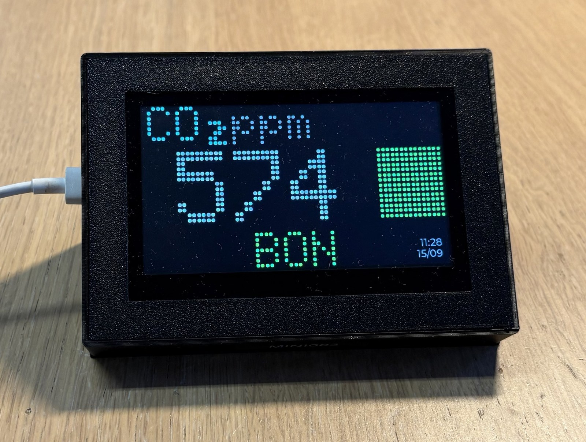
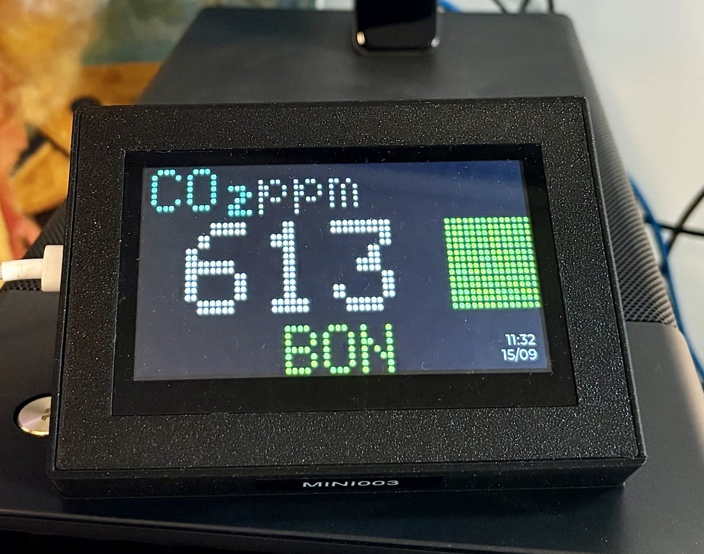
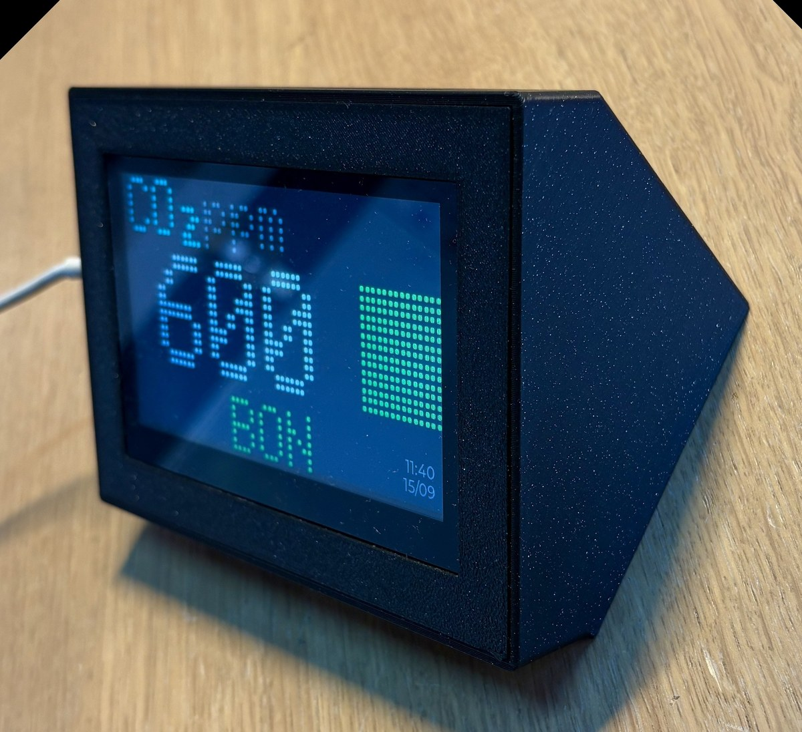
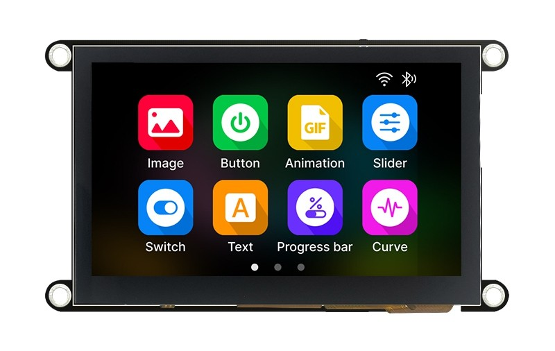
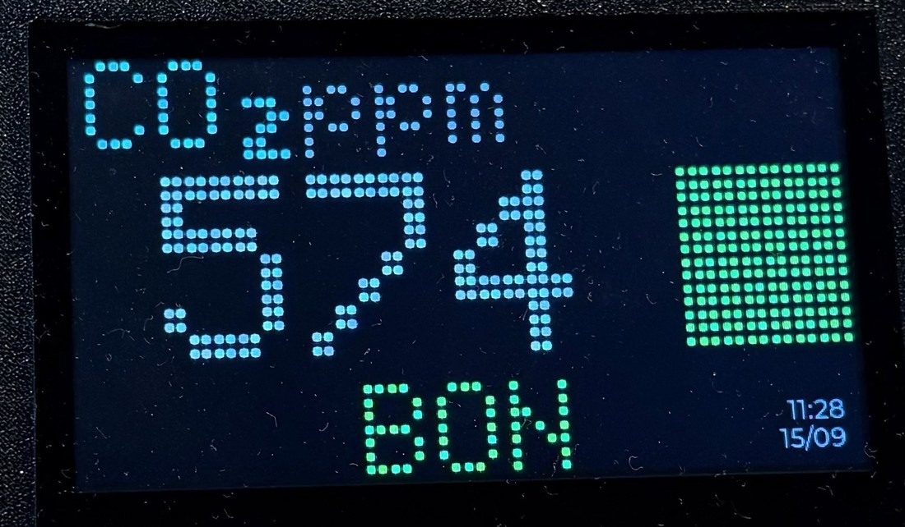
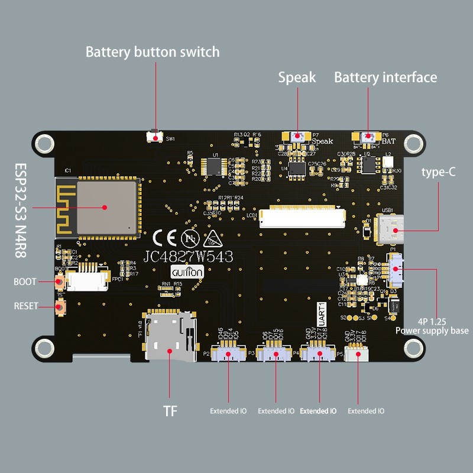

# ModuleAir Mini


{ width="100%" }

## Présentation

Le **ModuleAir Mini** est la version **tactile et interactive** du ModuleAir. Là où le [ModuleAir WiFi](../moduleair-wifi/index.md) affiche ses mesures sur un grand écran LED accroché au mur, le Mini se pose sur un bureau ou une table : un boîtier incliné équipé d'un **écran couleur tactile de 4,3 pouces**, qui assure à la fois l'affichage et la configuration.

Il mesure le **CO₂**, la **température** et l'**humidité**, affiche les résultats en continu avec le même code couleur que le reste de la gamme et les **enregistre sur une carte mémoire**. Les données se récupèrent de [trois façons](#recuperer-les-donnees) : par **câble USB-C** (fichier CSV), par **Bluetooth** avec l'application Cyan Sensor, ou automatiquement par **WiFi**. Il existe en **version sur batterie**, pour passer d'une salle à l'autre.

{ width="100%" }

!!! info "Deux façons de régler l'appareil"
    Le ModuleAir Mini n'a ni bouton ni interface web. L'heure, le réseau WiFi, la luminosité, les mises à jour et le journal de bord se règlent **sur l'écran tactile**, ou **à distance depuis l'application Cyan Sensor** une fois l'appareil connecté.

!!! success "Le WiFi n'est pas indispensable"
    Sans réseau, l'appareil mesure, affiche et **enregistre sur sa carte mémoire**. Les données se récupèrent ensuite **par câble USB-C** ou **par Bluetooth** avec l'application Cyan Sensor, qui les envoie aux serveurs AirCarto depuis le téléphone. Voir [Récupérer les données](#recuperer-les-donnees).

### Ce qui le distingue du ModuleAir WiFi

| | ModuleAir WiFi | **ModuleAir Mini** |
|---|---|---|
| Affichage | matrice LED 64 × 32 déportée | **dalle couleur tactile 480 × 272** |
| Interaction | interface web sur un autre appareil | **l'écran lui-même** |
| Mesures | PM1 · PM2.5 · PM10 · CO₂ | **CO₂ · température · humidité** |
| Configuration WiFi | portail captif ou Bluetooth | **Bluetooth (app Cyan Sensor) ou clavier à l'écran** |
| Stockage local | — | **carte microSD (journal CSV)** |
| Alimentation | secteur | **secteur USB-C, ou batterie (version sur batterie)** |
| Récupération des données | WiFi | **USB-C, Bluetooth (app Cyan Sensor) ou WiFi** |
| Usage | mural, salle de classe, ERP | **bureau, table, poste de travail** |

## Caractéristiques techniques

Le ModuleAir Mini rassemble, dans un boîtier imprimé en 3D, une carte ESP32-S3 à écran tactile intégré, un capteur de CO₂, une sonde de température/humidité, une horloge sauvegardée par pile et une carte mémoire.

{ width="500" }

### Plateforme

- **Carte** : Guition **JC4827W543**
- **Microcontrôleur** : **ESP32-S3** (Espressif), double cœur Xtensa LX7
- **Flash** : 4 Mo
- **PSRAM** : 8 Mo
- **Radio** : WiFi 802.11 b/g/n **2.4 GHz** + **Bluetooth LE**
- **Alimentation** : USB-C 5 V ; batterie Li-ion 18650 de 3 200 mAh sur la version batterie

### L'écran tactile

{ width="100%" }

Le module **Guition JC4827W543** réunit sur une seule carte l'ESP32-S3, la dalle, le tactile, le lecteur de carte mémoire et le port USB-C.

| Caractéristique | Valeur |
|-----------------|--------|
| Dalle | 4,3 pouces, **480 × 272 pixels**, couleur |
| Contrôleur | NV3041A, liaison **QSPI** |
| Tactile | **GT911** capacitif |
| Luminosité | **réglable** depuis l'écran ou l'application (l'extinction complète n'est pas proposée) |

### Capteurs et horloge

| Composant | Rôle | Interface |
|-----------|------|-----------|
| **[Senseair S88](https://senseair.com/product/s88/)** | Dioxyde de carbone (CO₂) | UART — Modbus RTU |
| **BME280** (Bosch) | Température · humidité · pression | I²C |
| **DS3231** | Horloge temps réel, sauvegardée par pile | I²C |

### Stockage

Une **carte microSD** enregistre une ligne CSV par cycle de mesure. Branché à un ordinateur par son port USB-C, le ModuleAir Mini **se présente comme une clé USB** : on récupère le fichier sans ouvrir le boîtier ni installer quoi que ce soit.

### Boîtier

Le boîtier est **imprimé en 3D**, incliné vers l'utilisateur pour que l'écran se lise depuis une position assise. Le **nom du capteur est gravé sur la face avant** (`MINI003` sur les photos de cette page) : c'est l'identifiant sous lequel il apparaît dans l'application et dans les données transmises.

L'écran et sa carte (module Guition JC4827W543) mesurent **120 × 70,2 mm**, pour une zone d'affichage utile de **95 × 54 mm**.

### Alimentation

Le ModuleAir Mini se branche sur un **port USB-C 5 V** : chargeur de téléphone, port USB d'un ordinateur ou d'une multiprise. Branché, il fonctionne en continu.

!!! warning "Alimentation recommandée"
    Le capteur de CO₂ demande des pics de courant pendant sa mesure, en plus de l'écran et du WiFi. Un adaptateur secteur **5 V / 1 A** est recommandé ; un port USB ancien ou un hub non alimenté peut provoquer des redémarrages.

### Version sur batterie

Le ModuleAir Mini existe en **version sur batterie** : une batterie **Li-ion 18650 de 3 200 mAh** est intégrée au boîtier. Le capteur se déplace alors de salle en salle **sans interrompre ses mesures** ni son enregistrement.

- **Recharge** par le même câble **USB-C**, sur un adaptateur secteur ; la charge est gérée par la carte électronique.
- **Niveau de batterie** affiché à l'écran.
- La batterie est au **format standard 18650** : elle se remplace sans changer l'appareil.

| Usage | Autonomie |
|-------|-----------|
| Écran allumé en permanence | environ **8 h** |
| Écran en veille (Réglages → Écran → Veille → **Éteindre**) | environ **48 h** |

!!! tip "Prolonger l'autonomie"
    Le mode de veille **Éteindre** coupe l'éclairage de l'écran après 10 secondes sans le toucher ; un toucher le rallume. Le mode **Atténuer** garde l'écran lisible à luminosité minimale. Les mesures et l'enregistrement continuent dans tous les cas.

## Les capteurs en détail

### Dioxyde de carbone (CO₂) — Senseair S88

Le **CO₂** est le meilleur indicateur du **renouvellement de l'air** dans une pièce occupée. L'air extérieur en contient environ **420 ppm** ; dans une pièce fermée, le taux monte avec la respiration des personnes présentes. Au-delà de **~1000–1500 ppm**, l'air est considéré comme **confiné** : il est temps d'aérer. Des niveaux élevés s'accompagnent souvent de somnolence, de maux de tête et d'une baisse de concentration, et le CO₂ est un bon indicateur indirect du risque de transmission des maladies aéroportées.

Le **S88** du fabricant **suédois [Senseair](https://senseair.com/)** fonctionne par principe **NDIR** (*Non-Dispersive InfraRed*, infrarouge non dispersif) : le CO₂ absorbe une longueur d'onde infrarouge précise ; en mesurant cette absorption dans une chambre optique, le capteur en déduit la concentration. C'est la méthode de référence pour la mesure du CO₂ en intérieur, robuste et stable dans le temps.

| Caractéristique | Valeur |
|-----------------|--------|
| Principe | NDIR (infrarouge non dispersif) |
| Plage | 400 à 10 000 ppm |
| Précision | ± 40 ppm ± 3 % de la mesure |
| Calibration | **ABC** (*Automatic Baseline Calibration*) automatique, sans entretien |
| Durée de vie | plus de 15 ans |
| Interface | UART — **Modbus RTU** (9600 bauds, 8N1) |

!!! tip "Calibration automatique"
    La calibration **ABC** recale la ligne de base du capteur sur la valeur la plus basse observée sur sa période glissante. Le capteur conserve sa justesse dans le temps **sans intervention**, à condition que la pièce soit aérée régulièrement.

### Température et humidité — BME280

{ width="300" }

La sonde **BME280** de Bosch mesure la **température**, l'**humidité relative** et la **pression atmosphérique**. Ce ne sont pas des polluants, mais les conditions ambiantes qui complètent le diagnostic de confort d'une pièce.

| Mesure | Gamme | Précision |
|--------|-------|-----------|
| Température | −40 à +85 °C | ± 1 °C |
| Humidité | 0 à 100 % HR | ± 3 % HR |
| Pression | 300 à 1100 hPa | ± 1 hPa |

!!! info "La pression n'est ni affichée ni transmise"
    Le BME280 mesure les trois grandeurs, mais le ModuleAir Mini n'exploite que la **température** et l'**humidité** : la pression atmosphérique n'apparaît pas à l'écran et ne fait pas partie des données envoyées.

### L'heure — DS3231

Le ModuleAir Mini embarque une **horloge temps réel DS3231**, sauvegardée par une pile bouton. Elle sert à **horodater le journal CSV** de la carte mémoire et à afficher l'heure à l'écran.

L'heure est demandée au premier allumage (voir [Première mise en service](#premiere-mise-en-service)) et reste modifiable à tout moment dans **Réglages → Date et heure**, ou depuis l'application.

!!! note "Affichage `--:--`"
    Le firmware écarte les lectures d'horloge aberrantes au lieu de les afficher. Tant qu'il ne dispose pas d'une heure sûre, l'écran indique **`--:--`** et aucune ligne n'est écrite sur la carte mémoire.

## Première mise en service

### 1. Brancher le capteur

Branchez le ModuleAir Mini sur une prise USB avec le câble USB-C fourni. Il démarre automatiquement : le **logo ModuleAir** s'affiche, puis le **logo AirCarto**.

### 2. La mise en route

Au **tout premier allumage**, et à ce moment-là seulement, trois écrans s'enchaînent :

| Écran | Contenu |
|-------|---------|
| **Bienvenue** | Écran de présentation ; un appui pour continuer |
| **Date et heure** | L'heure courante, à régler avec des molettes tactiles |
| **Configuration terminée** | Écran de confirmation ; l'appareil passe aux mesures |

Aux allumages suivants, l'appareil arrive directement sur les mesures.

Le réseau WiFi n'est pas demandé à cette étape : il se configure à tout moment, par l'une des deux méthodes décrites ci-dessous.

### 3. Connecter le capteur au WiFi

Les deux méthodes ci-dessous aboutissent au même résultat : le réseau est enregistré de la même façon, et l'appareil s'y reconnecte automatiquement aux démarrages suivants.

=== "Depuis l'application Cyan Sensor (Bluetooth)"

    Cette méthode évite la saisie du mot de passe sur le clavier tactile.

    Tant qu'il n'est pas connecté à un réseau, le ModuleAir Mini **s'annonce en Bluetooth**. Il apparaît alors dans « **Ajouter un capteur** » de l'[application Cyan Sensor](https://aircarto.fr/cyan-sensor/), l'application compagnon des capteurs AirCarto :

    1. Ouvrez l'application et lancez « Ajouter un capteur »
    2. Sélectionnez le ModuleAir Mini dans la liste
    3. L'application affiche les réseaux WiFi détectés par le capteur
    4. Choisissez le vôtre et saisissez le mot de passe **sur votre téléphone**

    L'écran du capteur rend compte de chaque étape :

    | Étape | Affichage |
    |-------|-----------|
    | L'application se connecte | « Mode configuration Bluetooth » |
    | Elle transmet le réseau | « Connexion à *votre réseau* » |
    | Connexion réussie | « Configuration réussie », avec le réseau et l'adresse IP |
    | Échec de la connexion | « Configuration impossible », puis retour à la consigne |

    !!! info "Le Bluetooth ne fonctionne que hors connexion"
        Le Bluetooth s'arrête dès que le WiFi est joint : la mémoire qu'il occupe est nécessaire à la connexion sécurisée vers les serveurs. Les deux radios ne sont jamais actives en même temps.

        Si le réseau devient injoignable (box changée, mot de passe modifié), le capteur **recommence à s'annoncer au bout d'une minute** et l'application propose « Reconfigurer le Wi-Fi ».

=== "Depuis l'écran tactile"

    La configuration peut aussi se faire entièrement depuis l'appareil, sans téléphone :

    1. Touchez l'**heure**, en bas à droite de l'écran de mesure → le menu **Réglages** s'ouvre
    2. **RÉSEAU WI-FI**
    3. Choisissez votre réseau dans la liste (rafraîchie automatiquement)
    4. Saisissez le mot de passe sur le **clavier tactile**, puis validez

    L'écran affiche « Connexion à… », puis « **Connecté !** » avec le nom du réseau. La connexion se fait **en direct, sans redémarrage**.

    !!! tip "Le clavier est en AZERTY"
        Le clavier tactile est en **AZERTY par défaut**. Il bascule en QWERTY dans **Réglages → Écran → Clavier**, et le choix est mémorisé.

!!! warning "Réseaux non supportés"
    Le capteur se connecte à un réseau WiFi **2.4 GHz** protégé par un mot de passe (ou ouvert). Les réseaux d'entreprise à **portail captif** ou à identifiant/mot de passe (université, hôtel, certains bureaux) ne sont **pas** supportés.

## L'écran en détail

### Composition d'un écran de mesure

L'écran reprend le rendu du [ModuleAir WiFi](../moduleair-wifi/index.md) : la valeur est dessinée en gros points sur fond noir, façon matrice LED, pour rester lisible à distance.

Tous les écrans de mesure suivent la même disposition :

| Zone | Position | Contenu |
|------|----------|---------|
| **Mesure** | En haut à gauche (cyan) | Le nom de la mesure (CO₂, TEMP, HUMI) |
| **Unité** | À droite du nom (gris) | L'unité (ppm, °C, %) |
| **Valeur** | Au centre, en grand | La mesure en cours |
| **Carré de couleur** | À droite | Le niveau (vert → ambre → rouge) |
| **Libellé** | En bas (même couleur) | Le niveau en toutes lettres (BON, AERER, OK…) |
| **Heure et date** | En bas à droite | L'heure courante ; **un appui ouvre les réglages** |

{ width="100%" }

### La rotation

L'écran fait défiler les mesures **toutes les 5 secondes**. Seules figurent dans la rotation les mesures des capteurs qui répondent :

| Capteur | Écrans dans la rotation |
|---------|--------------------------|
| Capteur de CO₂ | **CO₂** |
| BME280 | **Température**, **Humidité** |

### Seuils de couleur

Les seuils et les couleurs sont ceux du ModuleAir : la lecture est identique d'un capteur de la gamme à l'autre.

=== "CO₂"

    | CO₂ (ppm) | Libellé | Couleur |
    |-----------|---------|---------|
    | < 800 | **BON** | 🟢 Vert |
    | 800 – 1500 | **AERER** | 🟡 Ambre |
    | ≥ 1500 | **AERER** | 🔴 Rouge |

    Au-delà de 800 ppm, le message reste **« AERER »** : seule la couleur s'intensifie (ambre puis rouge) à mesure que l'air se confine.

=== "Température"

    | Température (°C) | Libellé | Couleur |
    |------------------|---------|---------|
    | < 19 | **FROID** | 🔵 Bleu |
    | 19 – 28 | **OK** | 🟢 Vert |
    | ≥ 28 | **CHAUD** | 🔴 Rouge |

=== "Humidité"

    | Humidité (%) | Libellé | Couleur |
    |--------------|---------|---------|
    | < 40 | **SEC** | 🔴 Rouge |
    | 40 – 60 | **IDEAL** | 🟢 Vert |
    | ≥ 60 | **HUMIDE** | 🔴 Rouge |

    « Sec » comme « Humide » sont signalés en rouge : seule la zone idéale (40–60 %) est verte.

### Quand un capteur tombe en panne

Lorsqu'un capteur cesse de répondre, ses écrans de mesure sont remplacés par un **écran d'erreur**. Ils ne disparaissent pas de la rotation.

L'écran d'erreur reprend la mise en page d'un écran de mesure, chaque élément étant remplacé : « Capteur » en cyan à la place du nom de la mesure, le nom du capteur à la place de la valeur, un **triangle d'alerte orange** à l'emplacement du carré de niveau, et « **ERREUR** » en rouge en bas.

| État du capteur | Contenu de la rotation |
|-----------------|------------------------|
| Capteur qui répond | Ses écrans de mesure |
| Capteur en panne | **Un** écran d'erreur, à leur place |

La panne est détectée **en continu**, pas seulement au démarrage : trois lectures ratées d'affilée déclarent le capteur hors service, ses valeurs cessent d'être transmises (aucune donnée périmée n'est envoyée), le diagnostic s'affiche dans l'application, et une **tentative de reconnexion a lieu toutes les 30 secondes**.

## Les réglages sur l'écran

Touchez l'**heure** en bas à droite d'un écran de mesure : le menu **RÉGLAGES** s'ouvre. Les principales entrées, l'une sous l'autre (la liste défile) :

| Entrée | Fonction |
|--------|----------|
| :material-clock-outline: **DATE ET HEURE** | Régler l'horloge avec des molettes tactiles |
| :material-wifi: **RÉSEAU WI-FI** | Choisir un réseau, saisir le mot de passe, ou **oublier** le réseau enregistré |
| :material-bluetooth: **TÉLÉVERSEMENT** | Envoyer les mesures enregistrées par Bluetooth, avec l'application Cyan Sensor (voir [Récupérer les données](#recuperer-les-donnees)) |
| :material-download: **MISE À JOUR** | Vérifier et installer une nouvelle version du firmware |
| :material-image: **ÉCRAN** | Luminosité, veille et disposition du clavier |
| :material-cog: **SYSTÈME** | Informations, journal de bord, réinitialisation |

### Écran

- **Luminosité** : un curseur, de la valeur minimale (l'extinction complète n'est pas proposée) au maximum. Le réglage est mémorisé.
- **Veille** : **Jamais** (par défaut, l'écran reste allumé), **Atténuer** (luminosité minimale après 10 s sans toucher l'écran) ou **Éteindre** (l'écran s'éteint après 10 s ; un toucher le rallume). À utiliser sur batterie pour prolonger l'autonomie.
- **Clavier** : deux pastilles côte à côte : **AZERTY** (par défaut) ou **QWERTY**. Le changement s'applique immédiatement au clavier de l'écran WiFi.

### Système

Cet écran regroupe trois éléments :

1. La **fiche d'identité** de l'appareil : son **jeton** (`TOKEN`, dérivé de l'adresse MAC, qui l'identifie côté serveur) et la **version** du firmware installé.
2. Le **JOURNAL** : les 200 dernières lignes du journal de bord, rafraîchies en direct (voir ci-dessous).
3. La **zone sensible**, encadrée de rouge : **Réinitialiser l'appareil** efface le réseau WiFi, l'heure et les réglages d'écran, et redemande la mise en route au redémarrage.

!!! danger "La réinitialisation ne touche pas à la carte mémoire"
    Une réinitialisation d'usine efface les **réglages**, pas les **données** : le fichier CSV de la carte microSD est conservé intact.

### Le journal de bord

Le firmware garde ses **200 dernières lignes** en mémoire : lectures brutes des capteurs, moyenne de chaque fenêtre, contenu complet de chaque envoi, code de réponse du serveur, état du WiFi et du Bluetooth. Ces mêmes lignes se lisent à **trois endroits** :

- sur **l'appareil**, Réglages → Système → Journal ;
- dans l'**application Cyan Sensor**, onglet « Capteur » → Journal, avec un bouton pour envoyer le tout au support ;
- sur le **port série**, depuis un ordinateur.

## Piloter le capteur depuis l'application Cyan Sensor

Une fois connecté au WiFi, le ModuleAir Mini **se publie sur le réseau local** sous le nom `moduleair-mini-XXXXXX.local`, dont les six derniers caractères sont propres à chaque capteur. L'application Cyan Sensor le découvre automatiquement et l'ouvre dans son onglet « **Capteur** », depuis lequel on peut :

- régler la **luminosité** de l'écran ;
- aligner la **date et l'heure** sur celles du téléphone ;
- **vérifier et installer** une mise à jour ;
- **oublier le réseau WiFi**, ce qui remet l'appareil en configuration Bluetooth ;
- lire le **journal de bord**.

!!! note "Le capteur et le téléphone doivent être sur le même réseau"
    Cet échange est **local** et ne passe par aucun serveur : le téléphone et le capteur doivent être sur le même WiFi. Hors connexion, la configuration se fait par Bluetooth.

??? info "L'API HTTP locale (avancé)"

    Le ModuleAir Mini expose un serveur HTTP sur le réseau local, avec les mêmes chemins et les mêmes formes de réponse que le ModuleAir.

    | Route | Rôle |
    |-------|------|
    | `GET /api/info` | Identité, version, état réseau |
    | `GET /data.json` | Dernières mesures |
    | `GET /api/display` · `POST /set-brightness` | Luminosité (0–255) |
    | `GET /api/time` · `POST /set-time` | Heure de l'appareil |
    | `GET /check-update` · `GET /do-update` | Mise à jour du firmware |
    | `POST /reset` | Oublier le réseau WiFi |
    | `POST /reboot` | Redémarrer |
    | `GET /logs` | Journal de bord (curseur `X-Log-Seq`) |

    Le serveur **n'est actif que lorsque le capteur est en ligne**, à l'inverse du Bluetooth qui ne l'est que hors connexion. Le Mini n'expose ni `/api/config`, ni les routes relatives aux capteurs de particules : il n'a ni matrice LED, ni capteurs activables, ni seuils réglables.

## Récupérer les données

Le ModuleAir Mini **enregistre toutes ses mesures en local**, sur sa carte microSD, qu'il soit connecté ou non. Pour les récupérer, trois options, au choix :

| Option | Ce qu'il faut | Résultat |
|--------|---------------|----------|
| **1. Câble USB-C** | Un ordinateur | Le fichier **CSV**, à ouvrir dans un tableur |
| **2. Bluetooth** | Un téléphone avec l'application **Cyan Sensor** | Les mesures sont **envoyées aux serveurs AirCarto via le téléphone**, sans WiFi sur le capteur |
| **3. WiFi** | Un réseau WiFi 2,4 GHz | Envoi **automatique** toutes les 60 secondes vers les serveurs AirCarto |

Avec les options 2 et 3, les mesures se consultent en ligne :

[:material-chart-line: Consulter mes données sur monmoduleair.fr](https://monmoduleair.fr){ .md-button }

### Option 1 — Par câble USB-C : le fichier CSV

**Branchez le capteur à un ordinateur avec un câble USB-C** : il apparaît comme une **clé USB**. Le fichier `data.csv` s'ouvre dans n'importe quel tableur, sans logiciel à installer.

```
datetime,co2_ppm,temp_c,hum_pct
```

!!! note "Horodatage"
    Une ligne n'est écrite que si le firmware dispose d'une heure sûre. C'est ce que garantit l'étape « date et heure » de la mise en route.

### Option 2 — Par Bluetooth, avec l'application Cyan Sensor

Pour un capteur **sans WiFi**, le téléphone sert de relais : l'application récupère les mesures enregistrées par Bluetooth et les envoie aux serveurs AirCarto par la connexion du téléphone.

1. Sur le capteur : **Réglages → TÉLÉVERSEMENT**, puis **ACTIVER LE BLUETOOTH**
2. Dans l'[application Cyan Sensor](https://aircarto.fr/cyan-sensor/) : **+** → **Téléverser un ModuleAir mini**
3. Sélectionnez le capteur : l'application récupère les mesures et les envoie

Seules les mesures **pas encore reçues** par les serveurs sont transférées : on peut téléverser aussi souvent qu'on le souhaite, sans créer de doublon. L'écran reste allumé pendant le transfert.

### Option 3 — Par WiFi : l'envoi automatique

Connecté au WiFi (voir [Connecter le capteur au WiFi](#3-connecter-le-capteur-au-wifi)), le capteur transmet ses mesures **toutes les 60 secondes**, sans aucune action.

!!! tip "Les valeurs transmises sont des moyennes"
    Les capteurs sont lus toutes les **2,5 secondes** pour l'écran, et échantillonnés toutes les **10 secondes** pour l'envoi. Toutes les **60 secondes**, c'est la **moyenne** des échantillons valides de la fenêtre qui est transmise. Aucune valeur instantanée n'est envoyée telle quelle.

!!! success "Aucune mesure perdue en cas de coupure"
    Si le WiFi ou le serveur est indisponible, les mesures restent sur la carte mémoire. Dès que la connexion revient, le capteur **renvoie automatiquement les minutes manquantes**, datées à leur heure réelle.

### Format des données envoyées

Les mesures sont transmises au format **JSON**, avec les codes **ISO LCSQA** utilisés par le reste de la gamme :

| Mesure | Code ISO | Unité |
|--------|----------|-------|
| CO₂ | `ISO_17` | ppm |
| Température | `ISO_54` | °C |
| Humidité | `ISO_55` | % |

Le capteur est identifié par son **Device ID** (`AABBCCDDEEFF`), dérivé de l'adresse MAC de l'ESP32-S3.

!!! info "Côté serveur, un Mini est un ModuleAir"
    Le ModuleAir Mini envoie le **même `device_type` (`ModuleAir`)**, sur le **même endpoint**, avec le **même jeton** que les autres membres de la famille. Ce qui le distingue est son **nom** en base : `MINI###` pour le Mini, là où un ModuleAir est `M###` et un ModuleAir Light `ML###`.

    Le pipeline de données est donc identique pour toute la gamme.

??? example "Exemple de payload JSON"

    ```json
    {
      "device_id": "AABBCCDDEEFF",
      "signal_quality": -52,
      "signal_quality_unit": "-52 dB",
      "ISO_17": 574,
      "ISO_17_unit": "574 ppm",
      "ISO_54": 22.3,
      "ISO_54_unit": "22.3 °C",
      "ISO_55": 45.2,
      "ISO_55_unit": "45.2 %",
      "error_flags": 0,
      "device_status": 2
    }
    ```

    Les champs d'une mesure sont **omis** lorsque le capteur correspondant est en erreur. Les champs de diagnostic (`error_flags`, `device_status`) sont toujours présents.

## Mise à jour du firmware (OTA)

Le firmware se met à jour **à distance** (*Over-The-Air*), sans câble ni logiciel, depuis l'écran ou depuis l'application :

1. **Réglages → MISE À JOUR** (le sous-titre de la carte indique déjà si une version est disponible)
2. Le capteur interroge le serveur et affiche la version proposée
3. **Confirmez** l'installation ; elle n'est jamais automatique
4. L'appareil télécharge, installe et redémarre automatiquement

La progression s'affiche à l'écran pendant toute l'opération.

!!! warning "Pendant la mise à jour"
    Ne débranchez pas le capteur pendant le téléchargement et l'installation. En cas d'échec, l'appareil **conserve l'ancienne version** et reste fonctionnel : la nouvelle version est écrite dans un second emplacement, et n'est activée qu'une fois complète et vérifiée.

!!! note "La vérification automatique n'installe jamais rien"
    Le capteur vérifie périodiquement en arrière-plan si une version plus récente existe, mais se limite à le signaler sur l'écran (« maj 0.2.0 disponible »). L'installation reste un geste explicite de l'utilisateur.

## Documentation matérielle

??? note "Câblage"

    { width="100%" }

    ```
            [Senseair S8]              [BME280]                 [DS3231]
         G+   G0  TxD  RxD         VCC  GND  SCL  SDA      SDA  SCL  3V3  GND
          │    │    │    │          │    │    │    │        │    │    │    │
         +5V  GND IO44 IO43       3.3V  GND IO17 IO18     IO7  IO6    │    │
          └───── P1 ──────┘        └────── P4 ──────┘      └─ P3 ─┘   │    │
                                     │    │                           │    │
                                     └────┴───────── repiquage ───────┘    │
                                          └───────────────────────────────-┘
    ```

    La carte JC4827W543 porte cinq connecteurs JST 1.25 mm sérigraphiés **P1** à **P5**, qui ne portent pas tous les mêmes signaux.

    | Connecteur | Ce qui y est raccordé | Remarque |
    |------------|-----------------------|----------|
    | **P1** (sous l'USB-C) | **Senseair S8** | seul connecteur fournissant le **5 V** |
    | **P3** | **DS3231**, signaux seulement | **ne fournit ni masse ni 3,3 V** |
    | **P4** (marqué « UART1 ») | **BME280** | 3,3 V et masse disponibles |
    | P5 | second BME280, ou alimentation d'appoint | mêmes signaux que P4 |

    ⚠ **Le S8 n'a aucune protection contre l'inversion de polarité.** Inverser `G+` et `G0` le détruit.

    ⚠ **Le BME280 accepte 3,6 V maximum.** Jamais sur le 5 V, sauf module à régulateur intégré.

    ⚠ **P3 ne sort que des GPIO** : le DS3231 est alimenté en se repiquant sur le 3,3 V et la masse du BME280.

    Le détail complet, avec les datasheets, figure dans le dépôt : [`docs/CABLAGE.md`](https://github.com/aircarto/ModuleAir-mini).

??? note "Brochage (pinout) ESP32-S3"

    | Bus | Capteur / fonction | GPIO |
    |-----|--------------------|------|
    | UART1 (Modbus RTU) | Senseair S8 | RX `IO44` · TX `IO43` |
    | I²C matériel | BME280 | SDA `IO18` · SCL `IO17` |
    | I²C logiciel | DS3231 | SDA `IO7` · SCL `IO6` |
    | QSPI | Dalle LCD NV3041A | `IO45` `IO47` `IO21` `IO48` `IO40` `IO39` |
    | I²C | Tactile GT911 | `IO8` `IO4` `IO3` `IO38` |
    | SPI | Carte microSD | `IO10` `IO11` `IO12` `IO13` |
    | PWM | Rétroéclairage | `IO1` |
    | USB natif | Console série + disque USB | `IO19` / `IO20` |

    **Broches réellement libres :** `IO5`, `IO9`, `IO14`, `IO15`, `IO16`, et `IO46` sous réserve (broche de strapping).

## Dépannage

| Symptôme | Cause probable | Que faire |
|----------|----------------|-----------|
| L'écran affiche `--:--` à la place de l'heure | L'horloge n'a pas encore de lecture sûre | Réglages → Date et heure |
| Un écran « Capteur / ERREUR » apparaît dans la rotation | Le capteur nommé ne répond plus | Vérifier son câblage ; consulter le journal |
| Le capteur n'apparaît pas dans l'application | Il est hors ligne, ou sur un autre réseau que le téléphone | Vérifier le WiFi ; sinon il s'annonce en Bluetooth au bout d'une minute |
| Les mesures ne remontent pas en ligne | Pas d'accès internet, ou serveur injoignable | Consulter le journal : il donne le code de réponse de chaque envoi |
| L'écran est resté blanc au démarrage | Le firmware n'a pas démarré | Débrancher / rebrancher l'appareil |

!!! tip "Commencer par le journal"
    **Réglages → Système → Journal** affiche en direct la dernière lecture de chaque capteur, la moyenne envoyée, le contenu exact de l'envoi et **le code de réponse du serveur**.

## Firmware

Le firmware du ModuleAir Mini est **open source** et développé par AirCarto.

[:material-github: Dépôt GitHub — ModuleAir-mini](https://github.com/aircarto){ .md-button }

La version installée est affichée dans **Réglages → Système**. Le projet suit le [Semantic Versioning](https://semver.org/) (`MAJEUR.MINEUR.CORRECTIF`).

!!! info "Évolutions prévues"
    - **Mode d'affichage détaillé** : cadrans, courbes des 20 dernières minutes et pastilles de niveau. Présent dans le firmware, il n'est pas encore accessible depuis l'interface.
    - **Remontée AtmoSud (MicroSpot)** : l'envoi secondaire est implémenté ; il sera activé appareil par appareil au démarrage du programme.
