# ModuleAir Mini


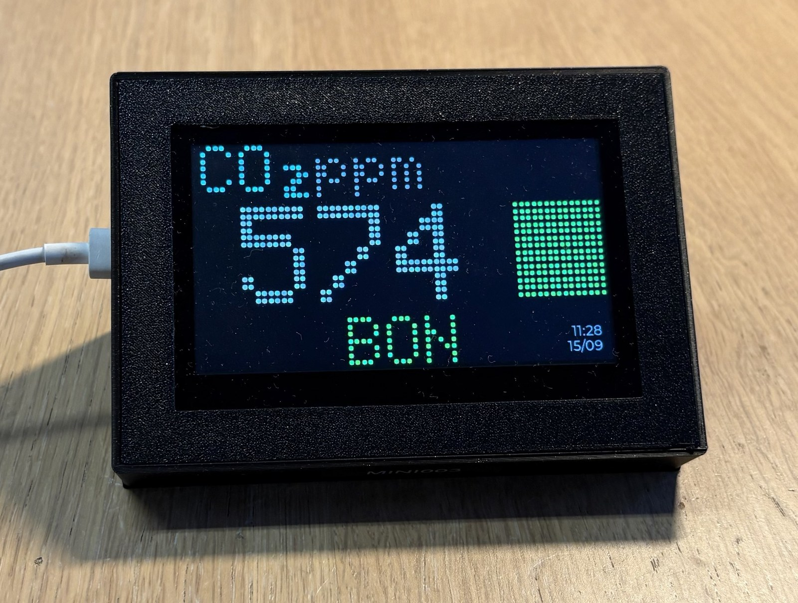{ width="100%" }

## Présentation

Le **ModuleAir Mini** est la version **tactile et interactive** du ModuleAir. Là où le [ModuleAir WiFi](../moduleair-wifi/index.md) affiche ses mesures sur un grand écran LED accroché au mur, le Mini se pose sur un bureau ou une table : un boîtier incliné équipé d'un **écran couleur tactile de 4,3 pouces**, qui assure à la fois l'affichage et la configuration.

Il mesure les **particules fines** (PM1, PM2.5, PM10), le **CO₂**, la **température** et l'**humidité**, affiche les résultats en continu avec le même code couleur que le reste de la gamme et les **enregistre sur une carte mémoire**. Les données se récupèrent de [trois façons](#recuperer-les-donnees) : par **câble USB-C** (fichier CSV), par **Bluetooth** avec l'application Cyan Sensor, ou automatiquement par **WiFi**. Il fonctionne sur secteur ou [sur batterie](#fonctionnement-sur-batterie), pour passer d'une salle à l'autre.

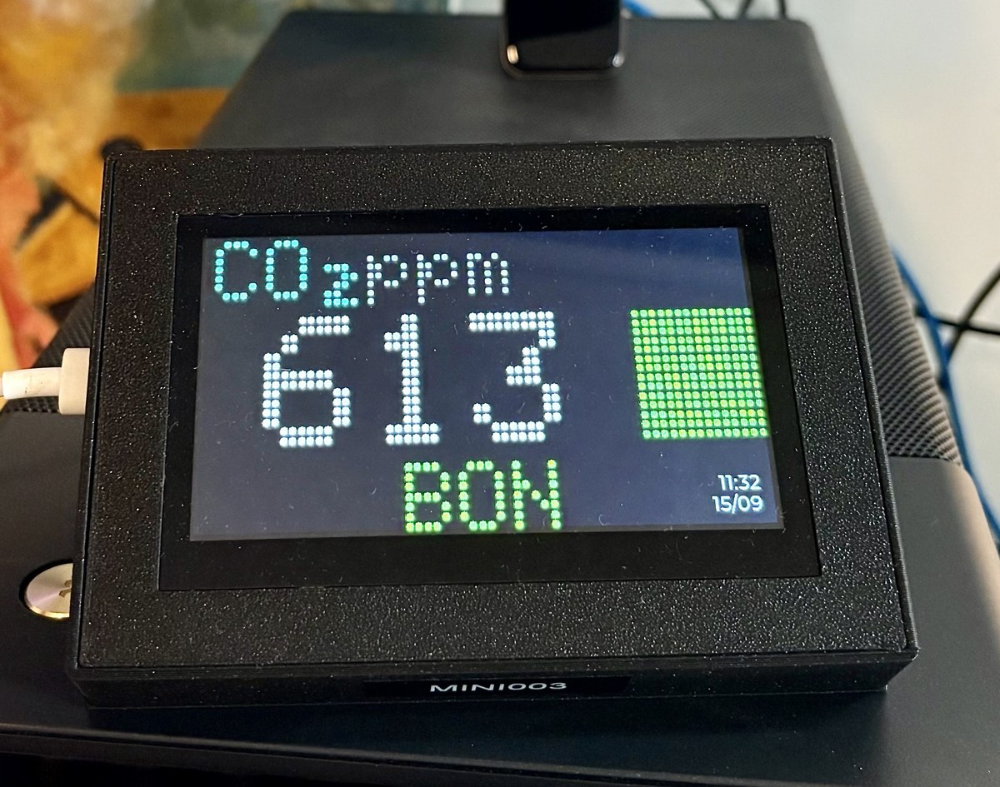{ width="100%" }

### Ce qui le distingue du ModuleAir WiFi

| | ModuleAir WiFi | **ModuleAir Mini** |
|---|---|---|
| Affichage | matrice LED 64 × 32 déportée | **dalle couleur tactile 480 × 272** |
| Interaction | interface web sur un autre appareil | **l'écran lui-même** |
| Mesures | PM1 · PM2.5 · PM10 · CO₂ | **PM1 · PM2.5 · PM10 · CO₂ · température · humidité** |
| Configuration WiFi | portail captif ou Bluetooth | **Bluetooth (app Cyan Sensor) ou clavier à l'écran** |
| Stockage local | — | **carte microSD (journal CSV)** |
| Alimentation | secteur | **secteur USB-C, ou batterie 18650** |
| Récupération des données | WiFi | **USB-C, Bluetooth (app Cyan Sensor) ou WiFi** |
| Usage | mural, salle de classe, ERP | **bureau, table, poste de travail** |

## Caractéristiques techniques

Le ModuleAir Mini rassemble, dans un boîtier imprimé en 3D, une carte ESP32-S3 à écran tactile intégré, un capteur de particules fines, un capteur de CO₂, une sonde de température/humidité, une horloge sauvegardée par pile, une carte mémoire et, sur batterie, une pile Li-ion 18650.

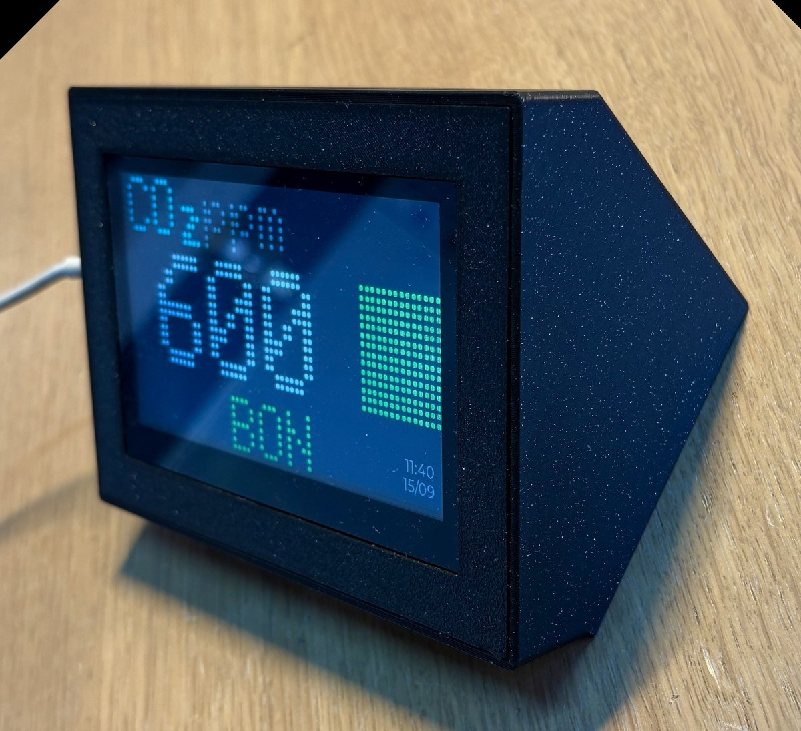{ width="500" }

### Plateforme

- **Carte** : Guition **JC4827W543**
- **Microcontrôleur** : **ESP32-S3** (Espressif), double cœur Xtensa LX7
- **Flash** : 4 Mo
- **PSRAM** : 8 Mo
- **Radio** : WiFi 802.11 b/g/n **2.4 GHz** + **Bluetooth LE**
- **Alimentation** : USB-C 5 V, ou pile Li-ion 18650 de 3 200 mAh rechargée par l'USB-C

### L'écran tactile

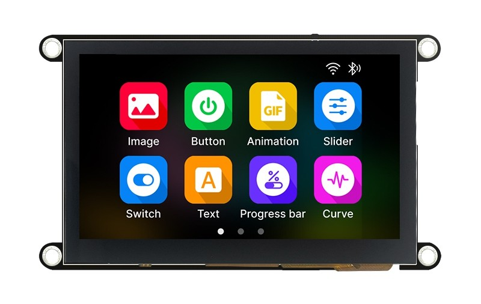{ width="100%" }

Le module **Guition JC4827W543** réunit sur une seule carte l'ESP32-S3, la dalle, le tactile, le lecteur de carte mémoire et le port USB-C.

| Caractéristique | Valeur |
|-----------------|--------|
| Dalle | 4,3 pouces, **480 × 272 pixels**, couleur |
| Contrôleur | NV3041A, liaison **QSPI** |
| Tactile | **GT911** capacitif |
| Luminosité | **réglable** depuis l'écran ou l'application |

### Capteurs et horloge

| Composant | Rôle | Interface |
|-----------|------|-----------|
| **[NextPM](https://tera-sensor.com/nextpm/)** (Tera Sensor) | Particules fines (PM1 · PM2.5 · PM10) | UART — Modbus RTU |
| **[Senseair S88](https://senseair.com/product/s88/)** | Dioxyde de carbone (CO₂) | UART — Modbus RTU |
| **BME280** (Bosch) | Température · humidité · pression | I²C |
| **DS3231** | Horloge temps réel, sauvegardée par pile | I²C |

### Stockage

Une **carte microSD** enregistre une ligne CSV par cycle de mesure. Branché à un ordinateur par son port USB-C, le ModuleAir Mini **se présente comme une clé USB** : on récupère le fichier sans ouvrir le boîtier ni installer quoi que ce soit.

### Boîtier

Le boîtier est **imprimé en 3D**, incliné vers l'utilisateur pour que l'écran se lise depuis une position assise. Le **nom du capteur est gravé sur la face avant** (`MINI003` sur les photos de cette page) : c'est l'identifiant sous lequel il apparaît dans l'application et dans les données transmises.

L'écran et sa carte (module Guition JC4827W543) mesurent **120 × 70,2 mm**, pour une zone d'affichage utile de **95 × 54 mm**.

### Alimentation

Le ModuleAir Mini se branche en **USB-C 5 V** : chargeur de téléphone, port USB d'un ordinateur ou d'une multiprise.

### Fonctionnement sur batterie

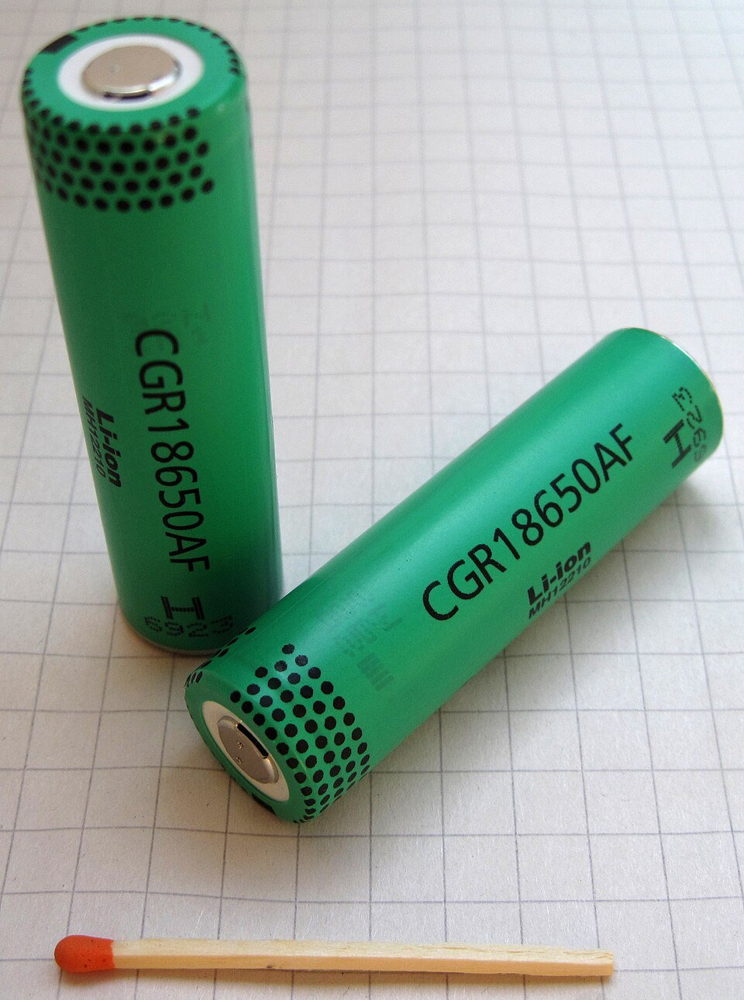{ width="250" }  
<small>Piles 18650 — photo Lead holder, [Wikimedia Commons](https://commons.wikimedia.org/wiki/File:LiIon-18650-match.jpg), CC BY-SA 3.0</small>

Le ModuleAir Mini peut aussi fonctionner sur batterie, avec une **pile Li-ion 18650** de **3 200 mAh** logée dans le boîtier. Il passe alors d'une salle à l'autre sans interrompre ses mesures.

- **Recharge** : par le câble **USB-C**, sur un adaptateur secteur ; les mesures continuent pendant la charge.
- **Niveau de charge** : affiché en bas à droite de l'écran.
- **Remplacement** : le 18650 est un format standard, la pile se change sans changer l'appareil.

| Usage | Autonomie |
|-------|-----------|
| Écran allumé, pleine luminosité | environ **7 h** |
| Écran allumé, luminosité minimale | environ **13 h** |

Pour prolonger l'autonomie, baisser la luminosité ou activer la [veille de l'écran](#veille-de-lecran) (Réglages → Écran) : le capteur continue de mesurer écran éteint.

!!! info "Éteindre le ModuleAir Mini sur batterie"
    Sur batterie, l'appareil ne s'arrête pas en le débranchant. Pour l'éteindre, **maintenez enfoncé pendant 10 secondes le bouton poussoir blanc** situé **sur le dessus du boîtier**.

    Éteint, il ne mesure plus et n'enregistre plus rien. Pour une simple pause de l'affichage, préférez la [veille de l'écran](#veille-de-lecran) : les mesures continuent.

## Les capteurs en détail

### Particules fines — NextPM (Tera Sensor)

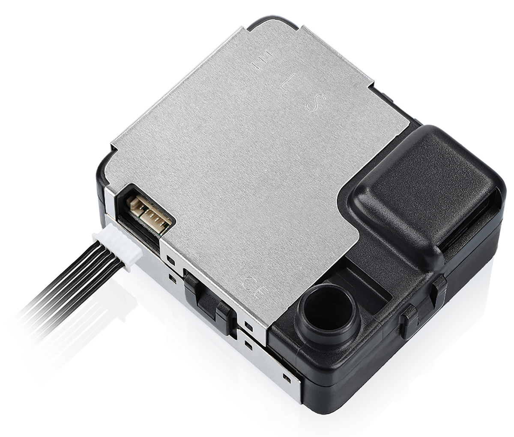{ width="300" }

Les **particules fines** (PM, *particulate matter*) sont des poussières microscopiques en suspension dans l'air. On les classe par taille : **PM10** (< 10 µm), **PM2.5** (< 2.5 µm) et **PM1** (< 1 µm). Plus une particule est fine, plus elle pénètre profondément dans l'appareil respiratoire — les PM2.5 atteignent les alvéoles pulmonaires, ce qui en fait l'un des polluants les plus surveillés sur le plan sanitaire. Elles proviennent du chauffage, de la cuisson, du trafic, du tabac, des bougies, etc.

Le **NextPM** est un **compteur optique de particules** fabriqué par la société française **[Tera Sensor](https://tera-sensor.com/nextpm/)**. Il éclaire le flux d'air avec un laser et mesure la lumière diffusée par les particules **selon deux angles (45° et 90°)** — une technologie brevetée qui améliore la distinction des tailles de particules. Il détecte les particules de **0.3 à 10 µm** et restitue les concentrations en **µg/m³** pour PM1, PM2.5 et PM10.

Pour rester fiable même dans un air humide, le capteur intègre un **système de chauffage** qui maintient l'humidité interne sous 60 %. C'est un capteur durable (durée de vie > 10 ans, > 10 000 h de fonctionnement) dont la corrélation avec les instruments de référence dépasse 0.95.

| Caractéristique | Valeur |
|-----------------|--------|
| Principe | Comptage optique laser, diffusion à 45° et 90° |
| Mesures | PM1 · PM2.5 · PM10, en µg/m³ |
| Taille des particules | 0,3 à 10 µm |
| Démarrage | environ 30 s (ventilateur et chauffage) |
| Interface | UART — **Modbus RTU** (115 200 bauds, 8E1) |

C'est le même capteur que celui du [ModuleAir WiFi](../moduleair-wifi/index.md) et du [NebuleAir Pro](../nebuleair-pro/index.md).

### Dioxyde de carbone (CO₂) — Senseair S88

Le **CO₂** est le meilleur indicateur du **renouvellement de l'air** dans une pièce occupée. L'air extérieur en contient environ **420 ppm** ; dans une pièce fermée, le taux monte avec la respiration des personnes présentes. Au-delà de **~1000–1500 ppm**, l'air est considéré comme **confiné** : il est temps d'aérer. Des niveaux élevés s'accompagnent souvent de somnolence, de maux de tête et d'une baisse de concentration, et le CO₂ est un bon indicateur indirect du risque de transmission des maladies aéroportées.

Le **S88** du fabricant **suédois [Senseair](https://senseair.com/)** fonctionne par principe **NDIR** (*Non-Dispersive InfraRed*, infrarouge non dispersif) : le CO₂ absorbe une longueur d'onde infrarouge précise ; en mesurant cette absorption dans une chambre optique, le capteur en déduit la concentration. C'est la méthode de référence pour la mesure du CO₂ en intérieur, robuste et stable dans le temps.

| Caractéristique | Valeur |
|-----------------|--------|
| Principe | NDIR (infrarouge non dispersif) |
| Plage | 400 à 10 000 ppm |
| Précision | ± 40 ppm ± 3 % de la mesure |
| Calibration | **ABC** (*Automatic Baseline Calibration*) automatique, sans entretien |
| Durée de vie | plus de 15 ans |
| Interface | UART — **Modbus RTU** (9600 bauds, 8N1) |

### Température et humidité — BME280

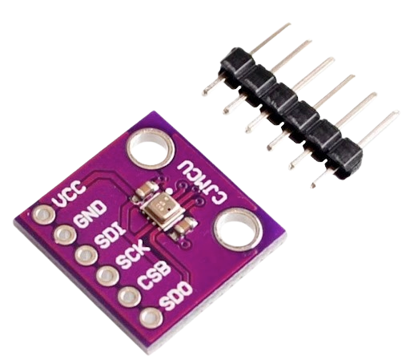{ width="300" }

La sonde **BME280** de Bosch mesure la **température** et l'**humidité relative**, qui complètent le diagnostic de confort d'une pièce.

| Mesure | Gamme | Précision |
|--------|-------|-----------|
| Température | −40 à +85 °C | ± 1 °C |
| Humidité | 0 à 100 % HR | ± 3 % HR |

### L'heure — DS3231

Le ModuleAir Mini embarque une **horloge temps réel DS3231**, sauvegardée par une pile bouton. Elle sert à **horodater le journal CSV** de la carte mémoire et à afficher l'heure à l'écran.

L'heure est demandée au premier allumage (voir [Première mise en service](#premiere-mise-en-service)) et reste modifiable à tout moment dans **Réglages → Date et heure**, ou depuis l'application.

## Première mise en service

### 1. Brancher le capteur

Branchez le ModuleAir Mini sur une prise USB avec le câble USB-C fourni. Il démarre automatiquement : le **logo ModuleAir** s'affiche, puis le **logo AirCarto**.

### 2. La mise en route

Au **premier allumage**, trois écrans s'enchaînent :

| Écran | Contenu |
|-------|---------|
| **Bienvenue** | Écran de présentation ; un appui pour continuer |
| **Date et heure** | L'heure courante, à régler avec des molettes tactiles |
| **Configuration terminée** | Écran de confirmation ; l'appareil passe aux mesures |

Aux allumages suivants, l'appareil arrive directement sur les mesures.

Le WiFi se configure ensuite, à tout moment.

### 3. Connecter le capteur au WiFi

=== "Depuis l'application Cyan Sensor (Bluetooth)"

    Tant qu'il n'est pas connecté à un réseau, le ModuleAir Mini **s'annonce en Bluetooth**. Il apparaît alors dans « **Ajouter un capteur** » de l'[application Cyan Sensor](https://aircarto.fr/cyan-sensor/) :

    1. Ouvrez l'application et lancez « Ajouter un capteur »
    2. Sélectionnez le ModuleAir Mini dans la liste
    3. L'application affiche les réseaux WiFi détectés par le capteur
    4. Choisissez le vôtre et saisissez le mot de passe **sur votre téléphone**

=== "Depuis l'écran tactile"

    Sans téléphone, depuis l'appareil :

    1. Touchez l'**heure**, en bas à droite de l'écran de mesure → le menu **Réglages** s'ouvre
    2. **RÉSEAU WI-FI**
    3. Choisissez votre réseau dans la liste
    4. Saisissez le mot de passe sur le **clavier tactile**, puis validez

    L'écran affiche « **Connecté !** » avec le nom du réseau.

!!! warning "Réseaux non supportés"
    Le capteur se connecte à un réseau WiFi **2.4 GHz** protégé par un mot de passe (ou ouvert). Les réseaux d'entreprise à **portail captif** ou à identifiant/mot de passe (université, hôtel, certains bureaux) ne sont **pas** supportés.

## L'écran en détail

### Composition d'un écran de mesure

L'écran reprend le rendu du [ModuleAir WiFi](../moduleair-wifi/index.md), façon matrice LED : une grille de **64 × 32 points** agrandie sur toute la dalle, chaque point dessiné comme une petite LED ronde. Chaque écran de mesure se lit de la même façon :

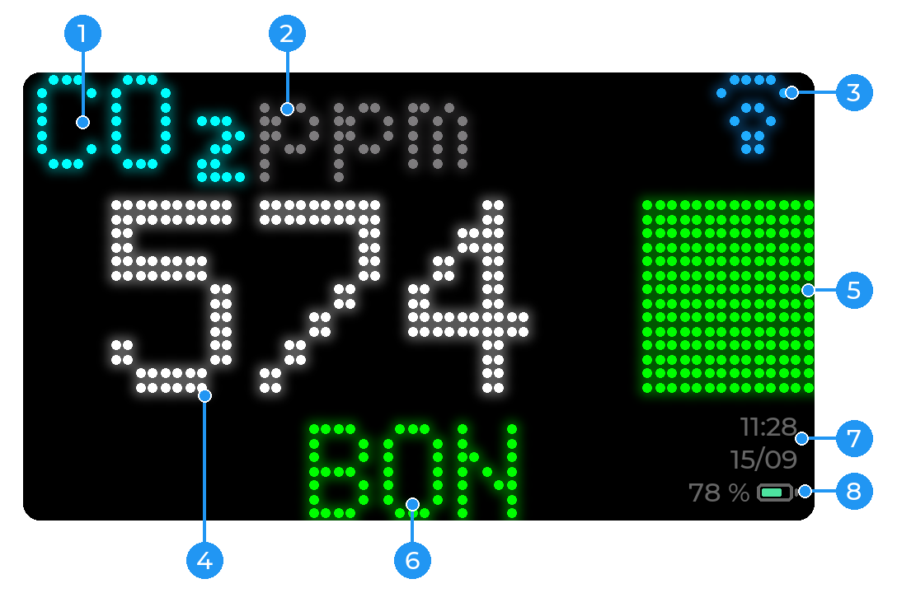{ width="100%" }

| | Zone | Position | Contenu |
|:-:|------|----------|---------|
| **1** | **Mesure** | En haut à gauche (cyan) | Le nom de la mesure (PM2.5, CO₂, Temp, Humi) |
| **2** | **Unité** | À droite du nom (gris) | L'unité (µg/m³, ppm, °C, %) |
| **3** | **Badge réseau** | En haut à droite | L'état de la connexion, comme sur le [ModuleAir WiFi](../moduleair-wifi/index.md#le-badge-de-connectivite) : logo WiFi bleu = en ligne ; rien = hors ligne |
| **4** | **Valeur** | Au centre, en grand (blanc) | La mesure en cours |
| **5** | **Carré de couleur** | À droite | Le niveau (vert → jaune → orange → rouge) |
| **6** | **Libellé** | En bas (même couleur) | Le niveau en toutes lettres (BON, AERER, OK…) |
| **7** | **Heure et date** | En bas à droite | L'heure courante ; **un appui ouvre les réglages** |
| **8** | **Batterie** | Sous la date | Le niveau de charge (version batterie uniquement) ; le chiffre passe en rouge à 10 % et moins |

> *Aperçus générés à partir des polices et de la mise en page exactes du firmware.*

### Écrans particuliers

<div class="screens">
  <figure>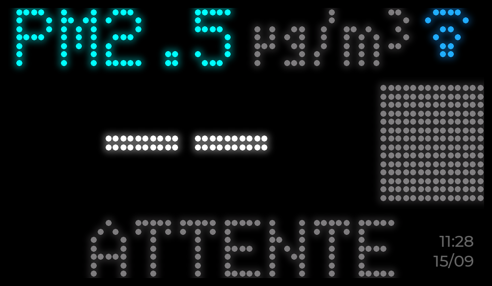<figcaption>Démarrage : le capteur chauffe, la page affiche « ATTENTE »</figcaption></figure>
  <figure>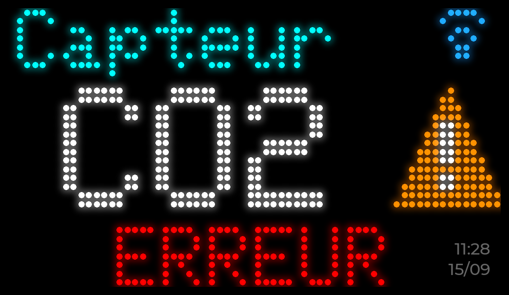<figcaption>Le capteur nommé ne répond plus : « Capteur / ERREUR »</figcaption></figure>
</div>

### La rotation

L'écran fait défiler les mesures **toutes les 5 secondes**, dans l'ordre du ModuleAir :

| Capteur | Écrans dans la rotation |
|---------|--------------------------|
| NextPM | **PM1**, **PM2.5**, **PM10** |
| Capteur de CO₂ | **CO₂** |
| BME280 | **Température**, **Humidité** |

Chaque page peut être masquée, et la durée d'affichage passée à 10, 15 ou 30 secondes, dans **Réglages → AFFICHAGE**.

### Seuils de couleur

Les seuils et les couleurs sont ceux du ModuleAir. Pour chaque mesure, le tableau des niveaux **et l'écran tel qu'il s'affiche** :

=== "Particules"

    | PM1 et PM2.5 (µg/m³) | PM10 (µg/m³) | Libellé | Couleur |
    |----------------------|--------------|---------|---------|
    | < 10 | < 15 | **BON** | 🟢 Vert |
    | 10 – 20 | 15 – 30 | **MOYEN** | 🟡 Jaune |
    | 20 – 50 | 30 – 75 | **DEGRADE** | 🟠 Orange |
    | ≥ 50 | ≥ 75 | **MAUVAIS** | 🔴 Rouge |

    Les écrans PM2.5 à chaque niveau (PM1 et PM10 s'affichent de la même façon) :

    <div class="screens">
      <figure>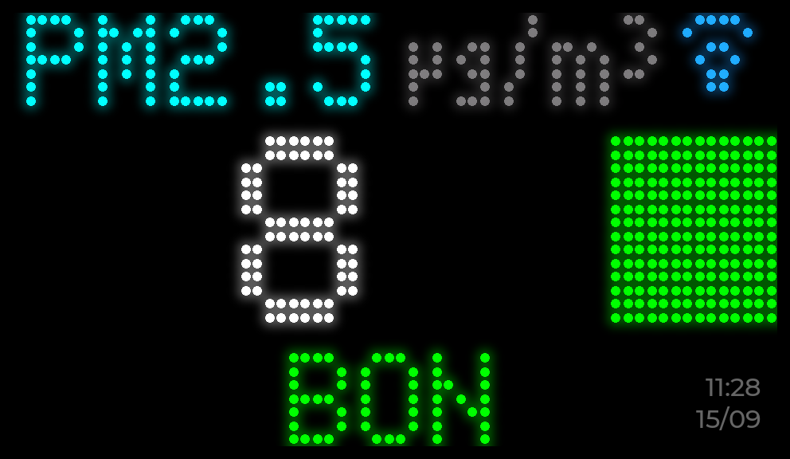<figcaption>BON · &lt; 10</figcaption></figure>
      <figure>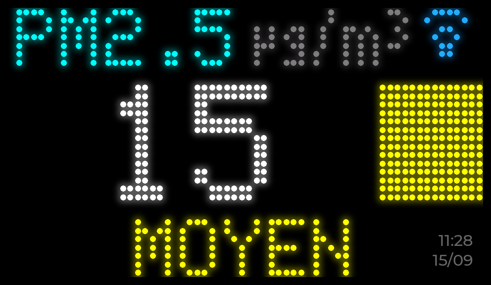<figcaption>MOYEN · 10–20</figcaption></figure>
      <figure>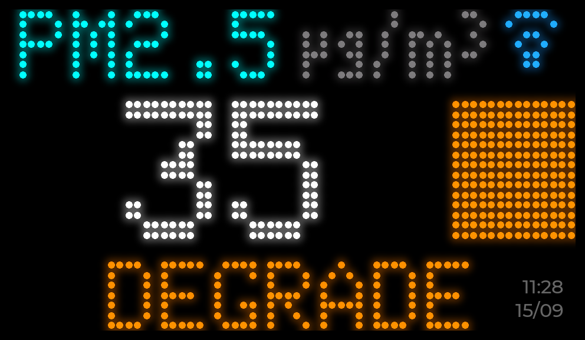<figcaption>DEGRADE · 20–50</figcaption></figure>
      <figure>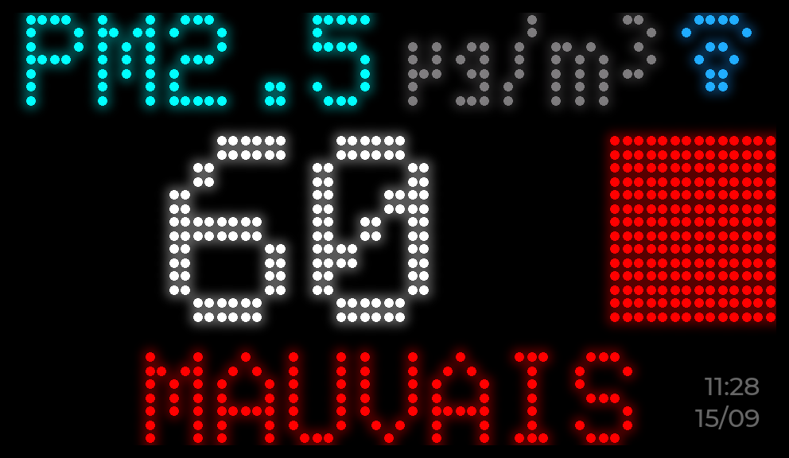<figcaption>MAUVAIS · ≥ 50</figcaption></figure>
    </div>

=== "CO₂"

    | CO₂ (ppm) | Libellé | Couleur |
    |-----------|---------|---------|
    | < 800 | **BON** | 🟢 Vert |
    | 800 – 1500 | **AERER** | 🟡 Ambre |
    | ≥ 1500 | **AERER** | 🔴 Rouge |

    <div class="screens">
      <figure>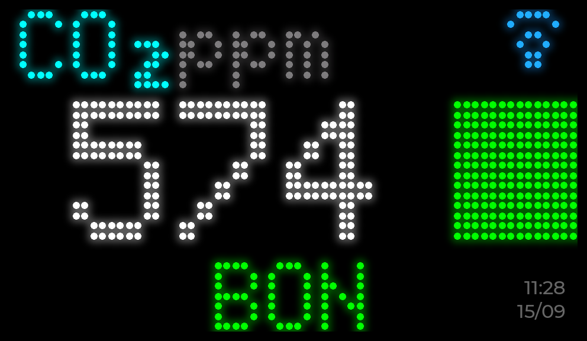<figcaption>BON · &lt; 800</figcaption></figure>
      <figure>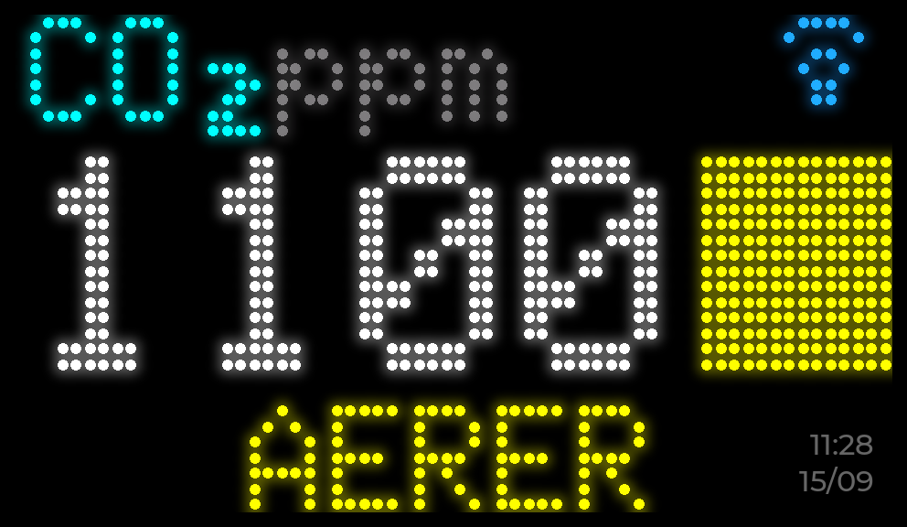<figcaption>AERER · 800–1500</figcaption></figure>
      <figure>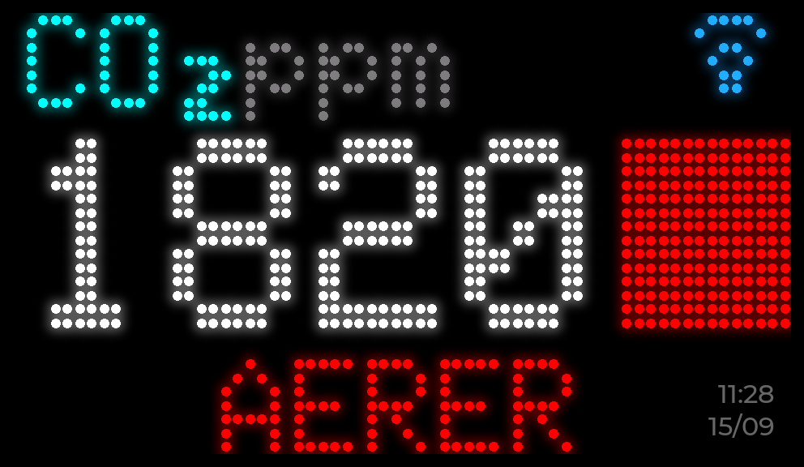<figcaption>AERER · ≥ 1500</figcaption></figure>
    </div>

    Au-delà de 800 ppm, le message reste **« AERER »** : seule la couleur s'intensifie, du jaune au rouge.

=== "Température"

    | Température (°C) | Libellé | Couleur |
    |------------------|---------|---------|
    | < 19 | **FROID** | 🔵 Bleu |
    | 19 – 28 | **OK** | 🟢 Vert |
    | ≥ 28 | **CHAUD** | 🔴 Rouge |

    <div class="screens">
      <figure>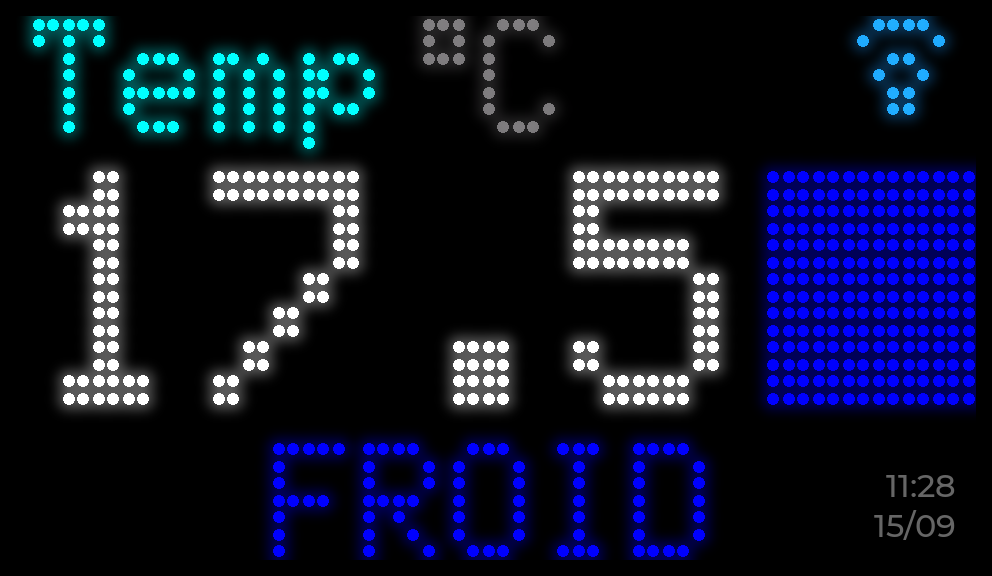<figcaption>FROID · &lt; 19 °C</figcaption></figure>
      <figure>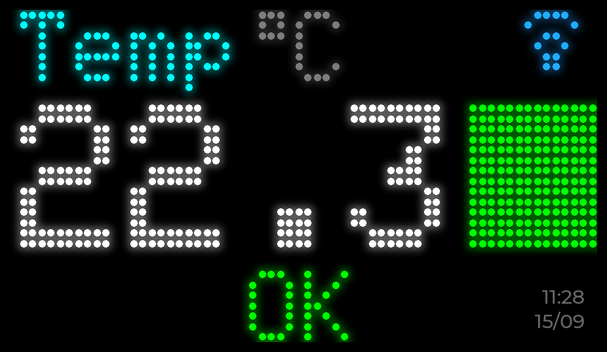<figcaption>OK · 19–28 °C</figcaption></figure>
      <figure>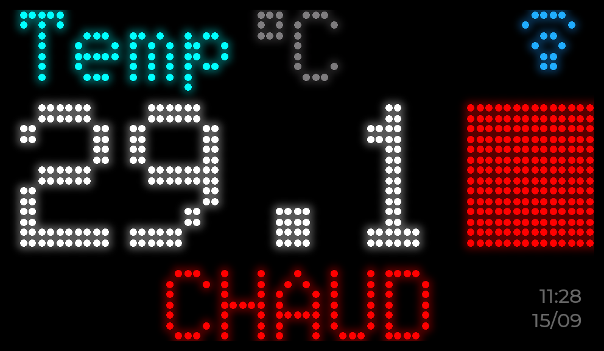<figcaption>CHAUD · ≥ 28 °C</figcaption></figure>
    </div>

=== "Humidité"

    | Humidité (%) | Libellé | Couleur |
    |--------------|---------|---------|
    | < 40 | **SEC** | 🔴 Rouge |
    | 40 – 60 | **IDEAL** | 🟢 Vert |
    | ≥ 60 | **HUMIDE** | 🔴 Rouge |

    <div class="screens">
      <figure>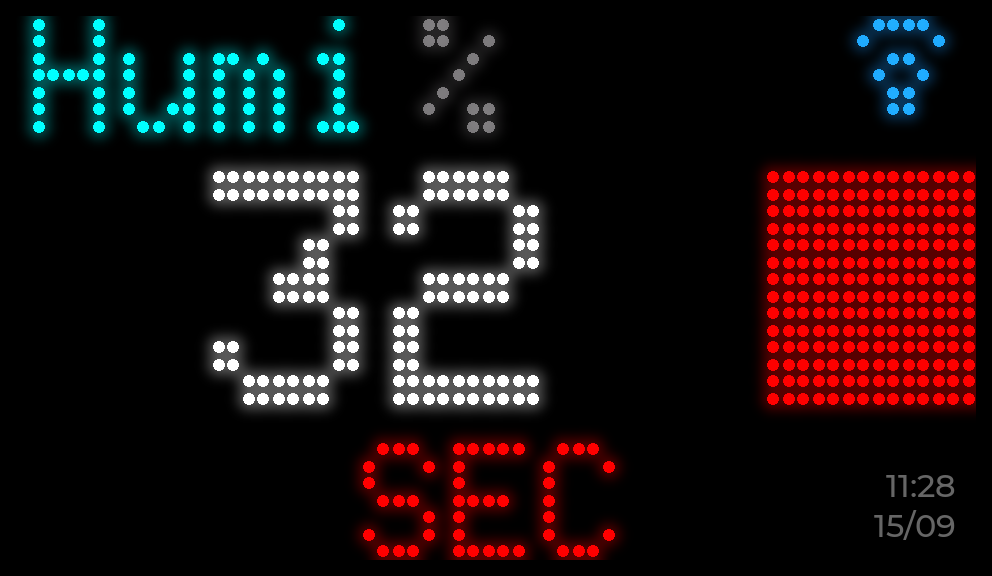<figcaption>SEC · &lt; 40 %</figcaption></figure>
      <figure>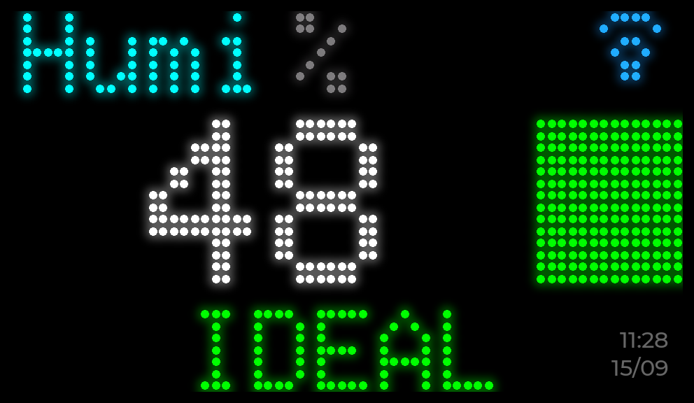<figcaption>IDEAL · 40–60 %</figcaption></figure>
      <figure>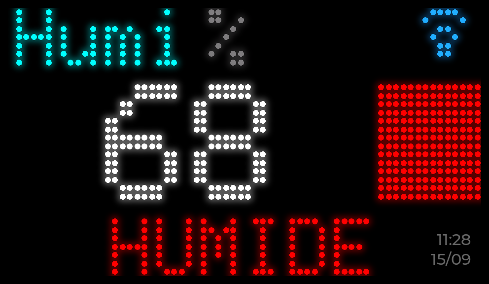<figcaption>HUMIDE · ≥ 60 %</figcaption></figure>
    </div>

## Les réglages sur l'écran

Touchez l'**heure** en bas à droite d'un écran de mesure pour ouvrir le menu **RÉGLAGES** :

| Entrée | Fonction |
|--------|----------|
| :material-clock-outline: **DATE ET HEURE** | Régler l'horloge avec des molettes tactiles |
| :material-chip: **CAPTEURS** | Activer ou désactiver chaque capteur (NextPM, CO₂, BME280), avec son état en direct |
| :material-view-carousel: **AFFICHAGE** | Choisir les pages de la rotation et leur durée |
| :material-wifi: **RÉSEAU WI-FI** | Choisir un réseau, saisir le mot de passe, ou **oublier** le réseau enregistré |
| :material-bluetooth: **TÉLÉVERSEMENT** | Envoyer les mesures enregistrées par Bluetooth, avec l'application Cyan Sensor (voir [Récupérer les données](#recuperer-les-donnees)) |
| :material-download: **MISE À JOUR** | Vérifier et installer une nouvelle version du firmware |
| :material-image: **ÉCRAN** | Luminosité, veille et disposition du clavier |
| :material-cog: **SYSTÈME** | Informations, journal de bord, réinitialisation |

### Écran

- **Luminosité** : un curseur, du minimum au maximum.
- **Veille** : voir ci-dessous.
- **Clavier** : **AZERTY** (par défaut) ou **QWERTY**.

### Veille de l'écran

**Réglages → ÉCRAN → Veille** propose trois modes. La veille se déclenche après **10 secondes sans toucher l'écran** :

| Mode | Après 10 s sans toucher l'écran | Pour quoi faire |
|------|---------------------------------|-----------------|
| :material-brightness-7: **JAMAIS** (par défaut) | L'écran reste allumé, à la luminosité réglée | Affichage permanent, sur secteur |
| :material-brightness-4: **ATTÉNUER** | La luminosité **baisse en fondu jusqu'au minimum** ; les mesures restent lisibles | Garder un œil sur l'air sans être ébloui, économiser la batterie |
| :material-monitor-off: **ÉTEINDRE** | Le rétroéclairage **s'éteint complètement** | Chambre, salle de réunion, autonomie maximale sur batterie |

- **Pour réveiller l'écran**, il suffit de le **toucher** : la luminosité revient en fondu. Ce premier toucher ne sert qu'à réveiller, il n'actionne rien à l'écran. Les 10 secondes repartent dès qu'on relâche.
- La veille **ne se déclenche pas** pendant un téléversement Bluetooth, une mise à jour du firmware ou la première mise en route : ce que l'écran affiche alors compte.

!!! tip "Écran éteint, le capteur travaille toujours"
    La veille ne coupe **que l'affichage**. Les capteurs continuent de mesurer, les mesures sont toujours **enregistrées sur la carte microSD** et, si le capteur est connecté, **envoyées toutes les 60 secondes**. Rien n'est perdu pendant que l'écran est éteint ou atténué.

### Système

- Le **jeton** de l'appareil (`TOKEN`, dérivé de l'adresse MAC) et la **version** du firmware.
- Le **JOURNAL** de bord (voir ci-dessous).
- **Réinitialiser l'appareil** : efface le réseau WiFi, l'heure et les réglages d'écran. Les mesures de la carte microSD sont conservées.

### Le journal de bord

Les **200 dernières lignes** du journal (lectures des capteurs, contenu de chaque envoi, réponse du serveur, état du WiFi) se lisent :

- sur **l'appareil**, Réglages → Système → Journal ;
- dans l'**application Cyan Sensor**, onglet « Capteur » → Journal, avec un bouton pour envoyer le tout au support ;
- sur le **port série**, depuis un ordinateur.

## Piloter le capteur depuis l'application Cyan Sensor

Une fois le ModuleAir Mini connecté au WiFi, l'application Cyan Sensor le trouve sur le réseau local et l'ouvre dans son onglet « **Capteur** ». On peut y :

- régler la **luminosité** de l'écran ;
- activer ou désactiver le **capteur de particules** ;
- aligner la **date et l'heure** sur celles du téléphone ;
- **vérifier et installer** une mise à jour ;
- **oublier le réseau WiFi**, ce qui remet l'appareil en configuration Bluetooth ;
- lire le **journal de bord**.

Le téléphone et le capteur doivent être sur le même réseau WiFi.

??? info "L'API HTTP locale (avancé)"

    Le ModuleAir Mini expose un serveur HTTP sur le réseau local, avec les mêmes chemins et les mêmes formes de réponse que le ModuleAir.

    | Route | Rôle |
    |-------|------|
    | `GET /api/info` | Identité, version, état réseau |
    | `GET /data.json` | Dernières mesures |
    | `GET /api/display` · `POST /set-brightness` | Luminosité (0–255) |
    | `GET /api/time` · `POST /set-time` | Heure de l'appareil |
    | `GET /check-update` · `GET /do-update` | Mise à jour du firmware |
    | `POST /set-sensor` | Activer ou désactiver le NextPM (`key=npm`, `val=0` ou `1`) |
    | `POST /reset` | Oublier le réseau WiFi |
    | `POST /reboot` | Redémarrer |
    | `GET /logs` | Journal de bord (curseur `X-Log-Seq`) |

    Le serveur n'est actif que lorsque le capteur est connecté au WiFi.

## Récupérer les données

Le ModuleAir Mini **enregistre toutes ses mesures en local**, sur sa carte microSD, qu'il soit connecté ou non. Pour les récupérer, trois options, au choix :

| Option | Ce qu'il faut | Résultat |
|--------|---------------|----------|
| **1. Câble USB-C** | Un ordinateur | Le fichier **CSV**, à ouvrir dans un tableur |
| **2. Bluetooth** | Un téléphone avec l'application **Cyan Sensor** | Les mesures sont **envoyées aux serveurs AirCarto via le téléphone**, sans WiFi sur le capteur |
| **3. WiFi** | Un réseau WiFi 2,4 GHz | Envoi **automatique** toutes les 60 secondes vers les serveurs AirCarto |

Avec les options 2 et 3, les mesures se consultent en ligne :

[:material-chart-line: Consulter mes données sur moduleair.fr](https://moduleair.fr/monModuleAir/){ .md-button }

### Option 1 — Par câble USB-C : le fichier CSV

**Branchez le capteur à un ordinateur avec un câble USB-C** : il apparaît comme une **clé USB**. Le fichier `data.csv` s'ouvre dans n'importe quel tableur, sans logiciel à installer.

```
datetime,co2_ppm,temp_c,hum_pct,pm1_ugm3,pm25_ugm3,pm10_ugm3
```

Une case vide signifie qu'il n'y avait pas de mesure valide à ce moment-là.

### Option 2 — Par Bluetooth, avec l'application Cyan Sensor

Pour un capteur **sans WiFi**, le téléphone sert de relais : l'application récupère les mesures enregistrées par Bluetooth et les envoie aux serveurs AirCarto par la connexion du téléphone.

1. Sur le capteur : **Réglages → TÉLÉVERSEMENT**, puis **ACTIVER LE BLUETOOTH**
2. Dans l'[application Cyan Sensor](https://aircarto.fr/cyan-sensor/) : **+** → **Téléverser un ModuleAir mini**
3. Sélectionnez le capteur : l'application récupère les mesures et les envoie

Seules les mesures **pas encore reçues** par les serveurs sont transférées : on peut téléverser aussi souvent qu'on le souhaite, sans créer de doublon.

### Option 3 — Par WiFi : l'envoi automatique

Connecté au WiFi (voir [Connecter le capteur au WiFi](#3-connecter-le-capteur-au-wifi)), le capteur transmet **toutes les 60 secondes** la moyenne des mesures de la minute écoulée.

Si la connexion est coupée, les mesures restent sur la carte mémoire et sont renvoyées automatiquement dès qu'elle revient.

### Format des données envoyées

Les mesures sont transmises au format **JSON**, avec les codes **ISO LCSQA** utilisés par le reste de la gamme :

| Mesure | Code ISO | Unité |
|--------|----------|-------|
| PM1 | `ISO_68` | µg/m³ |
| PM2.5 | `ISO_39` | µg/m³ |
| PM10 | `ISO_24` | µg/m³ |
| CO₂ | `ISO_17` | ppm |
| Température | `ISO_54` | °C |
| Humidité | `ISO_55` | % |
| Tension de la batterie | `battery_voltage` | V |

Le capteur est identifié par son **Device ID** (`AABBCCDDEEFF`), dérivé de l'adresse MAC de l'ESP32-S3.

??? example "Exemple de payload JSON"

    ```json
    {
      "device_id": "AABBCCDDEEFF",
      "signal_quality": -52,
      "signal_quality_unit": "-52 dB",
      "ISO_68": 4.1,
      "ISO_68_unit": "4.1 ugm3",
      "ISO_39": 6.3,
      "ISO_39_unit": "6.3 ugm3",
      "ISO_24": 8.7,
      "ISO_24_unit": "8.7 ugm3",
      "ISO_17": 574,
      "ISO_17_unit": "574 ppm",
      "ISO_54": 22.3,
      "ISO_54_unit": "22.3 °C",
      "ISO_55": 45.2,
      "ISO_55_unit": "45.2 %",
      "battery_voltage": 3.92,
      "battery_voltage_unit": "3.92 V",
      "error_flags": 0,
      "npm_status": 0,
      "device_status": 2
    }
    ```

    Les champs d'une mesure sont **omis** lorsque le capteur correspondant est en erreur.

## Mise à jour du firmware (OTA)

Le firmware se met à jour **à distance** (*Over-The-Air*), sans câble ni logiciel, depuis l'écran ou depuis l'application :

1. **Réglages → MISE À JOUR**
2. Le capteur interroge le serveur et affiche la version proposée
3. **Confirmez** l'installation ; elle n'est jamais automatique
4. L'appareil télécharge, installe et redémarre automatiquement

!!! warning "Pendant la mise à jour"
    Ne débranchez pas le capteur. En cas d'échec, l'appareil conserve l'ancienne version.

## Documentation matérielle

??? note "Câblage"

    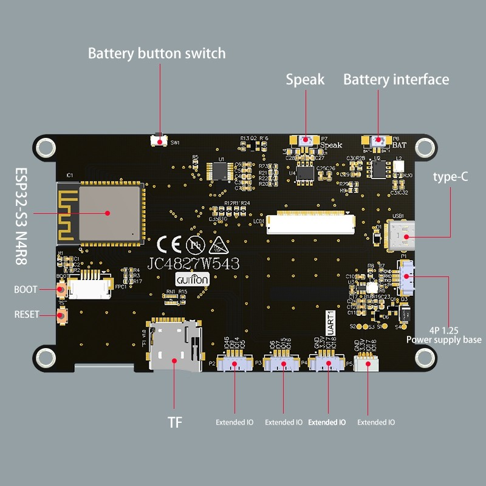{ width="100%" }

    ```
          [Senseair S8]               [NextPM]                          [BME280]           [DS3231]
       G+   G0  TxD  RxD     GND DE/RE Rx   Tx  +5V GND        VCC  GND  SCL  SDA    +   D    C   –
        │    │    │    │      │    ×   │    │    │   │          │    │    │    │     │   │    │   │
        S1   S2 IO44 IO43     S2      IO9 IO14  S1  S2        3.3V GND IO17 IO18  3.3V IO18 IO17 GND
                └─ P1 ─┘              └─ P2 ─┘                └────── P4 ──────┘    └───── P5 ─────┘
    ```

    La carte JC4827W543 porte des connecteurs JST 1.25 mm sérigraphiés **P1** à **P6**, et deux points de test **S1** / **S2** qui alimentent les capteurs 5 V.

    | Connecteur | Ce qui y est raccordé | Remarque |
    |------------|-----------------------|----------|
    | **P1** (sous l'USB-C) | **Senseair S8**, données | son +5V est une **entrée**, à 0 V sur batterie |
    | **P2** | **NextPM**, données (`IO9`, `IO14`) | ne pas utiliser `IO5`, relié à la mesure de la batterie |
    | **P4** (marqué « UART1 ») | **BME280** | 3,3 V et masse disponibles |
    | **P5** | **DS3231** | mêmes signaux que P4 (bus I²C partagé) |
    | **P6** « BAT » | **pile 18650** | charge gérée par la puce IP5306 de la carte |
    | **S1** / **S2** | **alimentation 5 V du S8 et du NextPM** | sortie 5 V de la puce de charge, présente sur USB **et** sur batterie |

    ⚠ **Les capteurs 5 V s'alimentent sur S1 / S2, pas sur P1.** Le +5V de P1 vient de l'USB : sur batterie, il tombe à 0 V. Ne jamais relier S1 au +5V de P1.

    ⚠ **Le S8 n'a aucune protection contre l'inversion de polarité.** Inverser `G+` et `G0` le détruit.

    ⚠ **Le NextPM est en 8E1** (parité paire), pas en 8N1 comme le S8. Deux numérotations de son connecteur circulent : seul l'ordre physique compte, le +5V est l'avant-dernier fil, voisin du Tx.

    ⚠ **Le BME280 accepte 3,6 V maximum.** Jamais sur le 5 V, sauf module à régulateur intégré.

    Le détail complet, avec les datasheets, figure dans le dépôt : [`docs/CABLAGE.md`](https://github.com/aircarto/ModuleAir-mini).

??? note "Brochage (pinout) ESP32-S3"

    | Bus | Capteur / fonction | GPIO |
    |-----|--------------------|------|
    | UART1 (Modbus RTU, 9600 8N1) | Senseair S8 | RX `IO44` · TX `IO43` |
    | UART2 (Modbus RTU, 115 200 8E1) | NextPM | RX `IO14` · TX `IO9` |
    | I²C matériel | BME280 et DS3231 | SDA `IO18` · SCL `IO17` |
    | ADC | Tension de la batterie (pont diviseur interne) | `IO5` |
    | QSPI | Dalle LCD NV3041A | `IO45` `IO47` `IO21` `IO48` `IO40` `IO39` |
    | I²C | Tactile GT911 | `IO8` `IO4` `IO3` `IO38` |
    | SPI | Carte microSD | `IO10` `IO11` `IO12` `IO13` |
    | PWM | Rétroéclairage | `IO1` |
    | USB natif | Console série + disque USB | `IO19` / `IO20` |

    **Broches réellement libres :** `IO6`, `IO7`, `IO15`, `IO16` (P3), et `IO46` sous réserve (broche de strapping).

## Dépannage

| Symptôme | Cause probable | Que faire |
|----------|----------------|-----------|
| L'écran affiche `--:--` à la place de l'heure | L'horloge n'a pas encore de lecture sûre | Réglages → Date et heure |
| Un écran « Capteur / ERREUR » apparaît dans la rotation | Le capteur nommé ne répond plus | Vérifier son câblage ; consulter le journal |
| Le capteur n'apparaît pas dans l'application | Il est hors ligne, ou sur un autre réseau que le téléphone | Vérifier le WiFi ; sinon il s'annonce en Bluetooth au bout d'une minute |
| Les mesures ne remontent pas en ligne | Pas d'accès internet, ou serveur injoignable | Consulter le journal : il donne le code de réponse de chaque envoi |
| L'écran est resté blanc au démarrage | Le firmware n'a pas démarré | Débrancher / rebrancher l'appareil |
| Les pages PM affichent « ATTENTE » | Le NextPM est en chauffe | Patienter une trentaine de secondes |
| Le pourcentage de batterie paraît trop élevé | L'appareil a démarré branché : la jauge n'a pas vu le début de la charge | Il se recale une fois l'appareil débranché |

## Firmware

Le firmware du ModuleAir Mini est **open source** et développé par AirCarto.

[:material-github: Dépôt GitHub — ModuleAir-mini](https://github.com/aircarto){ .md-button }

La version installée est affichée dans **Réglages → Système**.
