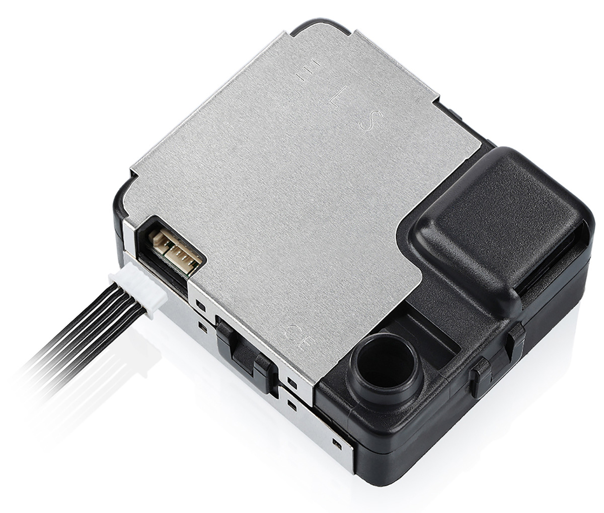
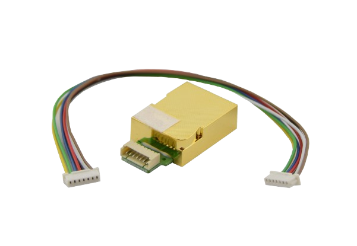
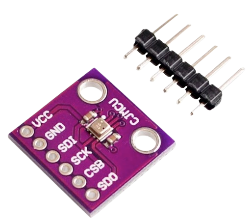
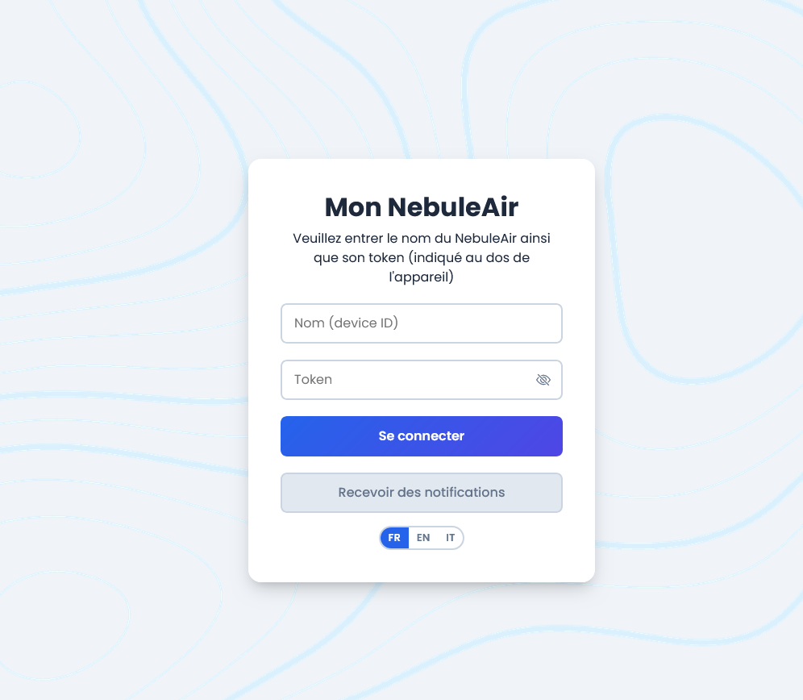
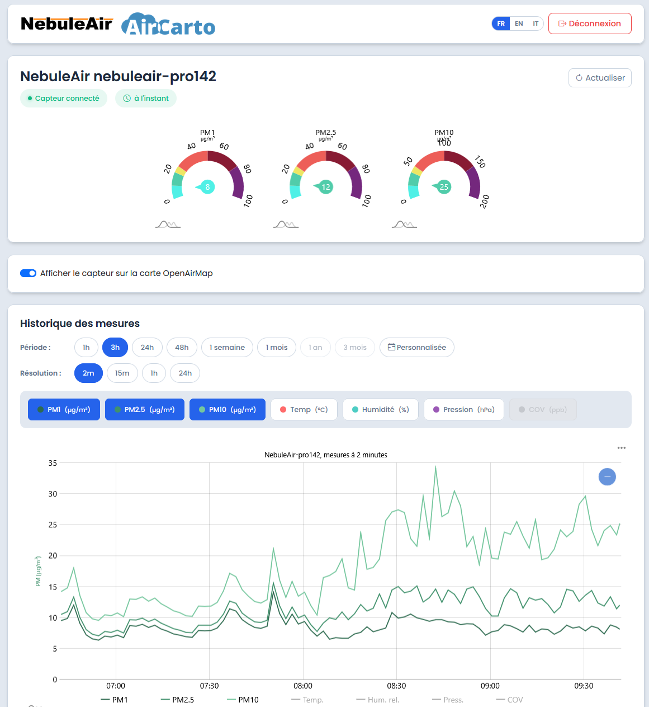
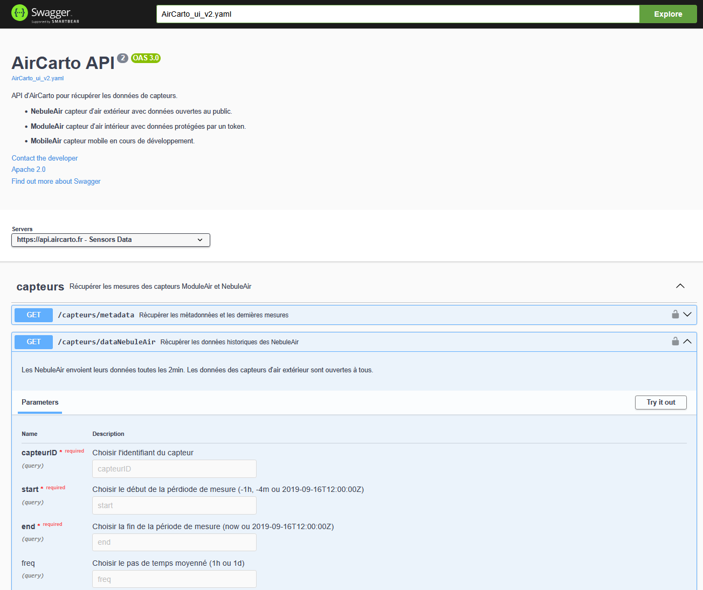

# ModuleAir Pro


<!-- PHOTO À AJOUTER : vue d'ensemble du ModuleAir Pro, écran allumé (hero)
{ width="100%" }
-->

## Présentation

Le **ModuleAir Pro** est la version professionnelle et autonome du ModuleAir. Il mesure en continu les **particules fines** (PM1, PM2.5, PM10) et le **CO₂**, les affiche sur un **grand écran LED de 128 × 64 pixels**, et transmet ses données par **4G (NB-IoT)** — sans dépendre du réseau WiFi du site d'installation.

C'est l'appareil à installer dans un lieu recevant du public (hall, école, salle d'attente, espace d'accueil) quand on veut **à la fois** un affichage lisible de loin et une remontée de données fiable et indépendante de l'infrastructure réseau des lieux.

!!! info "Même plateforme que le NebuleAir Pro"
    Le ModuleAir Pro partage **le cœur et le firmware du [NebuleAir Pro](../nebuleair-pro/index.md)** : Raspberry Pi Compute Module 4, modem 4G u-blox SARA-R500, horloge RTC, interface web de configuration, mises à jour à distance.

    Il s'en distingue par une **carte porteuse différente**, conçue autour de l'**écran LED matrix** et d'un **bouton physique**. Le même firmware gère les deux produits et reconnaît le type d'appareil au démarrage (`device_type`) : tout ce qui est décrit ici pour la 4G, le hotspot WiFi ou les mises à jour se comporte exactement comme sur un NebuleAir Pro.

## Caractéristiques techniques

### Plateforme

- **Carte mère** : Raspberry Pi Compute Module 4 (CM4), mémoire **eMMC** (pas de carte SD)
- **Système** : Debian 12
- **Carte porteuse** : PCB AirCarto spécifique ModuleAir Pro (écran LED matrix + bouton)

### Capteurs

De série, le ModuleAir Pro embarque :

| Capteur | Mesure | Paramètres | Liaison |
|---------|--------|------------|---------|
| **[NextPM](https://tera-sensor.com/nextpm/)** (Tera Sensor) | Particules fines | PM1 · PM2.5 · PM10 | UART (ttyAMA3) |
| **MH-Z19C** (Winsen) | Dioxyde de carbone | CO₂ | UART (ttyAMA4) |
| **BME280** (Bosch) | Environnement | Température, humidité, pression | I²C |

Les mesures sont relevées **toutes les 10 secondes** pour les particules et le CO₂, **toutes les 2 minutes** pour le BME280, et transmises **toutes les minutes** par la 4G.

### Écran LED matrix

- **Dalle LED RGB HUB75 de 128 × 64 pixels**
- Pilotée par la bibliothèque **[rpi-rgb-led-matrix](https://github.com/hzeller/rpi-rgb-led-matrix)** (hzeller), compilée sur le CM4
- **4 écrans** au choix, sélectionnés par le **bouton physique** ou depuis l'**interface web** (voir [L'écran LED en détail](#lecran-led-en-detail))
- **Luminosité réglable** de 10 à 100 %
- Un **cœur du processeur est réservé** au rafraîchissement de l'écran (`isolcpus=3`), pour un affichage stable sans scintillement

<!-- PHOTO À AJOUTER : écran allumé en gros plan (écran 4 capteurs)
{ width="100%" }
-->

### Bouton physique

Un **bouton** en façade permet de faire défiler les écrans, sans outil ni téléphone. Un appui = écran suivant.

### Connectivité

Le ModuleAir Pro communique sur le réseau **NB-IoT** (Narrowband IoT) à l'aide du module **SARA-R500** de chez **u-blox**, avec une **carte SIM multi-opérateur** intégrée. Aucune configuration réseau n'est nécessaire à l'installation.

Il dispose également d'une **puce WiFi**, utilisée pour la **configuration** (mode Hotspot) et, si on le souhaite, pour la mise à jour du firmware en ligne.

!!! tip "Indépendant du réseau du site"
    C'est l'intérêt principal du ModuleAir Pro face au [ModuleAir WiFi](../moduleair-wifi/index.md) : il n'a **pas besoin du WiFi de l'établissement**. Pas de mot de passe à demander, pas de portail captif, pas de coupure quand le réseau change.

### Horloge interne (RTC)

Le CM4 n'ayant pas d'horloge interne, un module **RTC DS3231** conserve l'heure même hors tension. Il alimente l'horloge affichée en bas des écrans. En cas de remplacement du module, l'heure se remet depuis la page **Admin** de l'interface web.

### Alimentation

Le ModuleAir Pro est conçu pour une **alimentation permanente sur le secteur**, en **5 V**. La dalle LED est le principal consommateur de l'appareil : l'alimentation fournie avec le capteur est dimensionnée en conséquence et **doit être utilisée telle quelle**.

!!! warning "Pas de version solaire"
    Contrairement au [NebuleAir Pro](../nebuleair-pro/index.md#autonomie-energetique-partenariat-re-lion-factory), le ModuleAir Pro n'existe **pas** en version batterie + panneau solaire : la consommation de l'écran est incompatible avec un fonctionnement autonome.

### Firmware

Le firmware du ModuleAir Pro est **open source** — c'est le même dépôt que le NebuleAir Pro :

[:material-git: Dépôt Gitea — nebuleair_pro_4g](http://gitea.aircarto.fr/PaulVua/nebuleair_pro_4g){ .md-button }

## Les capteurs en détail

### Particules fines — NextPM (Tera Sensor)

{ width="300" }

Les **particules fines** (PM, *particulate matter*) sont des poussières microscopiques en suspension dans l'air. On les classe par taille : **PM10** (< 10 µm), **PM2.5** (< 2.5 µm) et **PM1** (< 1 µm). Plus une particule est fine, plus elle pénètre profondément dans l'appareil respiratoire — les PM2.5 atteignent les alvéoles pulmonaires, ce qui en fait l'un des polluants les plus surveillés sur le plan sanitaire.

Le **NextPM** est un **compteur optique de particules** fabriqué par la société française **[Tera Sensor](https://tera-sensor.com/nextpm/)**. Il éclaire le flux d'air avec un laser et mesure la lumière diffusée par les particules **selon deux angles (45° et 90°)** — une technologie brevetée qui améliore la distinction des tailles. Il détecte les particules de **0.3 à 10 µm** et restitue les concentrations en **µg/m³**.

Pour rester fiable même dans un air humide, le capteur intègre un **système de chauffage** qui maintient l'humidité interne sous 60 %. Sa durée de vie dépasse **10 ans** (> 10 000 h de fonctionnement) et sa corrélation avec les instruments de référence dépasse 0.95.

!!! info "Le capteur de référence AirCarto"
    Le NextPM équipe aussi le [NebuleAir Pro](../nebuleair-pro/index.md) et le [ModuleAir WiFi](../moduleair-wifi/index.md).

### Dioxyde de carbone (CO₂) — MH-Z19C (Winsen)

{ width="300" }

Le **CO₂** est le meilleur indicateur du **renouvellement de l'air** dans une pièce occupée. L'air extérieur contient environ **420 ppm** ; dans une pièce fermée et occupée, le taux monte avec la respiration des personnes présentes. Au-delà de **~1000–1500 ppm**, l'air est considéré comme **confiné** : il est temps d'aérer. Des niveaux élevés s'accompagnent souvent de somnolence, de maux de tête et d'une baisse de concentration.

Le **MH-Z19C** fonctionne par principe **NDIR** (*Non-Dispersive InfraRed*) : le CO₂ absorbe une longueur d'onde infrarouge précise ; en mesurant cette absorption dans une chambre optique dorée, le capteur en déduit la concentration.

| Caractéristique | Valeur |
|-----------------|--------|
| Principe | NDIR (infrarouge non dispersif) |
| Gamme de mesure | 400 – 5000 ppm |
| Précision | ± (50 ppm + 5 % de la lecture) |
| Compensation | en température |
| Temps de chauffe | ~1 à 3 min |
| Interface | UART (sortie série) |

!!! note "Quelques minutes après un redémarrage"
    Après une coupure de courant, la mesure de CO₂ peut mettre **plusieurs minutes** à réapparaître, le temps que la sonde chauffe et que le système libère le port série. Les particules, elles, remontent immédiatement.

### Température, humidité, pression — BME280 (Bosch)

{ width="300" }

| Mesure | Gamme | Précision |
|--------|-------|-----------|
| Température | −40 à +85 °C | ± 1 °C |
| Humidité | 0 à 100 % HR | ± 3 % HR |
| Pression | 300 à 1100 hPa | ± 1 hPa |

!!! warning "Influence de l'électronique sur la température"
    Comme sur tout capteur compact, la chaleur dégagée par l'écran et le CM4 peut **tirer légèrement la température vers le haut**. La valeur est exploitable comme **tendance** (variation dans la journée), pas comme mesure de métrologie du confort thermique.

## L'écran LED en détail

L'écran est **le** cœur d'usage du ModuleAir Pro : c'est ce que voit le public. Il affiche l'un des **quatre écrans** ci-dessous, qui restent affichés en permanence — pas de rotation automatique : on choisit celui que l'on veut montrer.

### Les quatre écrans

=== "1 · 4 capteurs"

    L'écran principal : les **quatre mesures en même temps**, une par quadrant.

    | Quadrant | Mesure |
    |----------|--------|
    | Haut gauche | **PM10** (µg/m³) |
    | Haut droite | **PM2.5** (µg/m³) |
    | Bas gauche | **PM1** (µg/m³) |
    | Bas droite | **CO₂** (ppm) |

    Dans chaque quadrant : le **nom du polluant** en cyan, son **unité** en blanc, la **valeur** en grand, un **carré de couleur** indiquant le niveau, et en dessous le **niveau en toutes lettres** (BON, MOYEN, DÉGRADÉ, MAUVAIS, AÉRER SVP…). Les couleurs suivent les [seuils ci-dessous](#seuils-de-couleur).

    Un **spinner** au centre de l'écran annonce le prochain rafraîchissement des valeurs.

    <!-- PHOTO À AJOUTER : écran "4 capteurs" en fonctionnement
    { width="100%" }
    -->

=== "2 · État réseau"

    L'écran de diagnostic, utile à l'installation : il montre l'état des deux liens réseau.

    | Ligne | Contenu |
    |-------|---------|
    | **WiFi** | Connecté (vert) · Hotspot (orange) · Déconnecté (rouge) |
    | **4G** | Connecté (vert) · En connexion… (jaune) · Perdu / erreur modem (rouge) |
    | **4G Signal** | 5 barres + libellé de qualité |

    Les paliers de qualité du signal 4G (mesure `AT+CSQ`, de 0 à 31) :

    | CSQ | Barres | Qualité |
    |-----|:------:|---------|
    | 99 ou absent | 0 | NO SIGNAL |
    | 0 | 1 | VERY POOR |
    | 1 – 24 | 2 | POOR |
    | 25 – 26 | 3 | GOOD |
    | 27 – 28 | 4 | VERY GOOD |
    | 29 – 30 | 5 | EXCELLENT |
    | 31 | 5 | VERY STRONG |

    <!-- PHOTO À AJOUTER : écran "état réseau"
    { width="100%" }
    -->

=== "3 · CO₂ + PM + réseau"

    Une vue condensée en quatre lignes : **PM2.5**, **PM10**, **CO₂** (valeur + niveau en couleur), puis une ligne d'état `4G:OK WiFi:OK`.

    Pratique pour un affichage technique, quand on veut la donnée et l'état réseau d'un seul regard.

=== "4 · Éteint"

    Écran noir. Le capteur **continue de mesurer et de transmettre** normalement : seul l'affichage est coupé.

    Utile la nuit, ou dans un lieu où l'écran dérangerait.

### L'horloge

Les écrans affichent en permanence l'**heure du module RTC**, redessinée chaque seconde. Au-delà du confort, c'est un **témoin de bon fonctionnement** : si l'horloge se fige alors que l'écran reste allumé, c'est que l'affichage a décroché — un redémarrage du capteur suffit à le relancer.

### Changer d'écran avec le bouton

Un **appui sur le bouton** passe à l'écran suivant, en boucle :

**État réseau → 4 capteurs → CO₂ + PM + réseau → Éteint → État réseau → …**

Le choix est **mémorisé** : après une coupure de courant, le capteur revient sur le dernier écran affiché.

### Piloter l'écran depuis l'interface web

Tout ce que fait le bouton se fait aussi depuis la page **Écran Matrix** de l'interface web du capteur (voir [Configuration](#configuration)). Bouton et page web agissent sur le **même réglage** : un changement fait d'un côté se voit de l'autre.

La page propose :

| Réglage | Effet |
|---------|-------|
| **Affichage activé** | Interrupteur marche/arrêt de l'écran |
| **Écran affiché** | Choix direct parmi les 4 écrans, appliqué en ~1 s |
| **Luminosité** | De 10 à 100 %. Le changement redémarre l'écran en cours (~1 s de noir) |
| **Type de dalle LED** | Adressage des lignes de la dalle montée sur ce capteur (voir ci-dessous) |

Elle affiche également un **état en direct** : écran courant, luminosité, heure RTC, état 4G et WiFi, date de la dernière mesure PM et CO₂, et un **heartbeat** du contrôleur d'écran (pour distinguer un contrôleur vivant d'un contrôleur figé).

!!! warning "Type de dalle LED — ne pas y toucher sans raison"
    Deux variantes de dalle 128 × 64 existent selon les séries, et elles ne s'adressent pas de la même façon :

    - **FM6126A** (adressage ABC) — réglage `3`
    - **ICN2037BP / RT5957** (registre à décalage) — réglage `5`

    Ce réglage est **fait en usine** pour la dalle montée sur votre capteur. Si l'affichage devient **brouillé ou décalé** (pixels en désordre, lignes mélangées), c'est le symptôme d'un mauvais type de dalle : basculez sur l'autre valeur, le changement s'applique en ~1 s, sans redémarrage.

### Seuils de couleur

Les couleurs de l'écran suivent les mêmes seuils que le [ModuleAir WiFi](../moduleair-wifi/index.md#seuils-de-couleur) :

=== "PM1"

    | PM1 (µg/m³) | Niveau | Couleur |
    |-------------|--------|---------|
    | < 10 | BON | 🟢 Vert |
    | 10 – 20 | MOYEN | 🟡 Jaune |
    | 20 – 50 | DÉGRADÉ | 🔴 Rouge |
    | ≥ 50 | MAUVAIS | 🟣 Magenta |

=== "PM2.5"

    | PM2.5 (µg/m³) | Niveau | Couleur |
    |---------------|--------|---------|
    | < 10 | BON | 🟢 Vert |
    | 10 – 20 | MOYEN | 🟡 Jaune |
    | 20 – 50 | DÉGRADÉ | 🔴 Rouge |
    | ≥ 50 | MAUVAIS | 🟣 Magenta |

=== "PM10"

    | PM10 (µg/m³) | Niveau | Couleur |
    |--------------|--------|---------|
    | < 15 | BON | 🟢 Vert |
    | 15 – 30 | MOYEN | 🟡 Jaune |
    | 30 – 75 | DÉGRADÉ | 🔴 Rouge |
    | ≥ 75 | MAUVAIS | 🟣 Magenta |

=== "CO₂"

    | CO₂ (ppm) | Niveau | Couleur |
    |-----------|--------|---------|
    | < 800 | BON | 🟢 Vert |
    | 800 – 1500 | AÉRER SVP | 🟡 Jaune |
    | ≥ 1500 | AÉRER VITE | 🔴 Rouge |

## Installation

L'installation du ModuleAir Pro est simple :

1. **Choisir l'emplacement** : à hauteur de regard si possible, à l'écart d'une source directe de chaleur, d'un courant d'air de ventilation ou de la lumière directe du soleil (pour la lisibilité de l'écran)
2. **Brancher l'appareil** sur une prise secteur, avec l'alimentation fournie
3. **L'appareil démarre automatiquement** — comptez **1 à 2 minutes** avant l'affichage des premières mesures
4. **Connexion au réseau mobile** : le modem se connecte seul au réseau NB-IoT disponible
5. **Envoi des données** : les mesures partent **toutes les minutes**

!!! info "Carte SIM multi-opérateur"
    La carte SIM intégrée est multi-opérateur. Le choix du réseau est entièrement automatique, aucune configuration n'est nécessaire.

!!! tip "Vérifier que tout va bien en 10 secondes"
    Appuyez sur le bouton jusqu'à l'écran **État réseau** : si **4G** est en vert avec au moins **3 barres** de signal, le capteur transmet. Revenez ensuite sur l'écran **4 capteurs**.

    Si le signal est faible (1 ou 2 barres), déplacez le capteur de quelques mètres ou rapprochez-le d'une fenêtre.

## Configuration

Aucune configuration n'est nécessaire au démarrage : l'appareil est **pré-configuré en usine** et se connecte seul au réseau mobile.

L'interface web sert à **régler l'écran**, consulter les mesures, télécharger l'historique local et mettre à jour le firmware.

### Se connecter au capteur (mode Hotspot)

Le ModuleAir Pro est équipé d'une puce WiFi. Au démarrage, il vérifie s'il est connecté à un réseau WiFi connu ; si aucun n'est disponible, il crée automatiquement son propre réseau (**mode Hotspot**).

1. Cherchez le réseau WiFi **`moduleair-proXXX`** (où `XXX` est le numéro de votre capteur, inscrit sur le bon de livraison) dans la liste des réseaux disponibles sur votre téléphone ou votre ordinateur
2. Connectez-vous avec le mot de passe : **`nebuleaircfg`**
3. Ouvrez votre navigateur à l'adresse :
    - [http://aircarto.local](http://aircarto.local) (via mDNS)
    - ou directement : **`192.168.4.1`**

### Les pages de l'interface

| Page | Usage |
|------|-------|
| **Capteurs** | Les mesures en direct, capteur par capteur |
| **Écran Matrix** | Choix de l'écran, marche/arrêt, luminosité, type de dalle |
| **WiFi** | Connecter le capteur à un réseau WiFi local |
| **Database** | Consulter et télécharger l'historique stocké dans le capteur |
| **Logs** | Journal de fonctionnement en direct |
| **Admin** | Mise à jour du firmware, remise à l'heure de l'horloge, redémarrage |

### Connecter le ModuleAir Pro à un réseau WiFi

Depuis la page **WiFi**, la liste des réseaux détectés s'affiche (le scan est effectué au démarrage, avant l'activation du Hotspot). Une fois le capteur connecté à un réseau, le Hotspot se désactive et le capteur reste joignable sur ce réseau.

Ce n'est **pas obligatoire** : la 4G suffit à transmettre les données. Le WiFi sert surtout à la **mise à jour en ligne** du firmware et à un accès plus confortable à l'interface.

!!! note "Scan WiFi"
    La liste des réseaux est établie au démarrage de l'appareil. Si vous ne voyez pas votre réseau, redémarrez le capteur.

!!! warning "Réseaux non supportés"
    Le capteur ne se connecte qu'à un réseau protégé par mot de passe (ou ouvert). Les réseaux d'entreprise à **portail captif** ou à identifiant/mot de passe ne sont **pas** supportés.

## Mise à jour du firmware

Le firmware se met à jour de deux manières, exactement comme sur le [NebuleAir Pro](../nebuleair-pro/index.md#mise-a-jour-du-firmware) :

### 1. Mise à jour en ligne (via WiFi)

1. Connectez le capteur à un réseau WiFi disposant d'un accès internet (voir ci-dessus)
2. Accédez à la page **Admin**
3. Cliquez sur **Update** : la mise à jour se télécharge et s'installe automatiquement

### 2. Mise à jour manuelle (hors ligne)

1. Téléchargez la dernière version depuis la [page des releases](http://gitea.aircarto.fr/PaulVua/nebuleair_pro_4g/releases)
2. Connectez-vous au capteur via le **mode Hotspot**
3. Accédez à la page **Admin**
4. Glissez-déposez le fichier du firmware sur la zone prévue à cet effet

!!! note "L'écran redémarre après une mise à jour"
    Une mise à jour qui touche l'écran le recompile sur le capteur (~25 s) puis relance l'affichage. L'écran peut donc rester noir une poignée de secondes en fin de mise à jour : c'est normal.

## Récupération des données

Trois moyens d'accéder aux données de votre ModuleAir Pro.

### 1. Interface web MonNebuleAir

Rendez-vous sur [https://nebuleair.fr/monNebuleAir.html](https://nebuleair.fr/monNebuleAir.html) et renseignez :

- **Nom du capteur** : par exemple `moduleair-pro003`
- **Token** : le token associé au capteur



Vous accédez directement à la visualisation de vos données sous forme de graphiques.



!!! tip "Informations nécessaires"
    Le **nom du capteur** et le **token** sont inscrits sur le bon de livraison fourni avec votre capteur. Conservez-le précieusement.

!!! info "Pourquoi « MonNebuleAir » pour un ModuleAir ?"
    Les ModuleAir Pro et les NebuleAir Pro remontent leurs données par le **même canal et vers le même serveur**. L'interface MonNebuleAir et l'API décrite ci-dessous les traitent donc de la même façon, quel que soit le produit.

### 2. API AirCarto

Pour une récupération programmatique (intégration dans vos outils, export automatisé) :

1. Documentation de l'API : [https://api.aircarto.fr/](https://api.aircarto.fr/)
2. Endpoint historique : [https://api.aircarto.fr/#/capteurs/historique_nebuleAir](https://api.aircarto.fr/#/capteurs/historique_nebuleAir)



#### Exemple de requête

Données du capteur `moduleair-pro003` sur les 2 dernières heures, au format JSON :

```
https://api.aircarto.fr/capteurs/dataNebuleAir?capteurID=moduleair-pro003&start=-2h&end=now&format=JSON
```

!!! warning "Fuseau horaire UTC"
    Les dates envoyées dans la requête et retournées dans la réponse sont en **UTC**. Pensez à convertir si besoin (en France, UTC+1 en hiver, UTC+2 en été).

#### Paramètres de la requête

| Paramètre | Obligatoire | Description | Exemple |
|-----------|:-----------:|-------------|---------|
| `capteurID` | oui | Identifiant du capteur | `moduleair-pro003` |
| `start` | oui | Date de début. En **absolu** (ISO 8601) ou en **relatif** (`-1h`, `-30m`, `-7d`) | `-2h`, `2026-03-12T06:00:00Z` |
| `end` | oui | Date de fin. Mêmes formats, plus `now` | `now` |
| `format` | non | Format de sortie | `JSON` |
| `freq` | non | Pas de temps de moyennage. Sans ce paramètre, les données brutes (~1 mesure/minute) | `1h`, `1d` |

#### Exemple de réponse JSON

```json
[
  {
    "time": "2026-09-11T15:29:23Z",
    "sensorId": "moduleair-pro003",
    "PM1": 3.1,
    "PM25": 5.2,
    "PM10": 12.4,
    "TEMP": 22.4,
    "HUM": 48.6,
    "PRESS": 1013,
    "NOISE": null,
    "COV": null
  }
]
```

| Champ | Description | Unité |
|-------|-------------|-------|
| `time` | Horodatage de la mesure | ISO 8601 (UTC) |
| `sensorId` | Identifiant du capteur | - |
| `PM1` | Particules fines PM1 | µg/m³ |
| `PM25` | Particules fines PM2.5 | µg/m³ |
| `PM10` | Particules fines PM10 | µg/m³ |
| `TEMP` | Température | °C |
| `HUM` | Humidité relative | % |
| `PRESS` | Pression atmosphérique | hPa |
| `NOISE` | Niveau sonore (si disponible) | dB |
| `COV` | Composés organiques volatils (si disponible) | ppb |

!!! note "Valeurs à −1"
    Une valeur à **−1** signifie « pas de mesure disponible » pour ce paramètre à cet instant (capteur absent, ou mesure non encore remontée) — ce n'est pas une mesure négative.

### 3. Base de données locale

Le ModuleAir Pro enregistre **l'ensemble de ses mesures** dans une base SQLite, sur sa mémoire interne. On peut les consulter et les télécharger en se connectant directement au capteur.

1. Connectez-vous via le **mode Hotspot** ou sur le même réseau WiFi
2. Ouvrez la page **Database** de l'interface de configuration

!!! info "Quand s'en servir"
    En fonctionnement normal, les données remontent seules par la 4G et sont accessibles depuis MonNebuleAir ou l'API. La base locale sert de **filet de sécurité** : en cas de panne réseau ou modem, rien n'est perdu.

## Dépannage

| Symptôme | Cause probable | Que faire |
|----------|----------------|-----------|
| **Écran noir** | Écran mis en mode « Éteint » | Appuyez sur le bouton pour passer à l'écran suivant |
| **Écran noir, bouton sans effet** | Affichage décroché | Débranchez / rebranchez le capteur |
| **Affichage brouillé, pixels en désordre** | Mauvais type de dalle LED | Page **Écran Matrix** → changez le *type de dalle* (voir [ci-dessus](#piloter-lecran-depuis-linterface-web)) |
| **L'heure à l'écran est figée** | Affichage décroché (les valeurs ne se rafraîchissent plus) | Débranchez / rebranchez le capteur |
| **Pas de valeur CO₂ après un redémarrage** | La sonde chauffe / port série encore occupé | Patientez quelques minutes |
| **Pas de données en ligne, écran OK** | Signal 4G insuffisant | Écran **État réseau** : vérifiez le nombre de barres ; déplacez le capteur si 1–2 barres |
| **Valeurs PM figées ou nulles** | Entrée d'air obstruée | Vérifiez qu'aucune ouverture n'est bouchée |

Si le problème persiste, contactez-nous en indiquant le **nom du capteur** : nous pouvons diagnostiquer l'appareil à distance.

## FAQ

??? question "Le capteur a-t-il besoin du WiFi du site ?"
    Non. Le ModuleAir Pro transmet par **4G** avec sa propre carte SIM. Le WiFi est optionnel, utile surtout pour les mises à jour et l'accès à l'interface.

??? question "Puis-je éteindre l'écran la nuit ?"
    Oui : l'écran **Éteint** (4ᵉ appui sur le bouton, ou depuis l'interface web) coupe l'affichage. Le capteur continue de mesurer et de transmettre. Vous pouvez aussi simplement **baisser la luminosité** depuis l'interface web.

??? question "Les données sont-elles perdues en cas de coupure réseau ?"
    Non. Toutes les mesures sont enregistrées dans la **base locale** du capteur, récupérable depuis la page **Database**.

??? question "Puis-je le brancher sur une multiprise avec interrupteur ?"
    Oui. Le capteur redémarre seul à la remise sous tension et retrouve son écran. Comptez 1 à 2 minutes de démarrage, et quelques minutes de plus pour la première mesure de CO₂.

??? question "Que fait le capteur si le CO₂ dépasse le seuil ?"
    Il l'affiche : le quadrant CO₂ passe en jaune (**AÉRER SVP**) puis en rouge (**AÉRER VITE**). Il n'y a ni alarme sonore ni action automatique.
