# ModuleAir WiFi


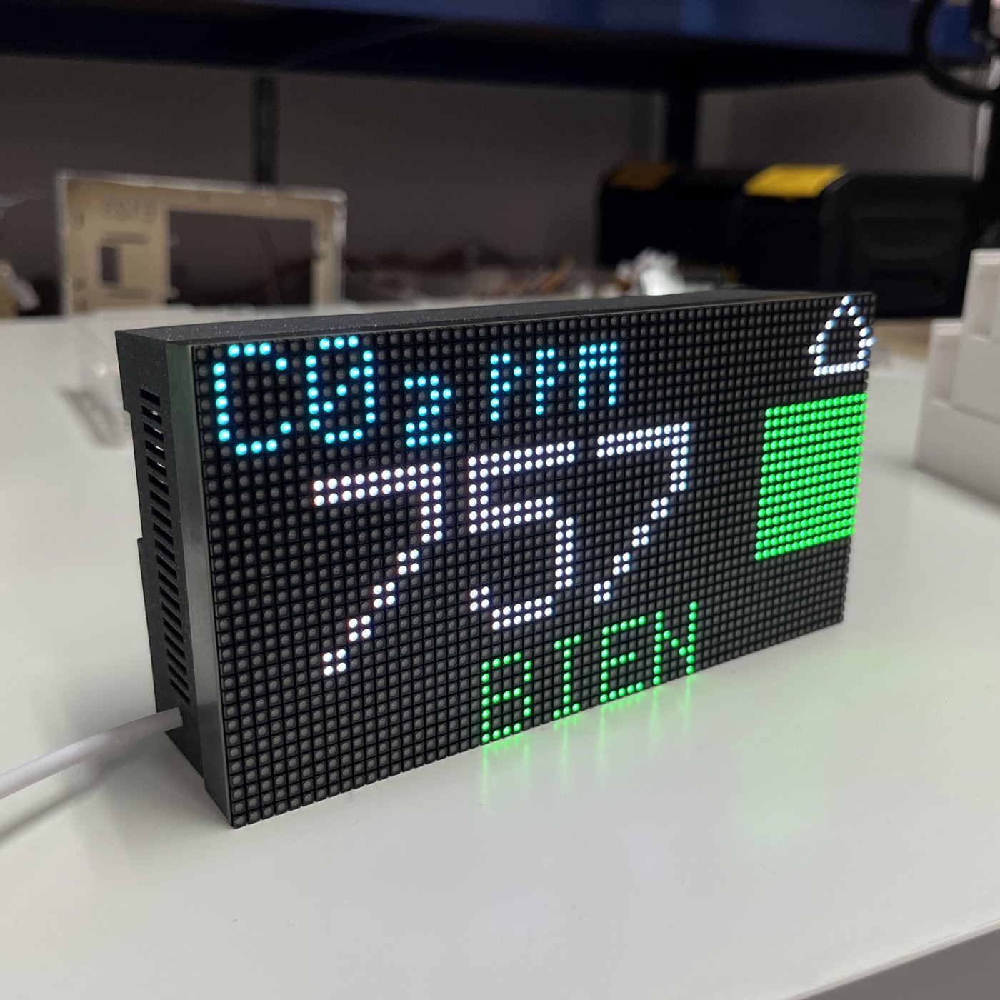{ width="100%" }

## Overview

The **ModuleAir WiFi** is a WiFi-connected indoor air quality monitor. It continuously measures **particulate matter** (PM1, PM2.5, PM10) and **CO₂**, and shows the results in real time on a built-in **LED display**.

This page documents **version 4** (V4) of the ModuleAir. The device is built around an **ESP32** microcontroller and sends its measurements to the AirCarto servers every minute.

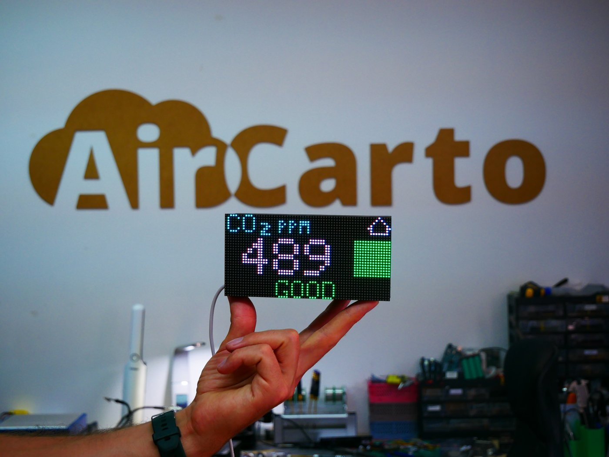{ width="500" }

!!! info "A set-up with no complicated configuration"
    The ModuleAir WiFi is configured entirely from a phone or a computer, with no app to install: plug it in, choose your WiFi network, and you are done.

### Presentation video

<div class="video-embed">
  <iframe src="https://www.youtube-nocookie.com/embed/uKvk7BQXUAg"
          title="ModuleAir: an open-source sensor to measure indoor air quality (PM &amp; CO₂)"
          allow="accelerometer; autoplay; clipboard-write; encrypted-media; gyroscope; picture-in-picture; web-share"
          referrerpolicy="strict-origin-when-cross-origin"
          allowfullscreen></iframe>
</div>

*The video is in French.*

## Technical specifications

{ width="100%" }

In a 3D-printed enclosure, the ModuleAir WiFi brings together an ESP32-based AirCarto circuit board, the air quality sensors, an LED display and its USB power supply:

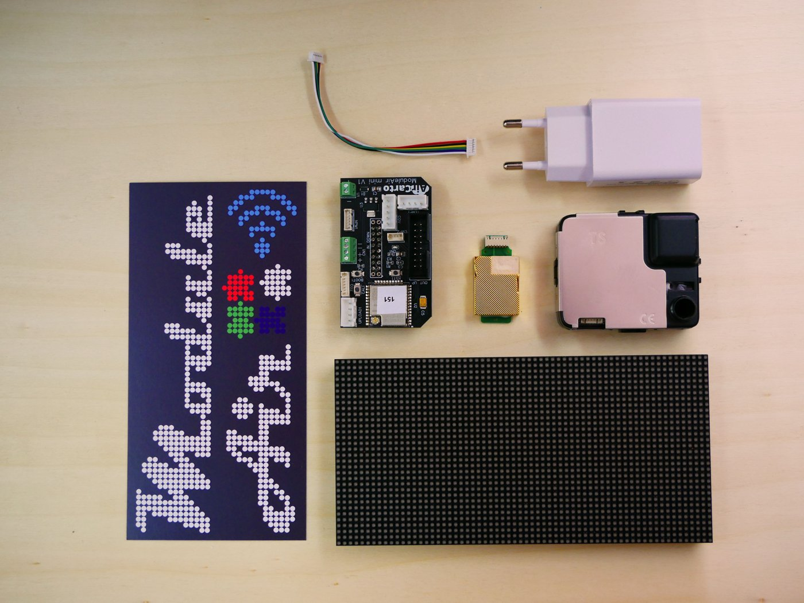{ width="100%" }

### Platform

- **Microcontroller**: ESP32-WROOM-32U (Espressif)
- **CPU**: dual-core Xtensa LX6 at 240 MHz
- **Flash**: 4 MB
- **WiFi**: 802.11 b/g/n, **external antenna** (U.FL connector) for better range

The board is a custom AirCarto board (**ModuleAir WiFi**) designed around this module.

### Sensors

As standard, the ModuleAir WiFi includes two reference sensors:

| Sensor | Measures | Parameters | Interface |
|--------|----------|------------|-----------|
| **[NextPM](https://tera-sensor.com/nextpm/)** (Tera Sensor) | Particulate matter | PM1 · PM2.5 · PM10 | UART (Modbus RTU) |
| **[S88](https://senseair.com/product/s88/)** (Senseair) | Carbon dioxide | CO₂ | UART (Modbus RTU) |

!!! info "New CO₂ sensor since September 2026"
    ModuleAir units produced **from September 2026** use the **Senseair S88** instead of the **MH-Z19C** (Winsen) fitted on earlier versions. Devices already installed keep working **with no action needed**: the firmware recognises the connected model by itself. See [Carbon dioxide (CO₂)](#carbon-dioxide-co2-senseair-s88).

As an **option**, a **VOC sensor** (volatile organic compounds) and a remote **BME280** sensor (temperature, humidity, pressure) can be added — see [The sensors in detail](#the-sensors-in-detail).

!!! note "Sensors detected automatically"
    The ModuleAir detects the connected sensors at every measurement cycle. A sensor can be plugged in or removed while the device is running, and each sensor can be **enabled or disabled** individually from the web dashboard (see [Settings and features](#settings-and-features)). Only the measurements of sensors that are present and enabled are displayed and sent.

### LED display

The ModuleAir WiFi has a **64 × 32 pixel RGB LED matrix** (HUB75 panel). Once the device is running, the display cycles through the different pollutants (one measurement every 5 seconds), alternating with logos, with a **colour code** showing the air quality.

The matrix comes in two sizes:

| Variant | Pitch | Dimensions |
|---------|-------|------------|
| **P2.5** | 2.5 mm | 160 × 80 mm |
| **P3** | 3.0 mm | 192 × 96 mm |

The display brightness can be adjusted from the dashboard (from 0 — display off — to 255).

### Enclosure

The enclosure is made of **3D-printed** parts, custom-designed to hold the PCB and the sensors. It has openings for air circulation (needed for particle and gas measurements), for the USB cable and for the external WiFi antenna. The AirCarto logo is built into the design.

The 3D file of the enclosure can be downloaded in the [3D files](#3d-files) section.

### Dimensions

Overall dimensions of the version with the **P2.5** matrix:

| Height | Width | Depth |
|--------|-------|-------|
| **79.2 mm** | **159.9 mm** | **45.9 mm** |

The depth is made up of **30.6 mm** of enclosure and **13.4 mm** of display (44.0 mm), plus the slight protrusion of the particle sensor at the back. Power cable not included.

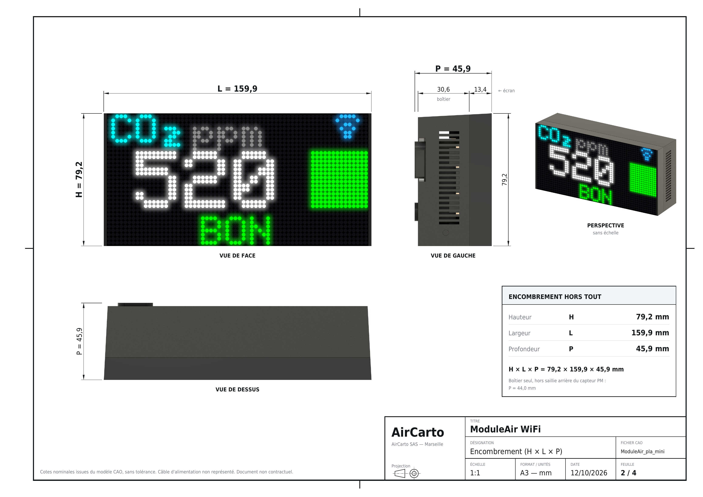{ width="100%" loading=lazy }

The full drawings are in the [Technical drawings](#technical-drawings) section.

### Connectivity

The ModuleAir WiFi connects to a standard **2.4 GHz WiFi** network (WPA/WPA2). It sends its measurements over the internet to the AirCarto servers.

!!! warning "Unsupported networks"
    The device can only connect to a WiFi network protected by a password (or an open network). Enterprise networks with a login page (captive portal) or a username/password (universities, hotels, some offices, eduroam) are **not** supported.

### Power supply and consumption

The ModuleAir WiFi is designed to be **permanently powered over 5 V USB** (phone charger or USB port). A standard **5 V / 1 A** mains adapter is enough.

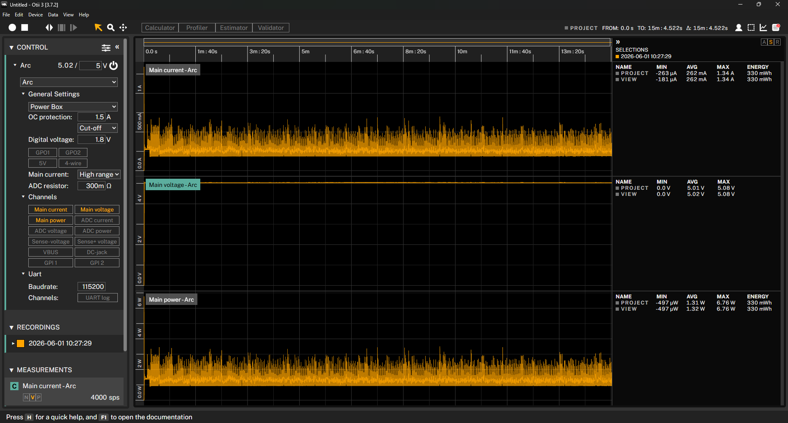{ width="100%" }

Measured on 5 V USB with a power profiler (~15 seconds of normal operation):

| Parameter | Value |
|-----------|-------|
| Supply voltage | 5.0 V |
| Average current | ~171 mA |
| Peak current | ~509 mA |
| Average power | ~858 mW |
| Peak power | ~2.56 W |

| Estimate | Value |
|----------|-------|
| Average consumption | ~0.86 W |
| Daily consumption | ~20.6 Wh/day |
| Yearly consumption | ~7.5 kWh/year |

!!! note "Reading the profile"
    The idle current is around **100–150 mA** (ESP32 active, WiFi kept on). The **periodic peaks** (300–509 mA) are the WiFi transmissions and sensor readings. A **start-up peak** (~1 s) comes with the ESP32 initialisation and the WiFi connection.

## The sensors in detail

As standard, the ModuleAir WiFi measures the **two key indoor air quality parameters**: **particulate matter** and **CO₂**, using reference sensors. A **VOC sensor** and a **temperature / humidity / pressure** sensor can be added as options (see below).

### Particulate matter — NextPM (Tera Sensor)

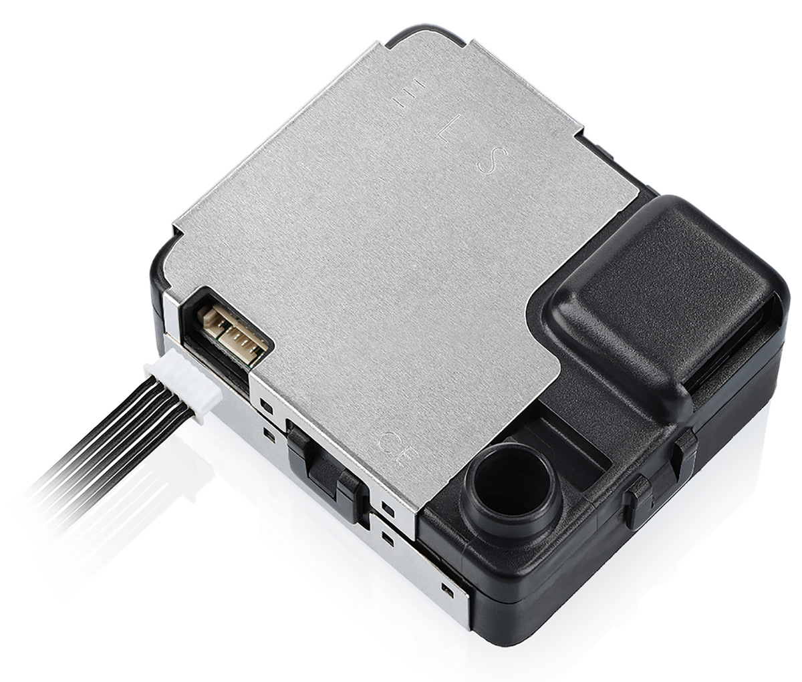{ width="300" }

**Particulate matter** (PM) is microscopic dust suspended in the air. It is classified by size: **PM10** (< 10 µm), **PM2.5** (< 2.5 µm) and **PM1** (< 1 µm). The finer a particle, the deeper it goes into the respiratory system — PM2.5 reaches the pulmonary alveoli, which makes it one of the most closely monitored pollutants for health. Sources include heating, cooking, traffic, tobacco, candles, etc.

The **NextPM** is an **optical particle counter** made by the French company **[Tera Sensor](https://tera-sensor.com/nextpm/)**. It lights the airflow with a laser and measures the light scattered by the particles **at two angles (45° and 90°)** — a patented technology that improves the distinction between particle sizes. It detects particles from **0.3 to 10 µm** and gives the concentrations in **µg/m³** for PM1, PM2.5 and PM10.

To stay reliable even in humid air, the sensor has a **heating system** that keeps its internal humidity below 60 %. It is a durable sensor (lifetime > 10 years, > 10,000 hours of operation) whose correlation with reference instruments exceeds 0.95.

!!! info "The same sensor as the NebuleAir Pro"
    The NextPM is AirCarto's reference particle sensor: it is also fitted on the [NebuleAir Pro](../nebuleair-pro/index.md).

### Carbon dioxide (CO₂) — Senseair S88

**CO₂** (carbon dioxide) is the best indicator of **air renewal** in an occupied room. Outdoor air contains about **420 ppm** of CO₂; in a closed, occupied room the level rises as people breathe. Above **~1000–1500 ppm** the air is considered **stale**: it is time to ventilate. High levels often come with drowsiness, headaches and reduced concentration. CO₂ is also a good proxy for the risk of airborne disease transmission.

Since **September 2026**, the ModuleAir measures CO₂ with the **[S88](https://senseair.com/product/s88/)** from the **Swedish** manufacturer **[Senseair](https://senseair.com/)**. It works on the **NDIR** principle (*Non-Dispersive InfraRed*): CO₂ absorbs a specific infrared wavelength; by measuring this absorption in an optical chamber, the sensor works out the concentration. It is a robust method that stays stable over time.

| Feature | Value |
|---------|-------|
| Principle | NDIR (non-dispersive infrared) |
| Measuring range | 400 – 10,000 ppm |
| Accuracy | ± 40 ppm ± 3 % of reading |
| Warm-up time | < 10 s |
| Response time (T63) | ≤ 30 s |
| Calibration | Automatic **ABC** (*Automatic Baseline Calibration*), maintenance-free |
| Lifetime | > 15 years |
| Interface | UART — **Modbus RTU** (9600 baud, 8N1) |

!!! info "Why the S88 replaces the MH-Z19C"
    Until August 2026, the ModuleAir was fitted with the **MH-Z19C** from the Chinese manufacturer **Winsen**. The switch to the S88 has two reasons:

    - **Supplier reliability** — Senseair is a **Swedish** manufacturer, with safer supply and technical support than our previous Chinese source.
    - **Measurement accuracy** — **comparison tests carried out in-house at AirCarto** show very reliable measurements with the S88.

    The S88's **ABC** calibration automatically resets the baseline to the lowest value seen over its rolling period (**8 days** by default): the sensor stays accurate over time with no intervention, as long as the room is ventilated from time to time.

!!! success "Nothing to do on devices already installed"
    The firmware **automatically detects** the CO₂ sensor model connected (MH-Z19C or S88) at every start-up, and handles a change while running. Both sensors report **exactly the same data** (`ISO_17`, in ppm): histories, alert thresholds, LED display and API are identical from one model to the other.

??? note "Previous sensor: MH-Z19C (Winsen) — ModuleAir made before September 2026"

    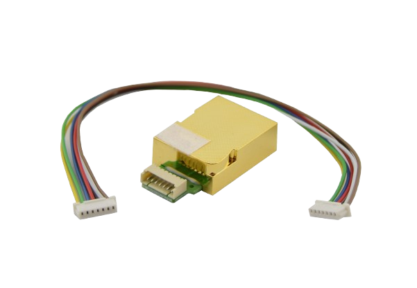{ width="300" }

    Also an **NDIR** sensor, measuring infrared absorption in a **gold-plated chamber**.

    | Feature | Value |
    |---------|-------|
    | Principle | NDIR (non-dispersive infrared) |
    | Measuring range | 400 – 5000 ppm |
    | Accuracy | ± (50 ppm + 5 % of reading) |
    | Compensation | temperature |
    | Warm-up time | ~1 to 3 min |
    | Interface | UART (serial output) |

### Volatile organic compounds (VOC) — CCS811 sensor (optional)

**VOCs** (volatile organic compounds) are gases given off by many sources in the home: **cleaning products**, **paints**, glues and varnishes, **new furniture**, air fresheners, **candles** and incense, **cooking**… Some are irritating or harmful at high levels. Like CO₂, they build up when a room is poorly ventilated.

The ModuleAir can be fitted with an optional **CCS811** sensor (ams / ScioSense). It is a **metal oxide** (MOX) sensor: a small heated sensitive layer changes its resistance in contact with VOCs. From this, the sensor works out a **total VOC** level (*TVOC*), shown in **ppb** (parts per billion) on the LED display, in the dashboard and in the data.

| Feature | Value |
|---------|-------|
| Principle | Heated metal oxide (MOX) sensor |
| Measures | Total VOC (TVOC) |
| Range | 0 – 1,187 ppb |
| Warm-up at every start | ~20 min |
| Stabilisation on first use | ~48 h of continuous operation |
| Interface | I²C |

!!! warning "Warm-up time"
    The sensor has to warm up before measuring: **every time it starts, it shows 0 for about twenty minutes** — this is normal. On **first use**, leave the device **plugged in continuously**: its readings stabilise after about **48 hours**.

!!! tip "Look at the changes, not the numbers"
    This sensor is designed to follow how VOCs **change**, not to give a precise absolute value. It shows very well **when VOCs rise** (cleaning, cooking, candles, paint…) and **when they fall again** after ventilating. However, two sensors placed side by side may show different figures: compare the readings of one sensor over time rather than values between sensors.

The VOC sensor is **enabled in our workshop** on ModuleAir units delivered with this option. It can be enabled or disabled at any time from the web dashboard, **Active sensors** card (see [Settings and features](#settings-and-features)).

### Temperature, humidity, pressure — BME280 sensor (optional)

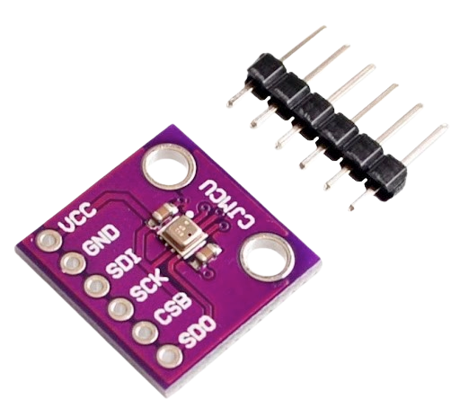{ width="300" }

The **BME280** sensor measures **temperature**, relative **humidity** and **atmospheric pressure** — the ambient conditions that complete the indoor air diagnosis.

!!! warning "Why this sensor is not fitted as standard"
    Inside the enclosure, **the heat given off by the LED display distorts** temperature and humidity readings. For this reason, the ModuleAir is delivered **as standard with particulate matter and CO₂ only**.

**On request**, AirCarto can supply a version with the BME280: we have developed **prototypes with a remote extension** that places the sensor **outside the enclosure**, connected by a cable. The measurement is then not affected by the heat of the display and stays reliable.

| Measurement | Range | Accuracy |
|-------------|-------|----------|
| Temperature | −40 to +85 °C | ± 1 °C |
| Humidity | 0 to 100 % RH | ± 3 % RH |
| Pressure | 300 to 1100 hPa | ± 1 hPa |

## First set-up

!!! note "Messages in French"
    The device's screens and its configuration pages are in French. The French messages are given below with their meaning.

### 1. Plug in the device

Plug the device into a USB socket (phone charger, USB port of an internet router…). It starts automatically: a short animation is shown on the LED display, then the display shows **« Config WiFi »** as long as the device is not configured.

### 2. Connect to the device's network

On first start (or as long as no network is saved), the ModuleAir creates its own WiFi access point:

- **Network name**: `ModuleAir-XXXXXX` (the last 6 characters are specific to your device)
- **Password**: none (open network)

On your phone or computer, open the WiFi settings and connect to this network. A **configuration page opens automatically** (captive portal). If it does not open, launch your browser on any address, or go to [http://192.168.4.1](http://192.168.4.1).

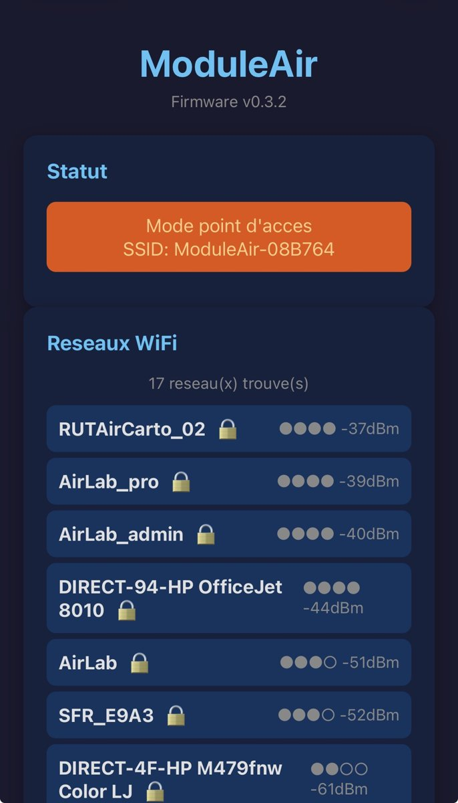{ width="45%" }

### 3. Choose your WiFi network

On the configuration page:

1. Find your WiFi network in the list (button **« Actualiser les réseaux »**, *refresh networks*, if needed)
2. Click the name of your network
3. Enter the password of your WiFi
4. Click **Connecter** (*connect*)

The device saves the credentials, restarts and tries to connect. The configuration is **saved**: on the next starts, the device reconnects to your network automatically.

#### Alternative: configuration over Bluetooth (BLE Improv)

As well as the captive portal, the ModuleAir supports WiFi configuration over **Bluetooth** using the **Improv** standard, from a compatible browser (**Chrome / Edge**). The device shows the progress (connecting, credentials received, success/failure) directly on the LED display.

### 4. Check the connection

Once connected, the display briefly shows the network and the signal quality, then the ModuleAir logo while waiting for the first measurement (~60 s). The device then automatically sends its measurements **every 60 seconds**.

!!! tip "Smart automatic reconnection"
    If the router restarts or the WiFi is lost for a moment, the device tries to reconnect on its own for 3 minutes, then keeps retrying periodically in the background. If the configured network can no longer be found, it switches back to access point mode so it can be reconfigured.

## The web dashboard

Once the device is connected to your WiFi, you can open its interface from any device on the **same network**.

Open a browser and type:

```
http://moduleair.local
```

!!! note "If the `.local` address does not work"
    Some devices (especially Android) do not handle `.local` addresses. In that case, use the device's **IP address** (shown in your router's admin interface).

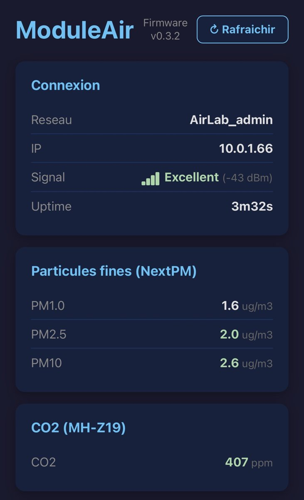{ width="45%" }

### Viewing the measurements

The dashboard shows the latest measurements in real time, grouped by sensor: **particulate matter**, **CO₂** and — if the optional sensor is installed — the **ambient conditions** (temperature / humidity / pressure). Values are coloured according to their level (**green** = good, **orange** = moderate, **red** = poor). The page refreshes automatically, without a full reload.

The **System** card shows the status of each sensor as a badge:

| Badge | Meaning |
|-------|---------|
| Green « ok » | Sensor enabled, reading correctly |
| Red « err » | Sensor enabled but in error (see the logs) |
| Grey crossed-out « off » | Sensor deliberately disabled |
| Orange « warm » | First measurement cycle in progress (just after start-up) |

### Settings and features

The dashboard is not only for viewing measurements: it lets you **fully customise** how the device works. All settings are **saved** and kept after a restart.

- **Enable / disable a sensor** — in *Active sensors*, each sensor has a switch. Disabling a sensor stops reading it and removes it from the display and from the data sent — **immediate effect**, no restart needed. Useful if a sensor is not installed or if you do not want to follow a measurement.
- **Choose the pollutants shown on the display** — in *Matrix screens*, you decide which parameters scroll on the LED display (PM1, PM2.5, PM10, CO₂, and — with the optional sensor — temperature, humidity): show only the ones you are interested in. You also choose which **logos** appear in the rotation (ModuleAir, AirCarto, AtmoSud).
- **Set the CO₂ alert thresholds** — edit the "good" and "poor" thresholds that set the colours (**800** and **1500 ppm** by default), with a "Default" button to go back to the official values.
- **Set the display brightness** — from 0 (display off) to 255.
- **Debug screen at start-up** — show or hide the technical information screen at boot.

!!! tip "Automatic consistency"
    If you disable a sensor, the screens of the matching pollutants are greyed out automatically (e.g. disabling the NextPM greys out PM1 / PM2.5 / PM10). Your display preferences are kept: they come back automatically when you enable the sensor again.

### Real-time logs

The dashboard includes a **live log** console (live tail), with pause and clear. It makes it easy to diagnose a sensor or connection problem without any special equipment.

## The LED display in detail

### What a measurement screen looks like

During operation, the display scrolls through one measurement every 5 seconds. Each pollutant has its own screen, always laid out the same way so it can be read at a glance. Each measurement screen is made of the following elements:

| Area | Position | Content |
|------|----------|---------|
| **Pollutant** | Top left (cyan) | Name of the measurement (PM2.5, CO₂, PM10…) |
| **Unit** | Right of the name (grey) | The unit (µg/m³, ppm…) |
| **Value** | Centre, large (white) | The current measurement |
| **Colour square** | Right | The quality level (green → yellow → orange → red) |
| **Label** | Bottom (same colour) | The level in words, in French (see [Colour thresholds](#colour-thresholds)) |
| **Network badge** | Top right | The connection status (blue = online) |

The **colour square** and the **label** take the same colour, set by the [thresholds below](#colour-thresholds): this is the main visual indicator of air quality.

### Screens shown

| State | Display |
|-------|---------|
| Start-up | Boot animation (spinner) |
| Waiting for WiFi configuration | « Config WiFi… » (orange) |
| Connecting | Network name + animated dots |
| Connected | « Connecté » + network name + signal bars (3 s) |
| Waiting for the first measurement | ModuleAir logo |
| Normal operation | Rotation of the pollutants (5 s/screen) + logos |
| WiFi lost | « WiFi déconnecté » (*WiFi disconnected*) until reconnection |
| OTA update | Dedicated progress screen |

### The connectivity badge

At the top right of each measurement screen, a small **badge** shows the connection status. In the background, the device checks its link **every 15 seconds**, in three successive steps:

1. **WiFi** — is the device connected to your router?
2. **Internet** — does internet access work? (direct test to a public IP, without relying on DNS)
3. **AirCarto server** — is the server that receives the measurements responding?

The badge sums up this diagnosis at a glance:

| Badge | Status | Meaning |
|:-----:|--------|---------|
| *(nothing)* | **Offline** | No WiFi connection at all. Needs to be reconfigured (WiFi portal or Bluetooth). |
| { width="46" } | **Online** | WiFi **+** internet **+** AirCarto server: everything is OK, measurements are sent normally. |
| 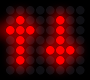{ width="46" } | **No internet** | The device is on the WiFi, but has **no internet access**. The problem is on the router / internet provider side. |
| 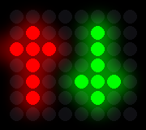{ width="46" } | **Server unreachable** | Internet works, but the **AirCarto server** is not responding. Nothing to do on your side. |

#### How to read the icons

- **WiFi logo (blue)** — shown when **everything works**: this is the normal state. The device is connected and sending its measurements.
- As soon as there is a **problem**, the WiFi logo is replaced by **two arrows** that show *where* the problem is:
    - **Up arrow ↑** = **sending** the measurements **to the AirCarto server** (upload).
    - **Down arrow ↓** = **internet access** in general (download).
- The **colour** of each arrow tells whether that direction works:
    - 🟢 **Green** = this link works · 🔴 **Red** = this link is down.

In practice:

- **↑ red + ↓ red** → nothing gets through in either direction: **no internet** (the WiFi is there, but the router has no internet).
- **↑ red + ↓ green** → internet works (↓ green) but sending to the server fails (↑ red): the problem is **the AirCarto server**, **not your WiFi**.

!!! tip "Offline, the device keeps measuring"
    Even without internet, the display keeps showing live measurements. Only the **online history** on [moduleair.fr](https://moduleair.fr/monModuleAir/) is paused until the connection is back.

### Colour thresholds

The colours shown on the display follow these thresholds. For each pollutant, here is the table of levels **and the screen as it is displayed** at each level (the CO₂ thresholds can be edited from the dashboard). The label at the bottom of the screen is in French: **BON** = good, **MOYEN** = moderate, **DÉGRADÉ** = degraded, **MAUVAIS** = poor, **AÉRER SVP** = please ventilate.

> *Previews generated from the exact fonts and layout of the firmware (64 × 32 pixel matrix).*

=== "PM1"

    Particles with a diameter **< 1 µm**.

    | PM1 (µg/m³) | Level | Colour |
    |-------------|-------|--------|
    | < 10 | Good | 🟢 Green |
    | 10 – 20 | Moderate | 🟡 Yellow |
    | 20 – 50 | Degraded | 🟠 Orange |
    | ≥ 50 | Poor | 🔴 Red |

    <div class="screens">
      <figure><figcaption>Good · &lt; 10</figcaption></figure>
      <figure><figcaption>Moderate · 10–20</figcaption></figure>
      <figure><figcaption>Degraded · 20–50</figcaption></figure>
      <figure><figcaption>Poor · ≥ 50</figcaption></figure>
    </div>

=== "PM2.5"

    Particles with a diameter **< 2.5 µm** (the most closely monitored for health).

    | PM2.5 (µg/m³) | Level | Colour |
    |---------------|-------|--------|
    | < 10 | Good | 🟢 Green |
    | 10 – 20 | Moderate | 🟡 Yellow |
    | 20 – 50 | Degraded | 🟠 Orange |
    | ≥ 50 | Poor | 🔴 Red |

    <div class="screens">
      <figure><figcaption>Good · &lt; 10</figcaption></figure>
      <figure><figcaption>Moderate · 10–20</figcaption></figure>
      <figure><figcaption>Degraded · 20–50</figcaption></figure>
      <figure><figcaption>Poor · ≥ 50</figcaption></figure>
    </div>

=== "PM10"

    Particles with a diameter **< 10 µm**.

    | PM10 (µg/m³) | Level | Colour |
    |--------------|-------|--------|
    | < 15 | Good | 🟢 Green |
    | 15 – 30 | Moderate | 🟡 Yellow |
    | 30 – 75 | Degraded | 🟠 Orange |
    | ≥ 75 | Poor | 🔴 Red |

    <div class="screens">
      <figure><figcaption>Good · &lt; 15</figcaption></figure>
      <figure><figcaption>Moderate · 15–30</figcaption></figure>
      <figure><figcaption>Degraded · 30–75</figcaption></figure>
      <figure><figcaption>Poor · ≥ 75</figcaption></figure>
    </div>

=== "CO₂"

    | CO₂ (ppm) — *editable* | Level | Colour |
    |------------------------|-------|--------|
    | < 800 | Good | 🟢 Green |
    | 800 – 1500 | Please ventilate | 🟡 Yellow |
    | ≥ 1500 | Please ventilate | 🔴 Red |

    <div class="screens">
      <figure><figcaption>Good · &lt; 800</figcaption></figure>
      <figure><figcaption>Please ventilate · 800–1500</figcaption></figure>
      <figure><figcaption>Please ventilate · ≥ 1500</figcaption></figure>
    </div>

    Above 800 ppm, the message shown stays **« AÉRER SVP »** (*please ventilate*): only the colour gets stronger (yellow then red) as the air becomes staler. Both thresholds (800 and 1500 ppm) can be **adjusted from the dashboard**.

=== "Temperature / Humidity"

    These are not pollutants, but a comfort zone is shown on the display.

    | Temperature (°C) | Colour | Message |
    |------------------|--------|---------|
    | < 19 | 🔵 Blue | Froid (*cold*) |
    | 19 – 28 | 🟢 Green | OK |
    | ≥ 28 | 🔴 Red | Chaud (*hot*) |

    | Humidity (%) | Colour | Message |
    |--------------|--------|---------|
    | < 40 | 🔴 Red | Sec (*dry*) |
    | 40 – 60 | 🟢 Green | Idéal (*ideal*) |
    | ≥ 60 | 🔴 Red | Humide (*humid*) |

    > For humidity, both "dry" and "humid" are shown in red: only the ideal zone (40–60 %) is green.

## Firmware update (OTA)

The ModuleAir WiFi firmware can be updated **remotely** (Over-The-Air), directly from the dashboard, with no cable or software:

1. On the dashboard, click **« Vérifier les mises à jour »** (*check for updates*)
2. If a new version is available, confirm the update
3. The device downloads the firmware, installs it and restarts automatically

The update takes about 30 seconds. The progress is shown both in the browser and on the LED display. The dashboard is available again once the device has restarted.

!!! warning "During the update"
    Do not unplug the device while the firmware is being downloaded and installed. If the update fails, the device keeps the previous version and stays functional (anti-rollback protection).

## Viewing the data

The ModuleAir can be used in two ways, depending on whether it has internet access.

### Connected to the internet — history on moduleair.fr

When the device is connected to a WiFi network **with internet access**, it sends its measurements **every 60 seconds** to the AirCarto servers. The data then **go up** to the cloud, where they are **stored** and can be viewed remotely, from anywhere:

[:material-chart-line: View my data on moduleair.fr](https://moduleair.fr/monModuleAir/){ .md-button }

This is the normal way to use it: you can follow how air quality changes over time, as charts.

### Offline — live display on the screen

Without internet access, the data **are not sent** to the cloud (so there is no online history), but the device keeps **measuring**: it shows the values **live on its LED display**. Air quality can still be read at a glance, directly on the device.

!!! note "What about the local dashboard?"
    The [http://moduleair.local](http://moduleair.local) interface stays available as long as you are on the **same WiFi network** as the device: it shows the latest measurements in real time and gives access to the settings. It is mainly a **configuration and monitoring** tool, not a history.

### Format of the data sent

Measurements are sent in **JSON** format, with the **ISO LCSQA** codes:

| Measurement | ISO code | Unit |
|-------------|----------|------|
| PM1.0 | `ISO_68` | µg/m³ |
| PM2.5 | `ISO_39` | µg/m³ |
| PM10 | `ISO_24` | µg/m³ |
| CO₂ | `ISO_17` | ppm |
| Temperature | `ISO_54` | °C |
| Humidity | `ISO_55` | % |
| Pressure | `ISO_53` | hPa |

> The temperature, humidity and pressure fields are only present if the optional sensor is installed.

The device is identified by its **Device ID** (`AABBCCDDEEFF`), derived from the ESP32's MAC address.

!!! note "Fields left out if a sensor is missing"
    A measurement's fields (`ISO_*`) are **left out** of the JSON when the matching sensor is missing or in error. The diagnostic fields (`error_flags`, `npm_status`, `device_status`) are always present.

??? example "Example JSON payload"

    ```json
    {
      "device_id": "AABBCCDDEEFF",
      "signal_quality": -52,
      "signal_quality_unit": "-52 dB",
      "version": 1,
      "version_major": 0,
      "version_minor": 3,
      "version_patch": 1,
      "ISO_68": 3.2,
      "ISO_39": 5.1,
      "ISO_24": 7.8,
      "ISO_54": 22.3,
      "ISO_55": 45.2,
      "ISO_53": 1013.5,
      "ISO_17": 420,
      "error_flags": 0,
      "npm_status": 0,
      "device_status": 2
    }
    ```

??? info "Diagnostic fields (advanced)"

    **`error_flags`** — bitmask of the sensors in error:

    | Bit | Value | Sensor |
    |-----|-------|--------|
    | 2 | `0x04` | BME280 (temperature / humidity / pressure) |
    | 3 | `0x08` | NextPM (particulate matter) |
    | 7 | `0x80` | CO₂ sensor (S88 or MH-Z19C) |

    A sensor **deliberately disabled** by the user does not raise its error bit (it is not a fault).

    **`npm_status`** — internal status register of the NextPM, passed on as is (`0xFF` = sensor silent / not read).

    **`device_status`** — status bitmask: bit 1 (`0x02`) = WiFi connected; bit 7 (`0x80`) = recent start-up (uptime < 5 min).

## Home Assistant integration

The ModuleAir can send its measurements to [Home Assistant](https://www.home-assistant.io/) **directly over the local network**, without going through the cloud: the data stay available even without internet access, and no account or token is needed.

!!! info "Minimum version"
    Local reading is available from firmware **0.4.0**. To find your device's version, look at the dashboard or the `software_version` field described below. If needed, first do an [OTA update](#firmware-update-ota).

### The local API `/data.json`

The device publishes its latest measurements at:

```
http://<device-ip-address>/data.json
```

The values are **60-second averages**, identical to those sent to the AirCarto servers. They are refreshed once a minute: polling the device more often brings nothing.

??? example "Example response"

    ```json
    {
      "software_version": "0.6.1",
      "age": "12",
      "sensordatavalues": [
        {"value_type": "NPM_P0", "value": "3.2"},
        {"value_type": "NPM_P1", "value": "7.8"},
        {"value_type": "NPM_P2", "value": "5.1"},
        {"value_type": "BME280_temperature", "value": "22.3"},
        {"value_type": "BME280_humidity", "value": "45.2"},
        {"value_type": "BME280_pressure", "value": "101350.0"},
        {"value_type": "MHZ19_CO2", "value": "612"},
        {"value_type": "signal", "value": "-52"}
      ]
    }
    ```

| Measurement | `value_type` | Unit |
|-------------|--------------|------|
| PM1.0 | `NPM_P0` | µg/m³ |
| PM10 | `NPM_P1` | µg/m³ |
| PM2.5 | `NPM_P2` | µg/m³ |
| CO₂ | `MHZ19_CO2` | ppm |
| Temperature | `BME280_temperature` | °C |
| Humidity | `BME280_humidity` | % |
| Pressure | `BME280_pressure` | **Pa** |
| WiFi signal | `signal` | dBm |

!!! warning "Watch the field names"
    The format follows the *sensor.community* convention: **`NPM_P1` is PM10** and **`NPM_P2` is PM2.5**. The CO₂ key is always `MHZ19_CO2`, whether the sensor is an MH-Z19C or a Senseair S88. Pressure is given in **pascals** (not hPa). As with the cloud upload, a measurement is **missing** from the list if the matching sensor is not installed or is in error.

`age` is the number of seconds since the measurements were last updated.

### Home Assistant configuration

1. **Give the device a fixed IP address**: in your router's interface, reserve an IP address (static DHCP lease) for the ModuleAir.
2. **Add the configuration** below to your `configuration.yaml` file, replacing `192.168.1.50` with the device's IP address.
3. **Restart Home Assistant**: the sensors appear in *Settings → Devices & services → Entities*.

!!! note "Use the IP address, not `moduleair.local`"
    All ModuleAir devices answer to the same name `moduleair.local`. If you have several on the same network, this name can point to any of them: always use the **IP address** in Home Assistant.

??? example "Full `configuration.yaml` configuration"

    ```yaml
    rest:
      - resource: http://192.168.1.50/data.json
        scan_interval: 60
        timeout: 30
        sensor:
          - name: "ModuleAir PM1"
            unique_id: moduleair_pm1
            unit_of_measurement: "µg/m³"
            device_class: pm1
            state_class: measurement
            value_template: >
              {{ value_json.sensordatavalues | selectattr('value_type', 'eq', 'NPM_P0')
                 | map(attribute='value') | first | default(none) }}
          - name: "ModuleAir PM2.5"
            unique_id: moduleair_pm25
            unit_of_measurement: "µg/m³"
            device_class: pm25
            state_class: measurement
            value_template: >
              {{ value_json.sensordatavalues | selectattr('value_type', 'eq', 'NPM_P2')
                 | map(attribute='value') | first | default(none) }}
          - name: "ModuleAir PM10"
            unique_id: moduleair_pm10
            unit_of_measurement: "µg/m³"
            device_class: pm10
            state_class: measurement
            value_template: >
              {{ value_json.sensordatavalues | selectattr('value_type', 'eq', 'NPM_P1')
                 | map(attribute='value') | first | default(none) }}
          - name: "ModuleAir CO2"
            unique_id: moduleair_co2
            unit_of_measurement: "ppm"
            device_class: carbon_dioxide
            state_class: measurement
            value_template: >
              {{ value_json.sensordatavalues | selectattr('value_type', 'eq', 'MHZ19_CO2')
                 | map(attribute='value') | first | default(none) }}
          # Optional BME280 sensor
          - name: "ModuleAir Temperature"
            unique_id: moduleair_temperature
            unit_of_measurement: "°C"
            device_class: temperature
            state_class: measurement
            value_template: >
              {{ value_json.sensordatavalues | selectattr('value_type', 'eq', 'BME280_temperature')
                 | map(attribute='value') | first | default(none) }}
          - name: "ModuleAir Humidity"
            unique_id: moduleair_humidity
            unit_of_measurement: "%"
            device_class: humidity
            state_class: measurement
            value_template: >
              {{ value_json.sensordatavalues | selectattr('value_type', 'eq', 'BME280_humidity')
                 | map(attribute='value') | first | default(none) }}
          - name: "ModuleAir Pressure"
            unique_id: moduleair_pressure
            unit_of_measurement: "hPa"
            device_class: atmospheric_pressure
            state_class: measurement
            value_template: >
              
              {{ (p | float / 100) | round(1) if p is not none else none }}
          - name: "ModuleAir WiFi Signal"
            unique_id: moduleair_signal
            unit_of_measurement: "dBm"
            device_class: signal_strength
            state_class: measurement
            entity_category: diagnostic
            value_template: >
              {{ value_json.sensordatavalues | selectattr('value_type', 'eq', 'signal')
                 | map(attribute='value') | first | default(none) }}
    ```

    Remove the sensors your ModuleAir does not have (for example the BME280 if it is not installed). For **several ModuleAir devices**, duplicate the `- resource: …` block with each device's IP address, and adapt the `name` and `unique_id` values so they stay unique.

!!! tip "Good practice"
    - Keep `scan_interval: 60`: the measurements only change once a minute, and the device answers requests one at a time.
    - Keep `timeout: 30`: while sending its data to the AirCarto servers, the device can take a few seconds to answer. With a shorter timeout, Home Assistant will now and then show the sensor as "unavailable".

## 3D files

The ModuleAir enclosure can be 3D printed. The file for the main body is available for download (STL format, ready to print).

### Enclosure body

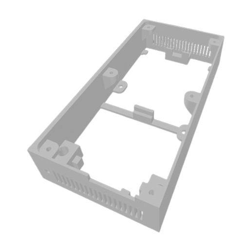{ width="400" }

[:material-download: Download the STL file](../assets/3d_files/ModuleAirMiniCorps_v41.stl){ .md-button }

## Technical drawings

Drawings from the CAD model (A3 format, nominal dimensions in mm, no tolerances, non-contractual document). Each sheet can be downloaded in full resolution (PNG 3308 × 2339) with the link below it. The annotations on the drawings are in French.

### General views

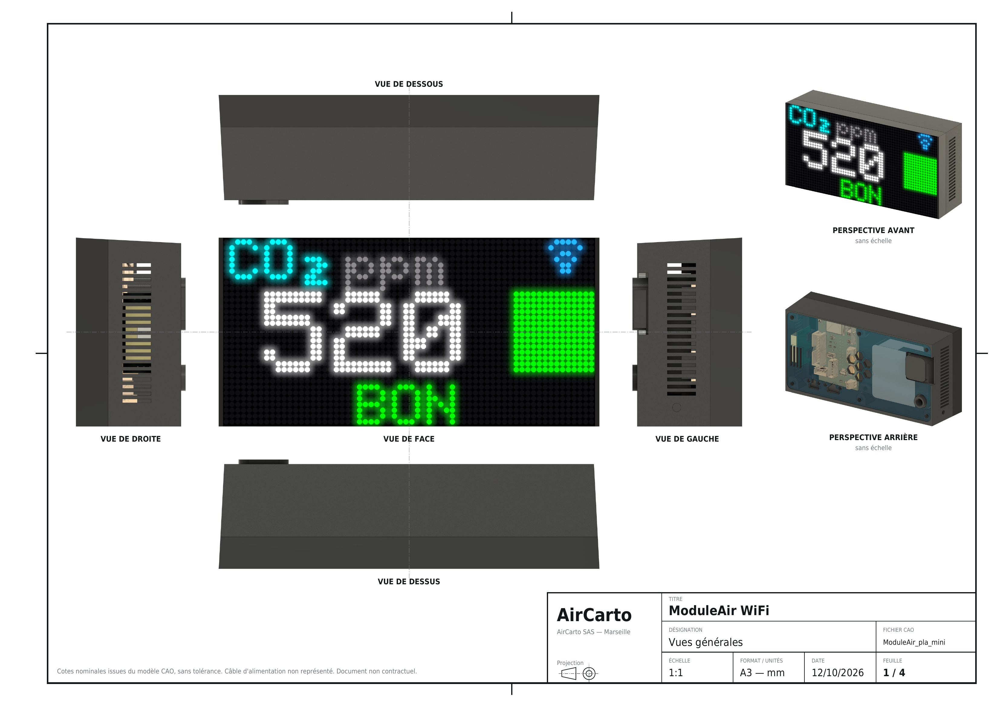{ width="100%" loading=lazy }

[:material-download: Full-resolution sheet](../assets/images/ModuleAir_WiFi_01_vues.png)

### Overall dimensions

{ width="100%" loading=lazy }

[:material-download: Full-resolution sheet](../assets/images/ModuleAir_WiFi_02_encombrement.png)

### Components

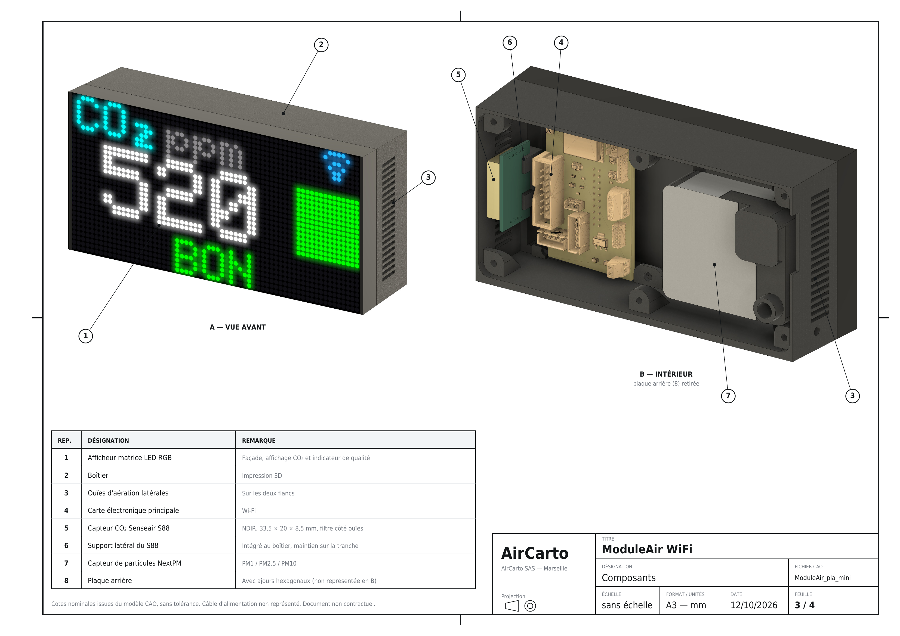{ width="100%" loading=lazy }

[:material-download: Full-resolution sheet](../assets/images/ModuleAir_WiFi_03_composants.png)

| Ref. | Description | Note |
|------|-------------|------|
| 1 | RGB LED matrix display | Front panel, CO₂ display and quality indicator |
| 2 | Enclosure | 3D printed |
| 3 | Side ventilation slots | On both sides |
| 4 | Main circuit board | WiFi (ESP32) |
| 5 | Senseair S88 CO₂ sensor | NDIR, 33.5 × 20 × 8.5 mm, filter facing the slots |
| 6 | S88 side holder | Built into the enclosure, holds the sensor by its edge |
| 7 | NextPM particle sensor | PM1 / PM2.5 / PM10 |
| 8 | Back plate | With hexagonal openings |

### Perspectives and back view

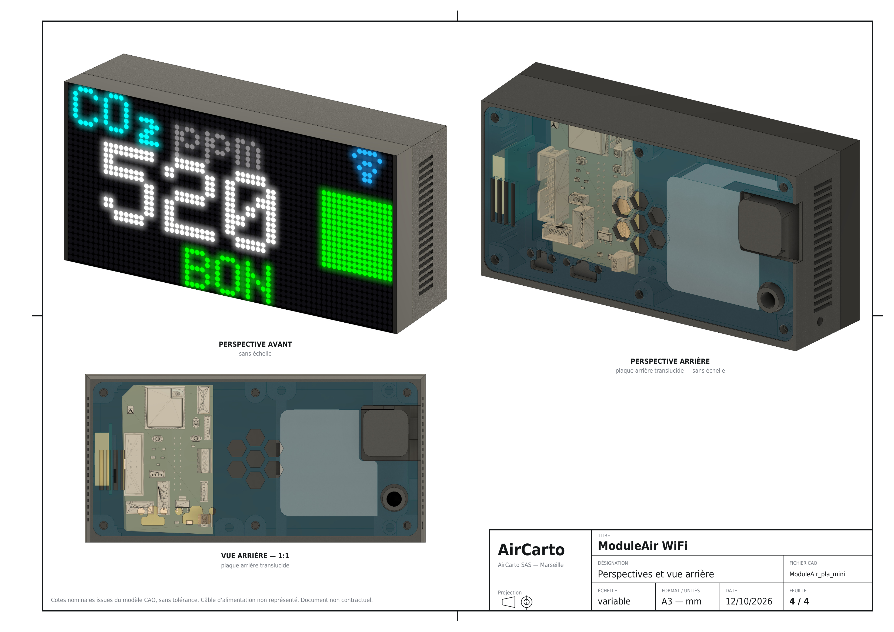{ width="100%" loading=lazy }

[:material-download: Full-resolution sheet](../assets/images/ModuleAir_WiFi_04_perspectives.png)

## Hardware documentation

??? note "Schematic"

    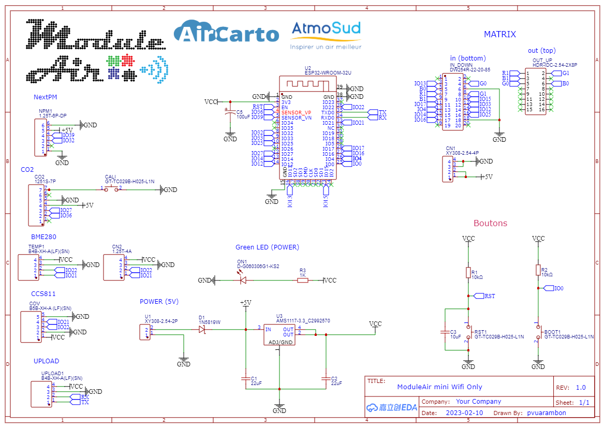{ width="100%" }

??? note "3D view of the PCB"

    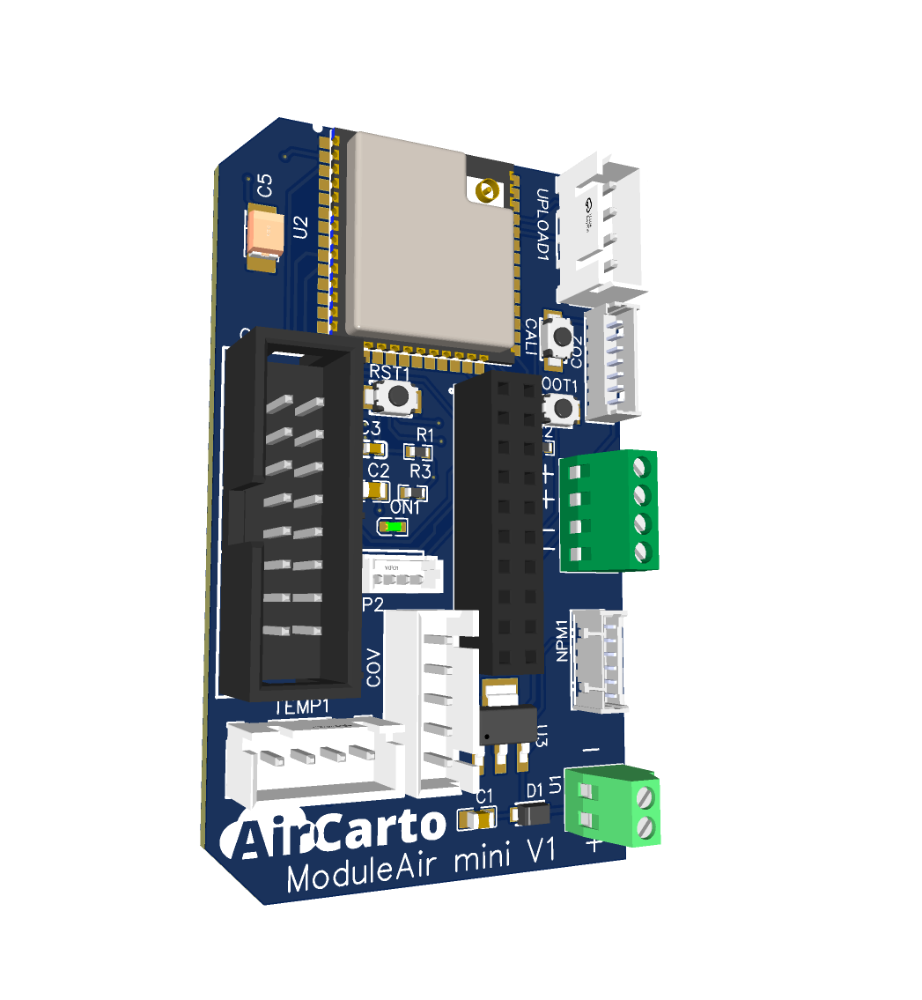{ width="500" }

??? note "ESP32 pinout"

    | Bus | Sensor / function | GPIO |
    |-----|-------------------|------|
    | UART1 (Modbus RTU) | NextPM | RX `IO39` · TX `IO32` |
    | UART2 | CO₂ sensor (S88 or MH-Z19C) | RX `IO36` · TX `IO27` |
    | I²C | BME280 (optional sensor) | SDA `IO21` · SCL `IO22` |
    | HSPI + control | HUB75 64×32 display | LAT `IO25`, A `IO17`, B `IO33`, C `IO4`, D `IO12`, E `IO15`, OE `IO16` |

    Power: **AMS1117-3.3** regulator (5 V → 3.3 V), Schottky protection diode. Buttons: `BOOT`, `RST` (reset), `CALI` (calibration). Green power LED.

## Firmware

The ModuleAir firmware is **open source** and developed by AirCarto.

[:material-github: AirCarto GitHub repository](https://github.com/aircarto){ .md-button }

The firmware version is shown on the dashboard (**System** card) and on the serial port at start-up. The project follows [Semantic Versioning](https://semver.org/) (`MAJOR.MINOR.PATCH`).

!!! info "Future developments"
    **LoRaWAN** integration (long-range transmission without WiFi) is being studied for a future PCB revision. It is not available on the current version of the ModuleAir WiFi.
