# ModuleAir WiFi


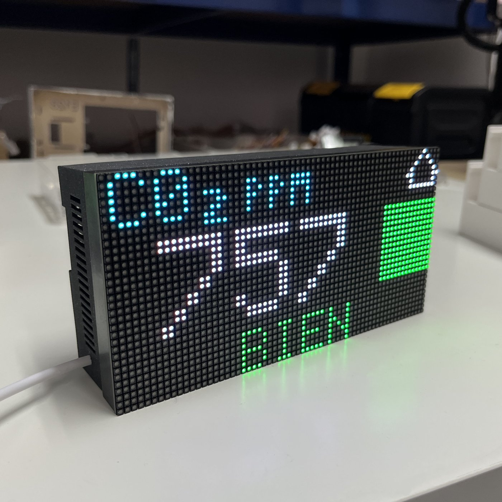{ width="100%" }

## Présentation

Le **ModuleAir WiFi** est un capteur de qualité de l'air d'intérieur connecté en WiFi. Il mesure en continu les **particules fines** (PM1, PM2.5, PM10) et le **CO₂**, et affiche les résultats en temps réel sur un **écran LED** intégré.

Cette page documente la **version 4** (V4) du ModuleAir. Le capteur est construit autour d'un microcontrôleur **ESP32** et transmet ses mesures toutes les minutes vers les serveurs AirCarto.

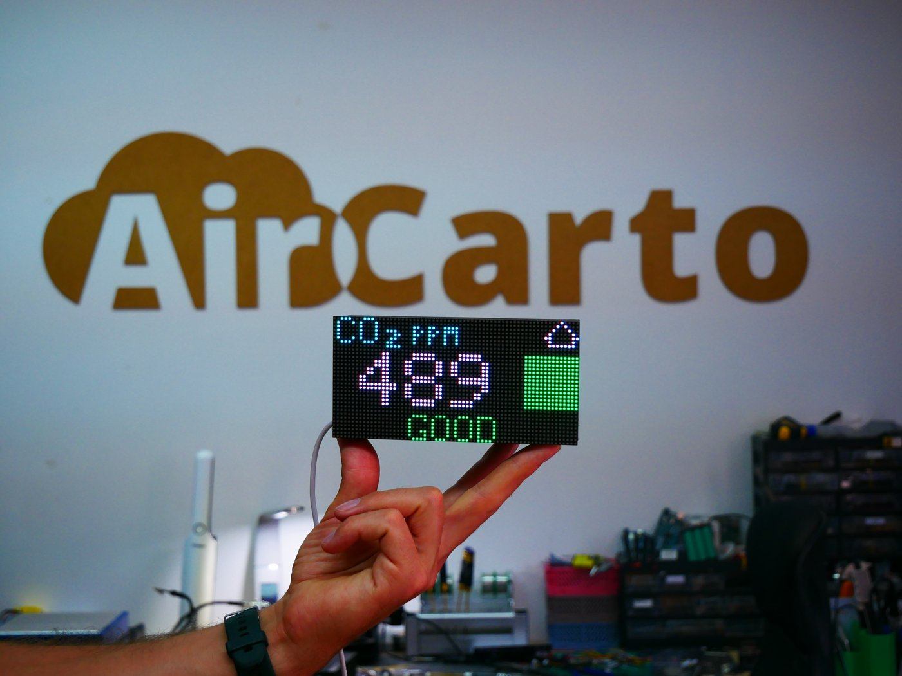{ width="500" }

!!! info "Une installation sans configuration compliquée"
    Le ModuleAir WiFi se configure entièrement depuis un téléphone ou un ordinateur, sans application à installer : on le branche, on choisit son réseau WiFi, et c'est terminé.

### Vidéo de présentation

<div class="video-embed">
  <iframe src="https://www.youtube-nocookie.com/embed/uKvk7BQXUAg"
          title="ModuleAir : un capteur open source pour mesurer la qualité de l’air intérieur (PM &amp; CO₂)"
          allow="accelerometer; autoplay; clipboard-write; encrypted-media; gyroscope; picture-in-picture; web-share"
          referrerpolicy="strict-origin-when-cross-origin"
          allowfullscreen></iframe>
</div>

## Caractéristiques techniques

{ width="100%" }

Le ModuleAir WiFi rassemble, dans un boîtier imprimé en 3D, une carte électronique AirCarto à base d'ESP32, les capteurs de qualité de l'air, un écran LED et son alimentation USB :

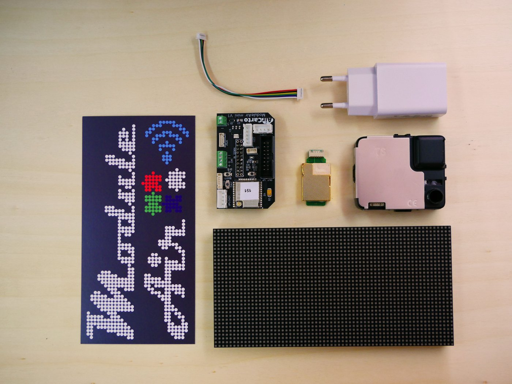{ width="100%" }

### Plateforme

- **Microcontrôleur** : ESP32-WROOM-32U (Espressif)
- **CPU** : double cœur Xtensa LX6 à 240 MHz
- **Flash** : 4 MB
- **WiFi** : 802.11 b/g/n, **antenne externe** (connecteur U.FL) pour une meilleure portée

La carte est une board custom AirCarto (**ModuleAir WiFi**) conçue autour de ce module.

### Capteurs

De série, le ModuleAir WiFi embarque deux capteurs de référence :

| Capteur | Mesure | Paramètres | Interface |
|---------|--------|------------|-----------|
| **[NextPM](https://tera-sensor.com/nextpm/)** (Tera Sensor) | Particules fines | PM1 · PM2.5 · PM10 | UART (Modbus RTU) |
| **[S88](https://senseair.com/product/s88/)** (Senseair) | Dioxyde de carbone | CO₂ | UART (Modbus RTU) |

!!! info "Changement de capteur CO₂ depuis septembre 2026"
    Les ModuleAir produits **à partir de septembre 2026** embarquent le **Senseair S88** à la place du **MH-Z19C** (Winsen) monté sur les versions précédentes. Les capteurs déjà installés continuent de fonctionner **sans aucune intervention** : le firmware reconnaît seul le modèle branché. Voir [Dioxyde de carbone (CO₂)](#dioxyde-de-carbone-co2-senseair-s88).

En **option**, une sonde **BME280** (température, humidité, pression) peut être ajoutée en version déportée — voir [Les capteurs en détail](#les-capteurs-en-detail).

!!! note "Capteurs détectés automatiquement"
    Le ModuleAir détecte les capteurs présents à chaque cycle de mesure. Un capteur peut être branché ou débranché à chaud, et chaque capteur peut être **activé ou désactivé** individuellement depuis le dashboard web (voir [Réglages et fonctionnalités](#reglages-et-fonctionnalites)). Seules les mesures des capteurs présents et activés sont affichées et transmises.

### Écran LED

Le ModuleAir WiFi est équipé d'une **matrice LED RGB de 64 × 32 pixels** (panneau HUB75). Une fois le capteur en fonctionnement, l'écran affiche en rotation les différents polluants (une mesure toutes les 5 secondes), entrecoupés des logos, avec un **code couleur** indiquant la qualité de l'air.

La matrice existe en deux tailles :

| Variante | Pas (pitch) | Dimensions |
|----------|-------------|------------|
| **P2.5** | 2.5 mm | 160 × 80 mm |
| **P3** | 3.0 mm | 192 × 96 mm |

La luminosité de l'écran est réglable depuis le dashboard (de 0 — écran éteint — à 255).

### Boîtier

Le boîtier est composé d'éléments **imprimés en 3D**, conçus sur mesure pour accueillir le PCB et les capteurs. Il intègre des ouvertures pour la circulation de l'air (nécessaire aux mesures de particules et de gaz), le passage du câble USB et l'antenne WiFi externe. Le logo AirCarto est directement intégré au design.

Le fichier 3D du boîtier est téléchargeable dans la section [Fichiers 3D](#fichiers-3d).

### Dimensions

Encombrement hors tout de la version avec matrice **P2.5** :

| Hauteur | Largeur | Profondeur |
|---------|---------|------------|
| **79,2 mm** | **159,9 mm** | **45,9 mm** |

La profondeur se décompose en **30,6 mm** de boîtier et **13,4 mm** d'écran (44,0 mm), plus la légère saillie arrière du capteur de particules. Câble d'alimentation non compris.

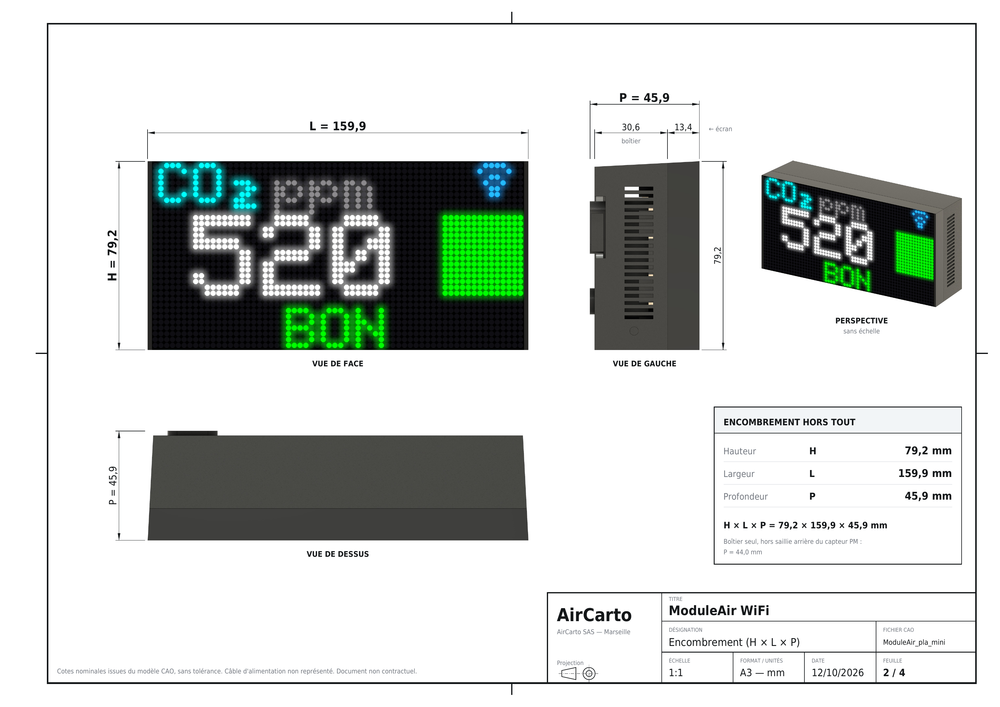{ width="100%" loading=lazy }

Les plans complets sont dans la section [Dessins techniques](#dessins-techniques).

### Connectivité

Le ModuleAir WiFi se connecte à un réseau **WiFi 2.4 GHz** classique (WPA/WPA2). Il transmet ses mesures par internet vers les serveurs AirCarto.

!!! warning "Réseaux non supportés"
    Le capteur ne peut se connecter qu'à un réseau WiFi protégé par un mot de passe (ou ouvert). Les réseaux d'entreprise à portail captif ou à identifiant/mot de passe (université, hôtel, certains bureaux) ne sont **pas** supportés.

### Alimentation et consommation

Le ModuleAir WiFi est conçu pour une **alimentation permanente sur USB 5 V** (chargeur de téléphone ou port USB). Un adaptateur secteur standard **5 V / 1 A** est suffisant.

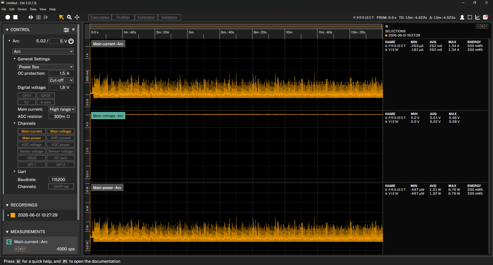{ width="100%" }

Mesure réalisée sur USB 5 V avec un power profiler (~15 secondes en fonctionnement normal) :

| Paramètre | Valeur |
|-----------|--------|
| Tension d'alimentation | 5.0 V |
| Courant moyen | ~171 mA |
| Courant max (pic) | ~509 mA |
| Puissance moyenne | ~858 mW |
| Puissance max (pic) | ~2.56 W |

| Estimation | Valeur |
|------------|--------|
| Consommation moyenne | ~0.86 W |
| Consommation journalière | ~20.6 Wh/jour |
| Consommation annuelle | ~7.5 kWh/an |

!!! note "Lecture du profil"
    Le courant de repos se situe autour de **100–150 mA** (ESP32 actif, WiFi maintenu). Les **pics périodiques** (300–509 mA) correspondent aux transmissions WiFi et aux lectures des capteurs. Un **pic au démarrage** (~1 s) accompagne l'initialisation de l'ESP32 et la connexion WiFi.

## Les capteurs en détail

De série, le ModuleAir WiFi mesure les **deux paramètres clés de la qualité de l'air intérieur** : les **particules fines** et le **CO₂**, à l'aide de capteurs de référence. Une sonde de **température / humidité / pression** peut être ajoutée en option (voir plus bas).

### Particules fines — NextPM (Tera Sensor)

{ width="300" }

Les **particules fines** (PM, *particulate matter*) sont des poussières microscopiques en suspension dans l'air. On les classe par taille : **PM10** (< 10 µm), **PM2.5** (< 2.5 µm) et **PM1** (< 1 µm). Plus une particule est fine, plus elle pénètre profondément dans l'appareil respiratoire — les PM2.5 atteignent les alvéoles pulmonaires, ce qui en fait l'un des polluants les plus surveillés sur le plan sanitaire. Elles proviennent du chauffage, de la cuisson, du trafic, du tabac, des bougies, etc.

Le **NextPM** est un **compteur optique de particules** fabriqué par la société française **[Tera Sensor](https://tera-sensor.com/nextpm/)**. Il éclaire le flux d'air avec un laser et mesure la lumière diffusée par les particules **selon deux angles (45° et 90°)** — une technologie brevetée qui améliore la distinction des tailles de particules. Il détecte les particules de **0.3 à 10 µm** et restitue les concentrations en **µg/m³** pour PM1, PM2.5 et PM10.

Pour rester fiable même dans un air humide, le capteur intègre un **système de chauffage** qui maintient l'humidité interne sous 60 %. C'est un capteur durable (durée de vie > 10 ans, > 10 000 h de fonctionnement) dont la corrélation avec les instruments de référence dépasse 0.95.

!!! info "Le même capteur que le NebuleAir Pro"
    Le NextPM est le capteur de particules de référence d'AirCarto : il équipe aussi le [NebuleAir Pro](../nebuleair-pro/index.md).

### Dioxyde de carbone (CO₂) — Senseair S88

Le **CO₂** (dioxyde de carbone) est le meilleur indicateur du **renouvellement de l'air** dans une pièce occupée. L'air extérieur contient environ **420 ppm** de CO₂ ; dans une pièce fermée et occupée, le taux monte avec la respiration des personnes présentes. Au-delà de **~1000–1500 ppm**, l'air est considéré comme **confiné** : il est temps d'aérer. Des niveaux élevés s'accompagnent souvent de somnolence, de maux de tête et d'une baisse de concentration. Le CO₂ est aussi un bon proxy du risque de transmission des maladies aéroportées.

Depuis **septembre 2026**, le ModuleAir mesure le CO₂ avec le **[S88](https://senseair.com/product/s88/)** du fabricant **suédois [Senseair](https://senseair.com/)**. Il fonctionne par principe **NDIR** (*Non-Dispersive InfraRed*, infrarouge non dispersif) : le CO₂ absorbe une longueur d'onde infrarouge précise ; en mesurant cette absorption dans une chambre optique, le capteur en déduit la concentration. C'est une méthode robuste et stable dans le temps.

| Caractéristique | Valeur |
|-----------------|--------|
| Principe | NDIR (infrarouge non dispersif) |
| Gamme de mesure | 400 – 10 000 ppm |
| Précision | ± 40 ppm ± 3 % de la lecture |
| Temps de chauffe | < 10 s |
| Temps de réponse (T63) | ≤ 30 s |
| Calibration | **ABC** (*Automatic Baseline Calibration*) automatique, sans entretien |
| Durée de vie | > 15 ans |
| Interface | UART — **Modbus RTU** (9600 bauds, 8N1) |

!!! info "Pourquoi le S88 remplace le MH-Z19C"
    Jusqu'en août 2026, le ModuleAir était équipé du **MH-Z19C** du fabricant chinois **Winsen**. Le passage au S88 répond à deux raisons :

    - **Fiabilité du fournisseur** — Senseair est un fabricant **suédois**, avec un approvisionnement et un support techniques plus sûrs que ceux de notre précédente filière chinoise.
    - **Précision de la mesure** — les **tests comparatifs réalisés en interne chez AirCarto** montrent des mesures très fiables avec le S88.

    La calibration **ABC** du S88 recale automatiquement la ligne de base sur la mesure la plus basse observée sur sa période glissante (**8 jours** par défaut) : le capteur reste juste dans le temps sans intervention, à condition que la pièce soit aérée de temps en temps.

!!! success "Rien à faire sur les capteurs déjà installés"
    Le firmware **détecte automatiquement** le modèle de sonde CO₂ branché (MH-Z19C ou S88) à chaque démarrage, et gère le changement à chaud. Les deux capteurs remontent **exactement la même donnée** (`ISO_17`, en ppm) : les historiques, les seuils d'alerte, l'affichage sur l'écran LED et l'API sont identiques d'un modèle à l'autre.

??? note "Ancienne sonde : MH-Z19C (Winsen) — ModuleAir d'avant septembre 2026"

    { width="300" }

    Également un capteur **NDIR**, mesurant l'absorption infrarouge dans une **chambre dorée**.

    | Caractéristique | Valeur |
    |-----------------|--------|
    | Principe | NDIR (infrarouge non dispersif) |
    | Gamme de mesure | 400 – 5000 ppm |
    | Précision | ± (50 ppm + 5 % de la lecture) |
    | Compensation | en température |
    | Temps de chauffe | ~1 à 3 min |
    | Interface | UART (sortie série) |

### Température, humidité, pression — sonde BME280 (en option)

{ width="300" }

La sonde **BME280** mesure la **température**, l'**humidité** relative et la **pression atmosphérique** — les conditions ambiantes qui complètent le diagnostic de l'air intérieur.

!!! warning "Pourquoi cette sonde n'est pas montée de série"
    À l'intérieur du boîtier, **la chaleur dégagée par l'écran LED fausse les mesures** de température et d'humidité. Pour cette raison, le ModuleAir est livré **de série avec uniquement les particules fines et le CO₂**.

**Sur demande**, AirCarto réalise une version équipée du BME280 : nous avons mis au point des **prototypes avec une extension déportée** qui place la sonde **à l'extérieur du boîtier**, reliée par un câble. La mesure échappe ainsi à la chaleur de l'écran et reste fiable.

| Mesure | Gamme | Précision |
|--------|-------|-----------|
| Température | −40 à +85 °C | ± 1 °C |
| Humidité | 0 à 100 % HR | ± 3 % HR |
| Pression | 300 à 1100 hPa | ± 1 hPa |

## Première mise en service

### 1. Brancher le capteur

Branchez le capteur sur une prise USB (chargeur de téléphone, port USB d'une box…). Le capteur démarre automatiquement : une courte animation s'affiche sur l'écran LED, puis l'écran indique **« Config WiFi »** tant que le capteur n'est pas configuré.

### 2. Se connecter au réseau du capteur

Au premier démarrage (ou tant qu'aucun réseau n'est mémorisé), le ModuleAir crée son propre point d'accès WiFi :

- **Nom du réseau** : `ModuleAir-XXXXXX` (les 6 derniers caractères sont propres à votre capteur)
- **Mot de passe** : aucun (réseau ouvert)

Sur votre téléphone ou ordinateur, ouvrez les paramètres WiFi et connectez-vous à ce réseau. Une **page de configuration s'ouvre automatiquement** (portail captif). Si elle ne s'ouvre pas, lancez votre navigateur sur n'importe quelle adresse, ou rendez-vous sur [http://192.168.4.1](http://192.168.4.1).

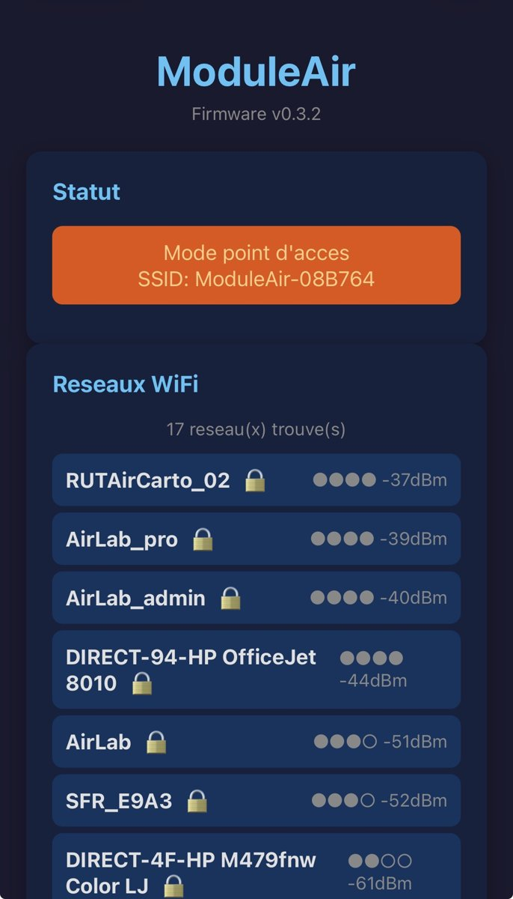{ width="45%" }

### 3. Choisir son réseau WiFi

Sur la page de configuration :

1. Repérez votre réseau WiFi dans la liste (bouton **« Actualiser les réseaux »** si besoin)
2. Cliquez sur le nom de votre réseau
3. Entrez le mot de passe de votre box WiFi
4. Cliquez sur **Connecter**

Le capteur enregistre les identifiants, redémarre et tente de se connecter. La configuration est **mémorisée** : aux démarrages suivants, le capteur se reconnecte automatiquement à votre box.

#### Variante : configuration par Bluetooth (BLE Improv)

En plus du portail captif, le ModuleAir supporte la configuration WiFi par **Bluetooth** via le standard **Improv**, depuis un navigateur compatible (**Chrome / Edge**). Le capteur affiche l'avancement (connexion, identifiants reçus, succès/échec) directement sur l'écran LED.

### 4. Vérifier la connexion

Une fois connecté, l'écran affiche brièvement le réseau et la qualité du signal, puis le logo ModuleAir en attendant la première mesure (~60 s). Le capteur envoie ensuite automatiquement ses mesures **toutes les 60 secondes**.

!!! tip "Reconnexion automatique intelligente"
    Si la box redémarre ou que le WiFi est momentanément perdu, le capteur tente de se reconnecter tout seul pendant 3 minutes, puis réessaie périodiquement en arrière-plan. Si le réseau configuré devient introuvable, il rebascule en mode point d'accès pour permettre une reconfiguration.

## Le dashboard web

Une fois le capteur connecté à votre WiFi, vous accédez à son interface depuis n'importe quel appareil du **même réseau**.

Ouvrez un navigateur et tapez :

```
http://moduleair.local
```

!!! note "Si l'adresse `.local` ne fonctionne pas"
    Certains appareils (notamment sous Android) ne gèrent pas les adresses `.local`. Utilisez alors l'**adresse IP** du capteur (visible dans l'interface d'administration de votre box).

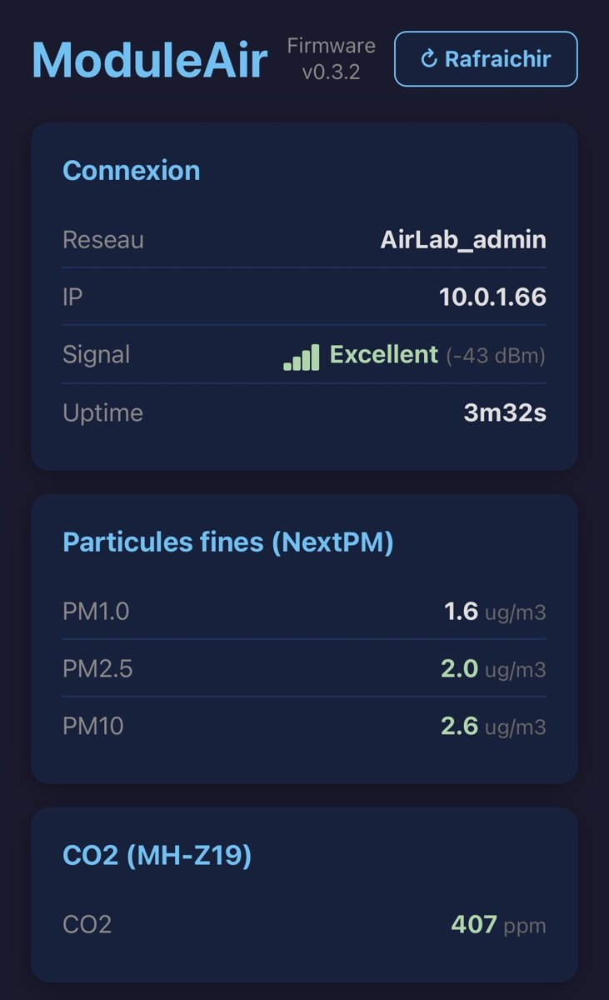{ width="45%" }

### Consulter les mesures

Le dashboard affiche en temps réel les dernières mesures, regroupées par capteur : **particules fines**, **CO₂** et — si la sonde optionnelle est installée — les **conditions ambiantes** (température / humidité / pression). Les valeurs sont colorées selon leur niveau (**vert** = bon, **orange** = moyen, **rouge** = mauvais). La page se rafraîchit automatiquement, sans rechargement complet.

La carte **Système** affiche l'état de chaque capteur sous forme de pastille :

| Pastille | Signification |
|----------|---------------|
| Verte « ok » | Capteur actif, lecture correcte |
| Rouge « err » | Capteur actif mais en erreur (voir les logs) |
| Grise barrée « off » | Capteur volontairement désactivé |
| Orange « warm » | Premier cycle de mesure en cours (juste après le démarrage) |

### Réglages et fonctionnalités

Le dashboard ne sert pas qu'à consulter les mesures : il permet de **personnaliser entièrement** le fonctionnement du capteur. Tous les réglages sont **mémorisés** et conservés après un redémarrage.

- **Activer / désactiver un capteur** — dans *Capteurs actifs*, chaque capteur possède un interrupteur. Désactiver un capteur arrête sa lecture, le retire de l'écran et des données envoyées — **effet immédiat**, sans redémarrage. Pratique si un capteur n'est pas installé ou que vous ne souhaitez pas suivre une mesure.
- **Choisir les polluants affichés à l'écran** — dans *Écrans matrice*, vous décidez quels paramètres défilent sur l'écran LED (PM1, PM2.5, PM10, CO₂, et — avec la sonde optionnelle — température, humidité) : affichez uniquement ceux qui vous intéressent. Vous choisissez aussi quels **logos** apparaissent dans la rotation (ModuleAir, AirCarto, AtmoSud).
- **Régler les seuils d'alerte CO₂** — éditez les seuils « bon » et « mauvais » qui déterminent les couleurs (par défaut **800** et **1500 ppm**), avec un bouton « Par défaut » pour revenir aux valeurs officielles.
- **Régler la luminosité de l'écran** — de 0 (écran éteint) à 255.
- **Écran de debug au démarrage** — afficher ou non l'écran d'information technique au boot.

!!! tip "Cohérence automatique"
    Si vous désactivez un capteur, les écrans des polluants correspondants se grisent automatiquement (ex. désactiver le NextPM grise PM1 / PM2.5 / PM10). Vos préférences d'affichage sont conservées : elles reviennent automatiquement quand vous réactivez le capteur.

### Logs en temps réel

Le dashboard intègre une console de **logs en direct** (live tail), avec pause et effacement. Elle permet de diagnostiquer facilement un problème de capteur ou de connexion sans matériel particulier.

## L'écran LED en détail

### À quoi ressemble un écran de mesure

En fonctionnement, l'écran fait défiler une mesure toutes les 5 secondes. Chaque polluant occupe un écran construit toujours de la même façon, pour une lecture en un coup d'œil. Chaque écran de mesure se compose des repères suivants :

| Zone | Position | Contenu |
|------|----------|---------|
| **Polluant** | En haut à gauche (cyan) | Le nom de la mesure (PM2.5, CO₂, PM10…) |
| **Unité** | À droite du nom (gris) | L'unité (µg/m³, ppm…) |
| **Valeur** | Au centre, en grand (blanc) | La mesure en cours |
| **Carré de couleur** | À droite | Le niveau de qualité (vert → jaune → orange → rouge) |
| **Libellé** | En bas (même couleur) | Le niveau en toutes lettres (BON, MOYEN, AÉRER SVP, MAUVAIS…) |
| **Badge réseau** | En haut à droite | L'état de la connexion (bleu = en ligne) |

Le **carré de couleur** et le **libellé** prennent la même couleur, déterminée par les [seuils ci-dessous](#seuils-de-couleur) : c'est l'indicateur visuel principal de la qualité de l'air.

### États affichés

| État | Affichage |
|------|-----------|
| Démarrage | Animation de boot (spinner) |
| En attente de configuration WiFi | « Config WiFi… » (orange) |
| Connexion en cours | Nom du réseau + points animés |
| Connecté | « Connecté » + nom du réseau + barres de signal (3 s) |
| Attente de la première mesure | Logo ModuleAir |
| Fonctionnement normal | Rotation des polluants (5 s/écran) + logos |
| WiFi perdu | « WiFi déconnecté » jusqu'à reconnexion |
| Mise à jour OTA | Écran de progression dédié |

### Le badge de connectivité

En haut à droite de chaque écran de mesure, un petit **badge** indique l'état de la connexion. En arrière-plan, le capteur teste son lien **toutes les 15 secondes**, en trois étapes successives :

1. **WiFi** — le capteur est-il associé à votre box ?
2. **Internet** — l'accès à internet fonctionne-t-il ? (test direct vers une IP publique, sans dépendre du DNS)
3. **Serveur AirCarto** — le serveur qui reçoit les mesures répond-il ?

Le badge résume ce diagnostic d'un coup d'œil :

| Badge | État | Signification |
|:-----:|------|---------------|
| *(rien)* | **Hors-ligne** | Pas de connexion WiFi du tout. À reconfigurer (portail WiFi ou Bluetooth). |
| { width="46" } | **En ligne** | WiFi **+** internet **+** serveur AirCarto : tout est OK, les mesures remontent normalement. |
| 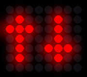{ width="46" } | **Pas d'internet** | Le capteur est sur le WiFi, mais **aucun accès internet**. Côté box / fournisseur d'accès. |
| 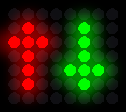{ width="46" } | **Serveur injoignable** | Internet fonctionne, mais le **serveur AirCarto** ne répond pas. Rien à faire de votre côté. |

#### Comment lire les icônes

- **Logo WiFi (bleu)** — apparaît quand **tout fonctionne** : c'est l'état normal. Le capteur est connecté et envoie ses mesures.
- Dès qu'il y a un **problème**, le logo WiFi laisse place à **deux flèches** qui montrent *où* ça coince :
    - **Flèche du haut ↑** = l'**envoi** des mesures **vers le serveur AirCarto** (montée).
    - **Flèche du bas ↓** = l'**accès à internet** en général (descente).
- La **couleur** de chaque flèche dit si cette direction marche :
    - 🟢 **Verte** = ce lien fonctionne · 🔴 **Rouge** = ce lien est coupé.

Concrètement :

- **↑ rouge + ↓ rouge** → rien ne passe dans aucun sens : **pas d'internet** (le WiFi est là, mais la box n'a pas internet).
- **↑ rouge + ↓ verte** → internet marche (↓ verte) mais l'envoi au serveur échoue (↑ rouge) : c'est **le serveur AirCarto** qui est en cause, **pas votre WiFi**.

!!! tip "Hors ligne, le capteur continue de mesurer"
    Même sans internet, l'écran continue d'afficher les mesures en direct. Seul l'**historique en ligne** sur monmoduleair.fr est suspendu tant que la connexion n'est pas rétablie.

### Seuils de couleur

Les couleurs affichées à l'écran suivent ces seuils. Pour chaque polluant, voici le tableau des niveaux **et l'écran tel qu'il s'affiche** à chaque niveau (les seuils CO₂ sont éditables depuis le dashboard) :

> *Aperçus générés à partir des polices et de la mise en page exactes du firmware (matrice 64 × 32 pixels).*

=== "PM1"

    Particules de diamètre **< 1 µm**.

    | PM1 (µg/m³) | Niveau | Couleur |
    |-------------|--------|---------|
    | < 10 | Bon | 🟢 Vert |
    | 10 – 20 | Moyen | 🟡 Jaune |
    | 20 – 50 | Dégradé | 🟠 Orange |
    | ≥ 50 | Mauvais | 🔴 Rouge |

    <div class="screens">
      <figure>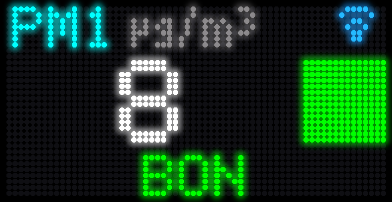<figcaption>Bon · &lt; 10</figcaption></figure>
      <figure>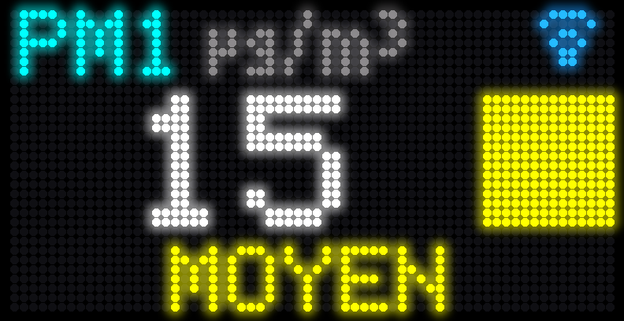<figcaption>Moyen · 10–20</figcaption></figure>
      <figure><figcaption>Dégradé · 20–50</figcaption></figure>
      <figure>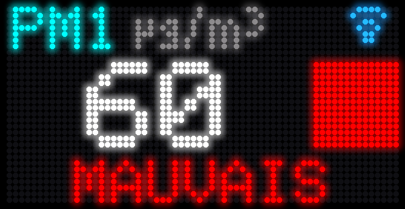<figcaption>Mauvais · ≥ 50</figcaption></figure>
    </div>

=== "PM2.5"

    Particules de diamètre **< 2.5 µm** (les plus surveillées sur le plan sanitaire).

    | PM2.5 (µg/m³) | Niveau | Couleur |
    |---------------|--------|---------|
    | < 10 | Bon | 🟢 Vert |
    | 10 – 20 | Moyen | 🟡 Jaune |
    | 20 – 50 | Dégradé | 🟠 Orange |
    | ≥ 50 | Mauvais | 🔴 Rouge |

    <div class="screens">
      <figure>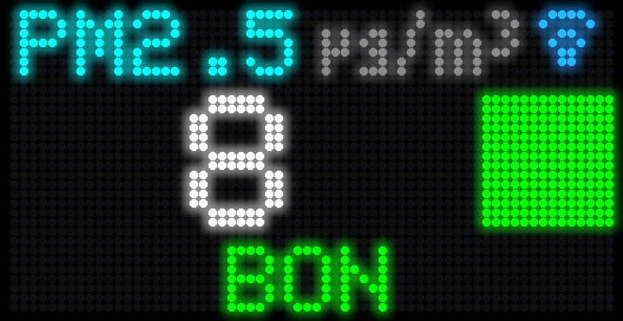<figcaption>Bon · &lt; 10</figcaption></figure>
      <figure>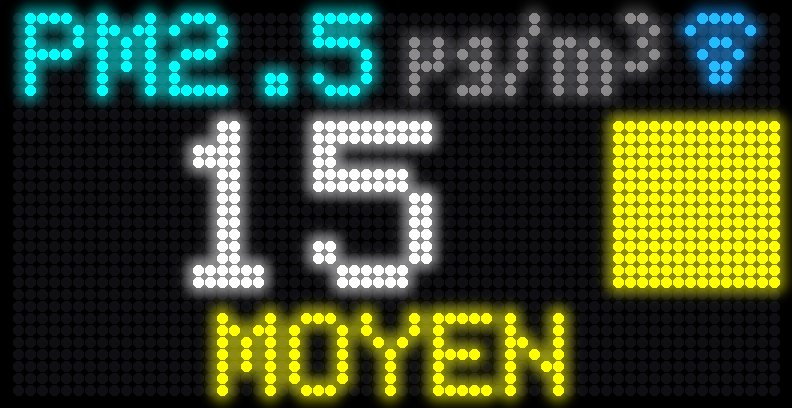<figcaption>Moyen · 10–20</figcaption></figure>
      <figure>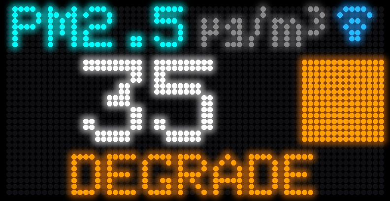<figcaption>Dégradé · 20–50</figcaption></figure>
      <figure>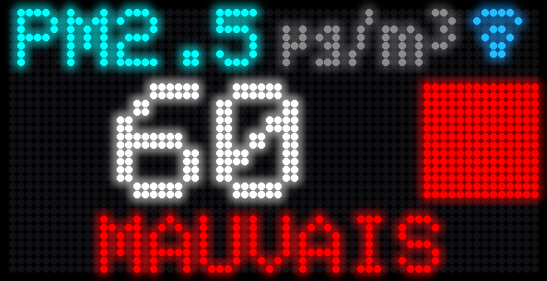<figcaption>Mauvais · ≥ 50</figcaption></figure>
    </div>

=== "PM10"

    Particules de diamètre **< 10 µm**.

    | PM10 (µg/m³) | Niveau | Couleur |
    |--------------|--------|---------|
    | < 15 | Bon | 🟢 Vert |
    | 15 – 30 | Moyen | 🟡 Jaune |
    | 30 – 75 | Dégradé | 🟠 Orange |
    | ≥ 75 | Mauvais | 🔴 Rouge |

    <div class="screens">
      <figure>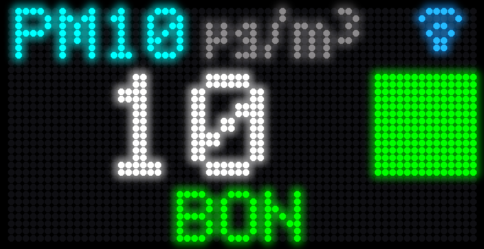<figcaption>Bon · &lt; 15</figcaption></figure>
      <figure>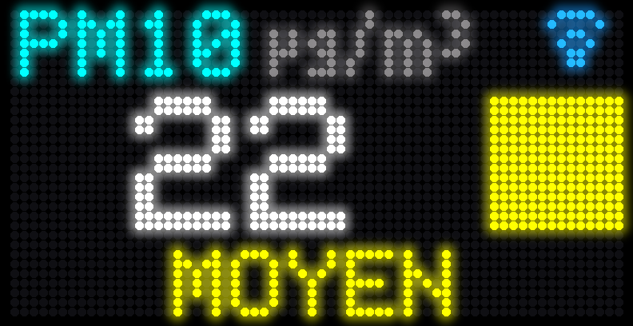<figcaption>Moyen · 15–30</figcaption></figure>
      <figure>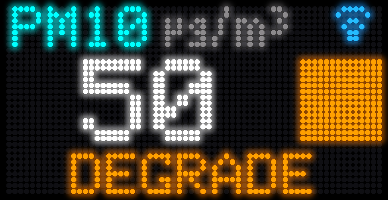<figcaption>Dégradé · 30–75</figcaption></figure>
      <figure>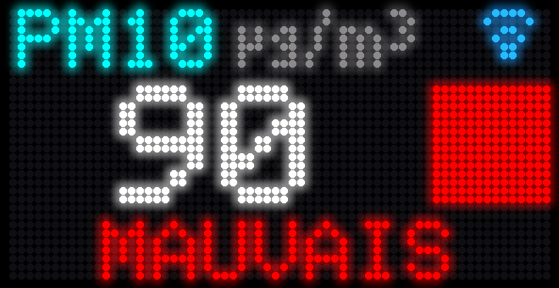<figcaption>Mauvais · ≥ 75</figcaption></figure>
    </div>

=== "CO₂"

    | CO₂ (ppm) — *éditable* | Niveau | Couleur |
    |------------------------|--------|---------|
    | < 800 | Bon | 🟢 Vert |
    | 800 – 1500 | Aérer SVP | 🟡 Jaune |
    | ≥ 1500 | Aérer SVP | 🔴 Rouge |

    <div class="screens">
      <figure>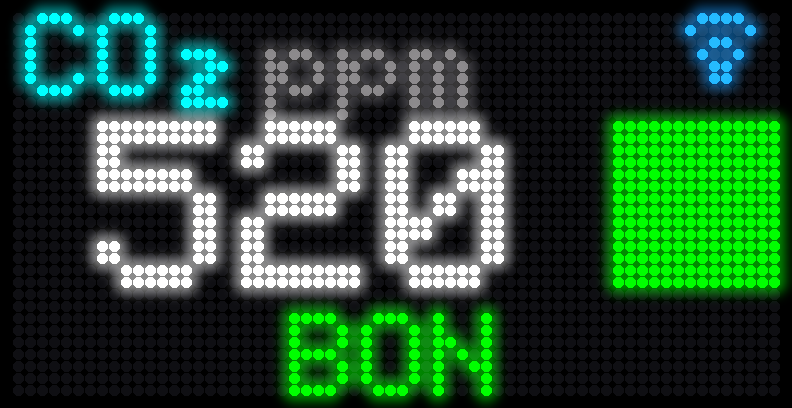<figcaption>Bon · &lt; 800</figcaption></figure>
      <figure>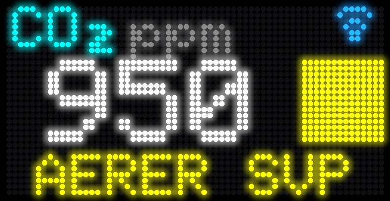<figcaption>Aérer SVP · 800–1500</figcaption></figure>
      <figure>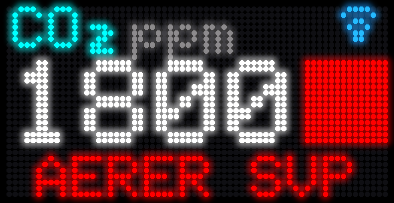<figcaption>Aérer SVP · ≥ 1500</figcaption></figure>
    </div>

    Au-delà de 800 ppm, le message affiché reste **« Aérer SVP »** : seule la couleur s'intensifie (jaune puis rouge) à mesure que l'air se confine. Les deux seuils (800 et 1500 ppm) sont **réglables depuis le dashboard**.

=== "Température / Humidité"

    Ce ne sont pas des polluants, mais une zone de confort est signalée à l'écran.

    | Température (°C) | Couleur | Message |
    |------------------|---------|---------|
    | < 19 | 🔵 Bleu | Froid |
    | 19 – 28 | 🟢 Vert | OK |
    | ≥ 28 | 🔴 Rouge | Chaud |

    | Humidité (%) | Couleur | Message |
    |--------------|---------|---------|
    | < 40 | 🔴 Rouge | Sec |
    | 40 – 60 | 🟢 Vert | Idéal |
    | ≥ 60 | 🔴 Rouge | Humide |

    > Pour l'humidité, « Sec » comme « Humide » sont signalés en rouge : seule la zone idéale (40–60 %) est verte.

## Mise à jour du firmware (OTA)

Le firmware du ModuleAir WiFi peut être mis à jour **à distance** (Over-The-Air), directement depuis le dashboard, sans aucun câble ni logiciel :

1. Sur le dashboard, cliquez sur **« Vérifier les mises à jour »**
2. Si une nouvelle version est disponible, confirmez la mise à jour
3. Le capteur télécharge le firmware, l'installe et redémarre automatiquement

La mise à jour prend environ 30 secondes. La progression est affichée à la fois dans le navigateur et sur l'écran LED. Le dashboard redevient accessible une fois le capteur redémarré.

!!! warning "Pendant la mise à jour"
    Ne débranchez pas le capteur pendant le téléchargement et l'installation. En cas d'échec, le capteur conserve l'ancienne version et reste fonctionnel (protection anti-rollback).

## Consulter les données

Le ModuleAir s'utilise de deux manières, selon qu'il dispose ou non d'un accès à internet.

### Connecté à internet — l'historique sur monmoduleair.fr

Quand le capteur est connecté à un WiFi **disposant d'un accès internet**, il transmet ses mesures **toutes les 60 secondes** vers les serveurs AirCarto. Les données **remontent** alors dans le cloud, où elles sont **historisées** et consultables à distance, depuis n'importe où :

[:material-chart-line: Consulter mes données sur monmoduleair.fr](https://monmoduleair.fr){ .md-button }

C'est le mode d'usage normal : vous pouvez suivre l'évolution de la qualité de l'air sous forme de graphiques, sur la durée.

### Hors ligne — l'affichage en direct sur l'écran

Sans accès internet, les données **ne remontent pas** vers le cloud (il n'y a donc pas d'historique en ligne), mais le capteur continue de **mesurer** : il affiche les valeurs **en direct sur son écran LED**. La qualité de l'air reste donc lisible en un coup d'œil, directement sur l'appareil.

!!! note "Et le dashboard local ?"
    L'interface [http://moduleair.local](http://moduleair.local) reste accessible tant que vous êtes sur le **même réseau WiFi** que le capteur : elle affiche les dernières mesures en temps réel et donne accès aux réglages. C'est surtout un outil de **configuration et de contrôle**, pas d'historique.

### Format des données envoyées

Les mesures sont envoyées au format **JSON**, avec les codes **ISO LCSQA** :

| Mesure | Code ISO | Unité |
|--------|----------|-------|
| PM1.0 | `ISO_68` | µg/m³ |
| PM2.5 | `ISO_39` | µg/m³ |
| PM10 | `ISO_24` | µg/m³ |
| CO₂ | `ISO_17` | ppm |
| Température | `ISO_54` | °C |
| Humidité | `ISO_55` | % |
| Pression | `ISO_53` | hPa |

> Les champs de température, d'humidité et de pression ne sont présents que si la sonde optionnelle est installée.

Le capteur est identifié par son **Device ID** (`AABBCCDDEEFF`), dérivé de l'adresse MAC de l'ESP32.

!!! note "Champs omis si capteur absent"
    Les champs d'une mesure (`ISO_*`) sont **omis** du JSON lorsque le capteur correspondant est absent ou en erreur. Les champs de diagnostic (`error_flags`, `npm_status`, `device_status`) sont toujours présents.

??? example "Exemple de payload JSON"

    ```json
    {
      "device_id": "AABBCCDDEEFF",
      "signal_quality": -52,
      "signal_quality_unit": "-52 dB",
      "version": 1,
      "version_major": 0,
      "version_minor": 3,
      "version_patch": 1,
      "ISO_68": 3.2,
      "ISO_39": 5.1,
      "ISO_24": 7.8,
      "ISO_54": 22.3,
      "ISO_55": 45.2,
      "ISO_53": 1013.5,
      "ISO_17": 420,
      "error_flags": 0,
      "npm_status": 0,
      "device_status": 2
    }
    ```

??? info "Champs de diagnostic (avancé)"

    **`error_flags`** — bitmask des capteurs en erreur :

    | Bit | Valeur | Capteur |
    |-----|--------|---------|
    | 2 | `0x04` | BME280 (température / humidité / pression) |
    | 3 | `0x08` | NextPM (particules fines) |
    | 7 | `0x80` | Capteur CO₂ (S88 ou MH-Z19C) |

    Un capteur **volontairement désactivé** par l'utilisateur ne lève pas son bit d'erreur (ce n'est pas une panne).

    **`npm_status`** — registre de statut interne du NextPM, transmis tel quel (`0xFF` = capteur muet / non lu).

    **`device_status`** — bitmask d'état : bit 1 (`0x02`) = WiFi connecté ; bit 7 (`0x80`) = démarrage récent (uptime < 5 min).

## Intégration à Home Assistant

Le ModuleAir peut remonter ses mesures dans [Home Assistant](https://www.home-assistant.io/) **directement sur le réseau local**, sans passer par le cloud : les données restent disponibles même sans accès internet, et aucun compte ni token n'est nécessaire.

!!! info "Version minimale"
    La lecture locale est disponible à partir du firmware **0.4.0**. Pour connaître la version de votre capteur, consultez le dashboard ou le champ `software_version` décrit ci-dessous. Si besoin, faites d'abord une [mise à jour OTA](#mise-a-jour-du-firmware-ota).

### L'API locale `/data.json`

Le capteur expose ses dernières mesures à l'adresse :

```
http://<adresse-ip-du-capteur>/data.json
```

Les valeurs sont les **moyennes sur 60 secondes**, identiques à celles envoyées aux serveurs AirCarto. Elles sont renouvelées une fois par minute : interroger le capteur plus souvent n'apporte rien.

??? example "Exemple de réponse"

    ```json
    {
      "software_version": "0.6.1",
      "age": "12",
      "sensordatavalues": [
        {"value_type": "NPM_P0", "value": "3.2"},
        {"value_type": "NPM_P1", "value": "7.8"},
        {"value_type": "NPM_P2", "value": "5.1"},
        {"value_type": "BME280_temperature", "value": "22.3"},
        {"value_type": "BME280_humidity", "value": "45.2"},
        {"value_type": "BME280_pressure", "value": "101350.0"},
        {"value_type": "MHZ19_CO2", "value": "612"},
        {"value_type": "signal", "value": "-52"}
      ]
    }
    ```

| Mesure | `value_type` | Unité |
|--------|--------------|-------|
| PM1.0 | `NPM_P0` | µg/m³ |
| PM10 | `NPM_P1` | µg/m³ |
| PM2.5 | `NPM_P2` | µg/m³ |
| CO₂ | `MHZ19_CO2` | ppm |
| Température | `BME280_temperature` | °C |
| Humidité | `BME280_humidity` | % |
| Pression | `BME280_pressure` | **Pa** |
| Signal WiFi | `signal` | dBm |

!!! warning "Attention aux noms de champs"
    Le format reprend la convention *sensor.community* : **`NPM_P1` correspond aux PM10** et **`NPM_P2` aux PM2.5**. La clé CO₂ est toujours `MHZ19_CO2`, que la sonde soit une MH-Z19C ou une Senseair S88. La pression est exprimée en **pascals** (et non en hPa). Comme pour l'envoi cloud, une mesure est **absente** de la liste si le capteur correspondant n'est pas installé ou est en erreur.

`age` indique le nombre de secondes écoulées depuis la dernière mise à jour des mesures.

### Configuration de Home Assistant

1. **Fixez l'adresse IP du capteur** : dans l'interface de votre box ou de votre routeur, réservez une adresse IP (bail DHCP statique) pour le ModuleAir.
2. **Ajoutez la configuration** ci-dessous à votre fichier `configuration.yaml`, en remplaçant `192.168.1.50` par l'adresse IP du capteur.
3. **Redémarrez Home Assistant** : les capteurs apparaissent dans *Paramètres → Appareils et services → Entités*.

!!! note "Utilisez l'adresse IP, pas `moduleair.local`"
    Tous les ModuleAir répondent au même nom `moduleair.local`. Si vous en avez plusieurs sur le même réseau, ce nom peut désigner n'importe lequel d'entre eux : utilisez toujours l'**adresse IP** dans Home Assistant.

??? example "Configuration `configuration.yaml` complète"

    ```yaml
    rest:
      - resource: http://192.168.1.50/data.json
        scan_interval: 60
        timeout: 30
        sensor:
          - name: "ModuleAir PM1"
            unique_id: moduleair_pm1
            unit_of_measurement: "µg/m³"
            device_class: pm1
            state_class: measurement
            value_template: >
              {{ value_json.sensordatavalues | selectattr('value_type', 'eq', 'NPM_P0')
                 | map(attribute='value') | first | default(none) }}
          - name: "ModuleAir PM2.5"
            unique_id: moduleair_pm25
            unit_of_measurement: "µg/m³"
            device_class: pm25
            state_class: measurement
            value_template: >
              {{ value_json.sensordatavalues | selectattr('value_type', 'eq', 'NPM_P2')
                 | map(attribute='value') | first | default(none) }}
          - name: "ModuleAir PM10"
            unique_id: moduleair_pm10
            unit_of_measurement: "µg/m³"
            device_class: pm10
            state_class: measurement
            value_template: >
              {{ value_json.sensordatavalues | selectattr('value_type', 'eq', 'NPM_P1')
                 | map(attribute='value') | first | default(none) }}
          - name: "ModuleAir CO2"
            unique_id: moduleair_co2
            unit_of_measurement: "ppm"
            device_class: carbon_dioxide
            state_class: measurement
            value_template: >
              {{ value_json.sensordatavalues | selectattr('value_type', 'eq', 'MHZ19_CO2')
                 | map(attribute='value') | first | default(none) }}
          # Sonde optionnelle BME280
          - name: "ModuleAir Température"
            unique_id: moduleair_temperature
            unit_of_measurement: "°C"
            device_class: temperature
            state_class: measurement
            value_template: >
              {{ value_json.sensordatavalues | selectattr('value_type', 'eq', 'BME280_temperature')
                 | map(attribute='value') | first | default(none) }}
          - name: "ModuleAir Humidité"
            unique_id: moduleair_humidity
            unit_of_measurement: "%"
            device_class: humidity
            state_class: measurement
            value_template: >
              {{ value_json.sensordatavalues | selectattr('value_type', 'eq', 'BME280_humidity')
                 | map(attribute='value') | first | default(none) }}
          - name: "ModuleAir Pression"
            unique_id: moduleair_pressure
            unit_of_measurement: "hPa"
            device_class: atmospheric_pressure
            state_class: measurement
            value_template: >
              
              {{ (p | float / 100) | round(1) if p is not none else none }}
          - name: "ModuleAir Signal WiFi"
            unique_id: moduleair_signal
            unit_of_measurement: "dBm"
            device_class: signal_strength
            state_class: measurement
            entity_category: diagnostic
            value_template: >
              {{ value_json.sensordatavalues | selectattr('value_type', 'eq', 'signal')
                 | map(attribute='value') | first | default(none) }}
    ```

    Supprimez les capteurs que votre ModuleAir ne possède pas (par exemple la sonde BME280 si elle n'est pas installée). Pour **plusieurs ModuleAir**, dupliquez le bloc `- resource: …` avec l'adresse IP de chaque capteur, et adaptez les `name` et `unique_id` pour qu'ils restent uniques.

!!! tip "Bonnes pratiques"
    - Gardez `scan_interval: 60` : les mesures ne changent qu'une fois par minute, et le capteur répond aux requêtes une par une.
    - Gardez `timeout: 30` : pendant l'envoi de ses données vers les serveurs AirCarto, le capteur peut mettre quelques secondes à répondre. Avec un délai trop court, Home Assistant affiche ponctuellement le capteur comme « indisponible ».

## Fichiers 3D

Le boîtier du ModuleAir est imprimable en 3D. Le fichier du corps principal est disponible au téléchargement (format STL, prêt à imprimer).

### Corps du boîtier

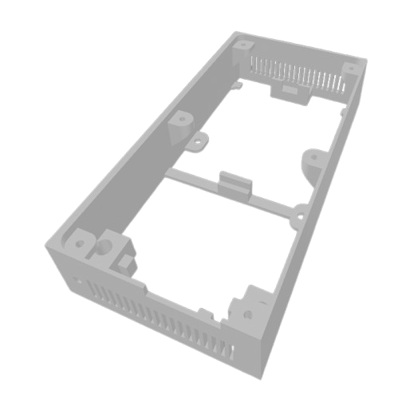{ width="400" }

[:material-download: Télécharger le fichier STL](../assets/3d_files/ModuleAirMiniCorps_v41.stl){ .md-button }

## Dessins techniques

Plans issus du modèle CAO (format A3, cotes nominales en mm, sans tolérance, document non contractuel). Chaque planche se télécharge en pleine résolution (PNG 3308 × 2339) avec le lien placé dessous.

### Vues générales

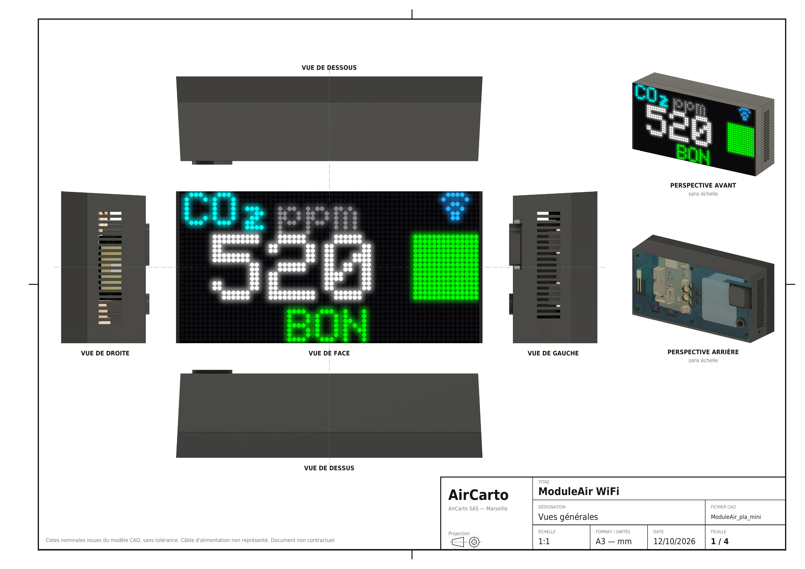{ width="100%" loading=lazy }

[:material-download: Planche en pleine résolution](../assets/images/ModuleAir_WiFi_01_vues.png)

### Encombrement

{ width="100%" loading=lazy }

[:material-download: Planche en pleine résolution](../assets/images/ModuleAir_WiFi_02_encombrement.png)

### Composants

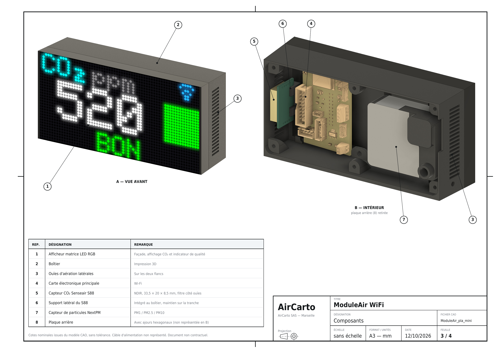{ width="100%" loading=lazy }

[:material-download: Planche en pleine résolution](../assets/images/ModuleAir_WiFi_03_composants.png)

| Rep. | Désignation | Remarque |
|------|-------------|----------|
| 1 | Afficheur matrice LED RGB | Façade, affichage CO₂ et indicateur de qualité |
| 2 | Boîtier | Impression 3D |
| 3 | Ouïes d'aération latérales | Sur les deux flancs |
| 4 | Carte électronique principale | WiFi (ESP32) |
| 5 | Capteur CO₂ Senseair S88 | NDIR, 33,5 × 20 × 8,5 mm, filtre côté ouïes |
| 6 | Support latéral du S88 | Intégré au boîtier, maintien sur la tranche |
| 7 | Capteur de particules NextPM | PM1 / PM2.5 / PM10 |
| 8 | Plaque arrière | Avec ajours hexagonaux |

### Perspectives et vue arrière

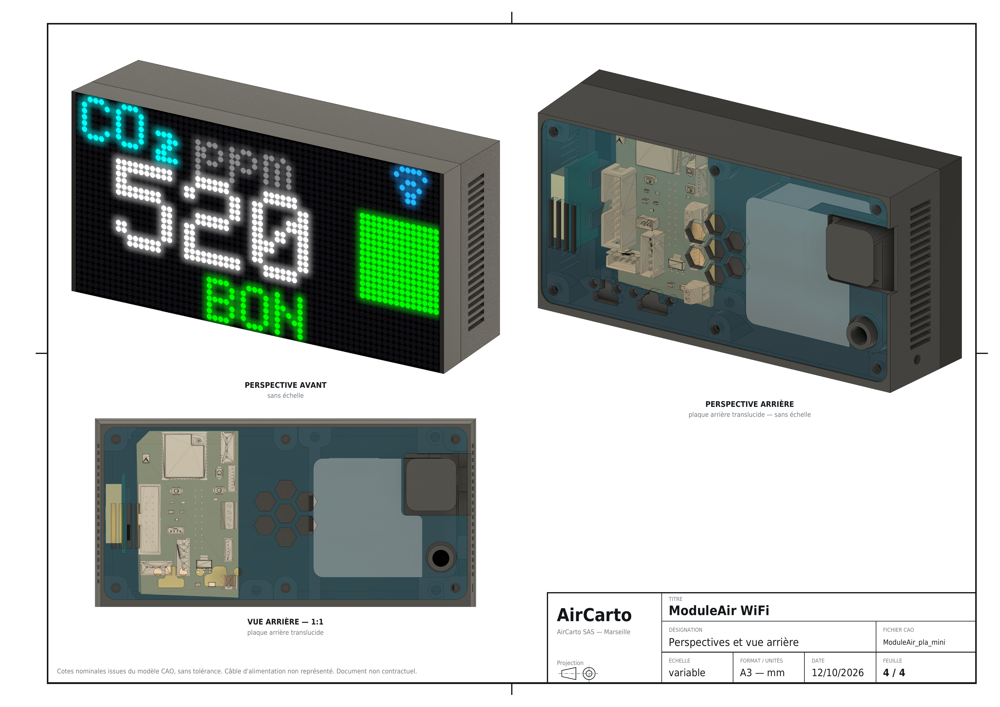{ width="100%" loading=lazy }

[:material-download: Planche en pleine résolution](../assets/images/ModuleAir_WiFi_04_perspectives.png)

## Documentation matérielle

??? note "Schématique"

    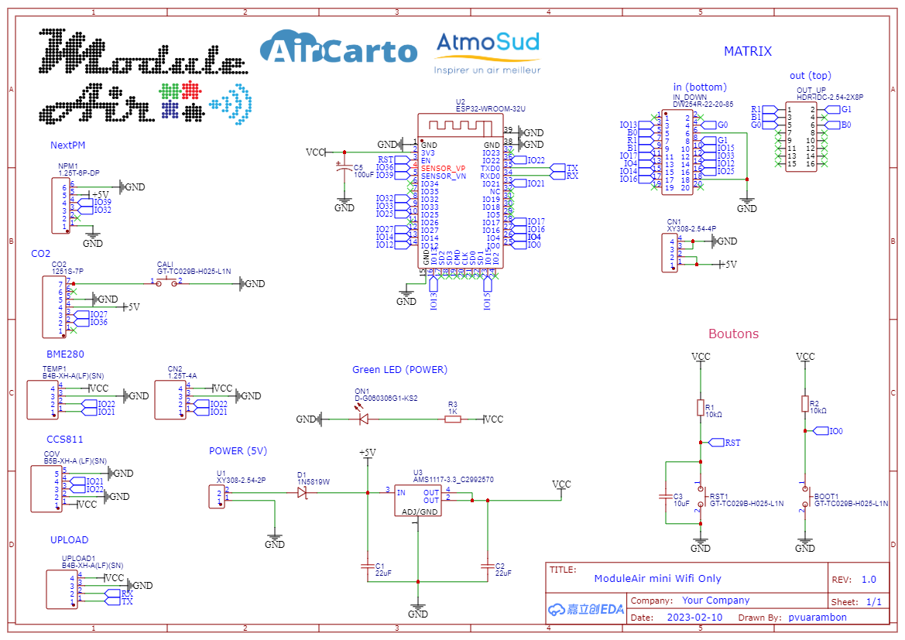{ width="100%" }

??? note "Vue 3D du PCB"

    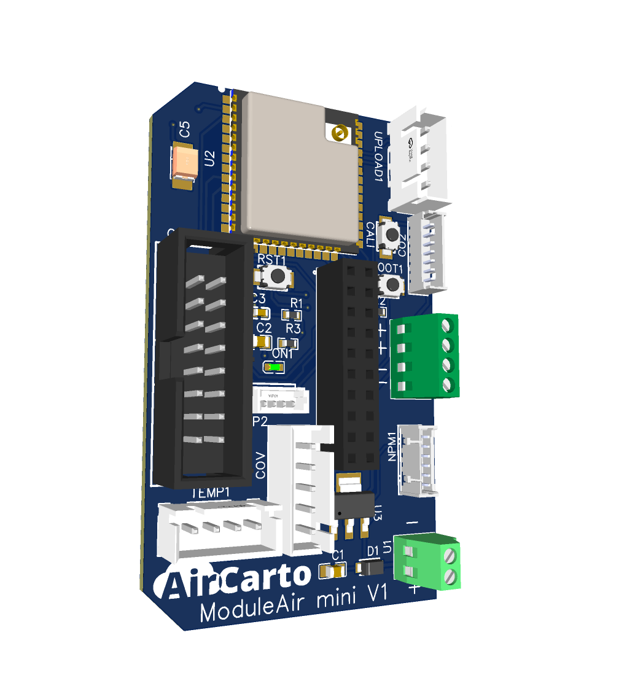{ width="500" }

??? note "Brochage (pinout) ESP32"

    | Bus | Capteur / fonction | GPIO |
    |-----|--------------------|------|
    | UART1 (Modbus RTU) | NextPM | RX `IO39` · TX `IO32` |
    | UART2 | Capteur CO₂ (S88 ou MH-Z19C) | RX `IO36` · TX `IO27` |
    | I²C | BME280 (sonde optionnelle) | SDA `IO21` · SCL `IO22` |
    | HSPI + contrôle | Écran HUB75 64×32 | LAT `IO25`, A `IO17`, B `IO33`, C `IO4`, D `IO12`, E `IO15`, OE `IO16` |

    Alimentation : régulateur **AMS1117-3.3** (5 V → 3.3 V), diode Schottky de protection. Boutons : `BOOT`, `RST` (reset), `CALI` (calibration). LED verte d'alimentation.

## Firmware

Le firmware du ModuleAir est **open source** et développé par AirCarto.

[:material-github: Dépôt GitHub AirCarto](https://github.com/aircarto){ .md-button }

La version du firmware est affichée sur le dashboard (carte **Système**) et au démarrage sur le port série. Le projet suit le [Semantic Versioning](https://semver.org/) (`MAJEUR.MINEUR.CORRECTIF`).

!!! info "Évolutions futures"
    Une intégration **LoRaWAN** (transmission longue portée sans WiFi) est à l'étude pour une future révision du PCB. Elle n'est pas disponible sur la version actuelle du ModuleAir WiFi.
