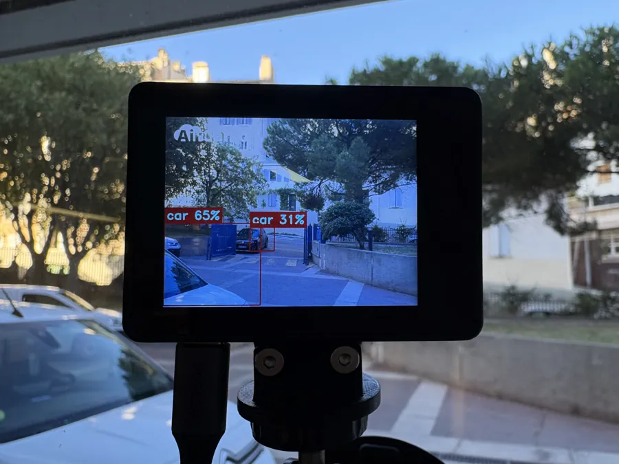
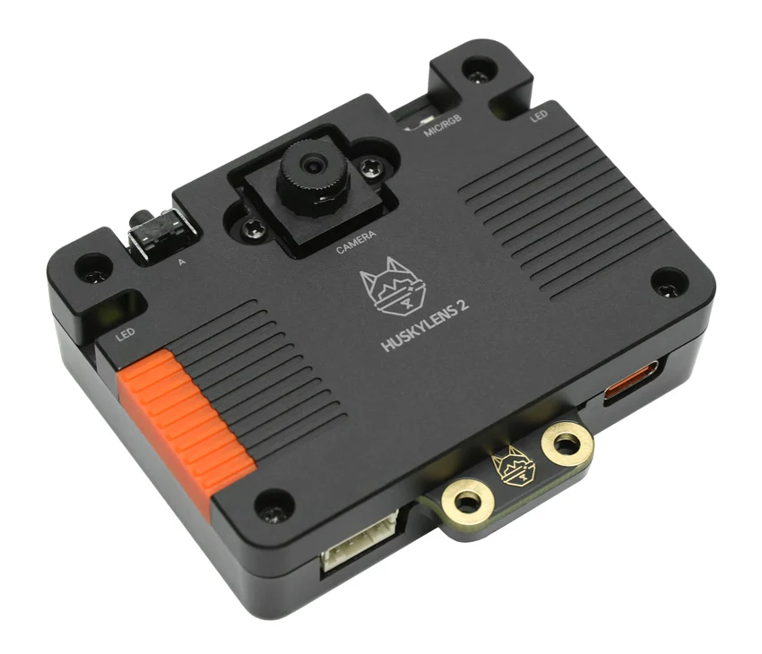
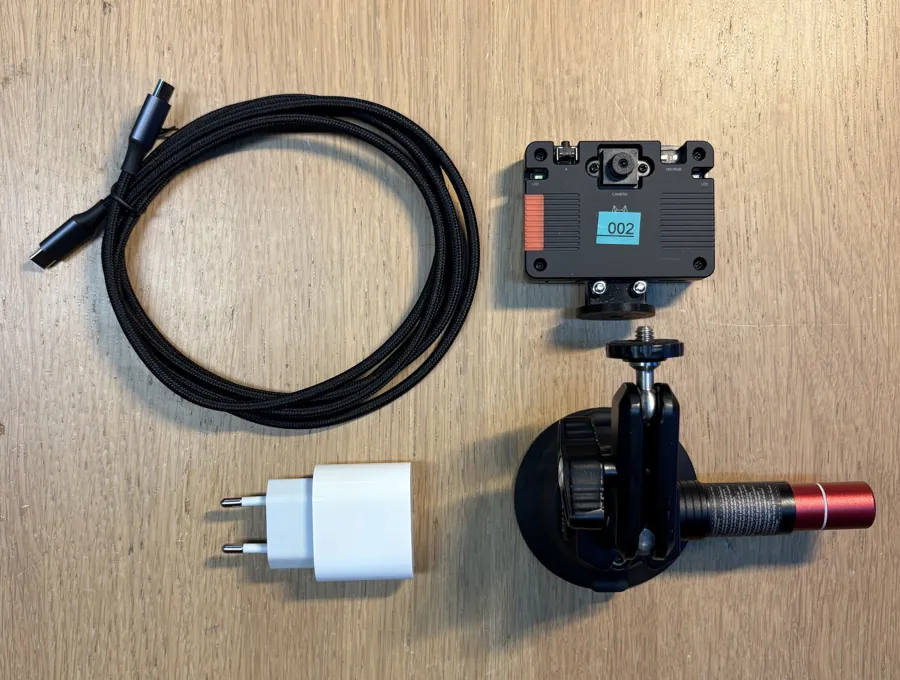
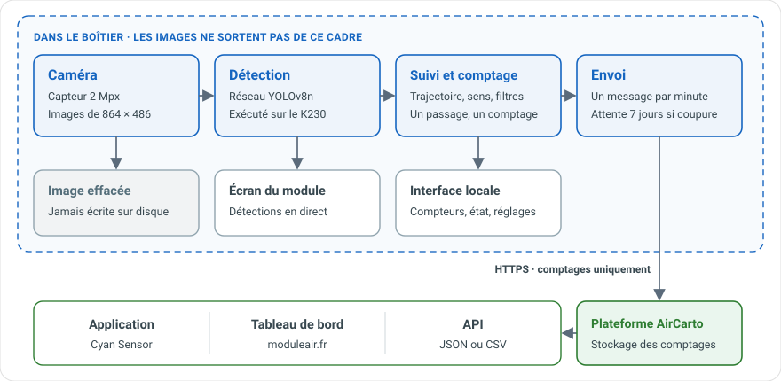
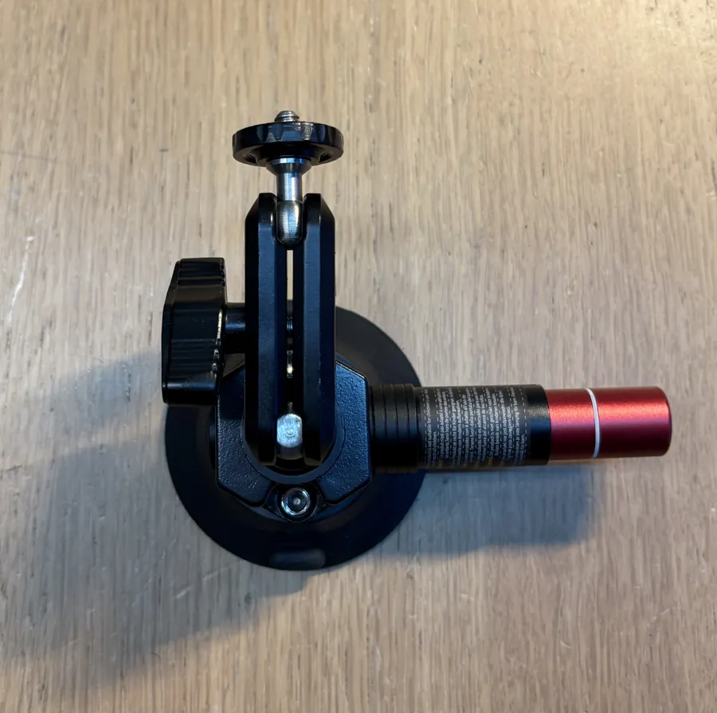
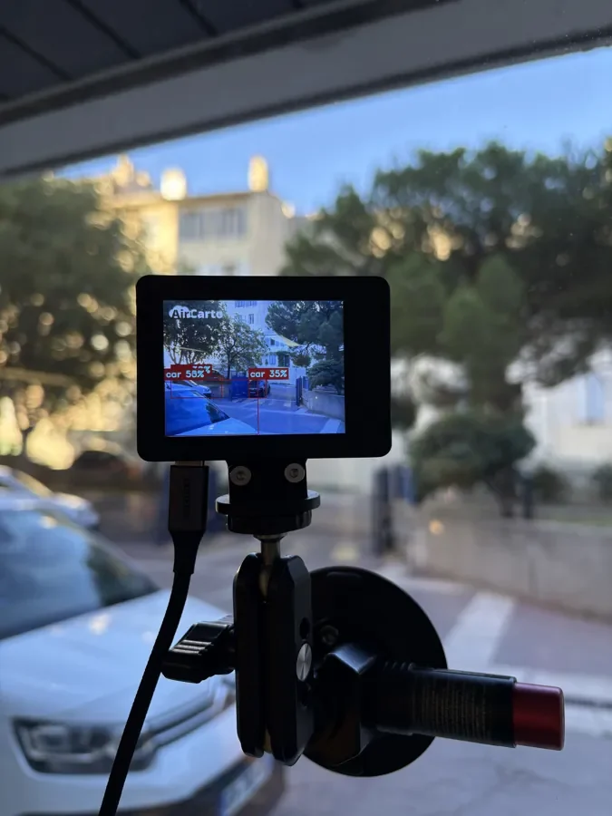
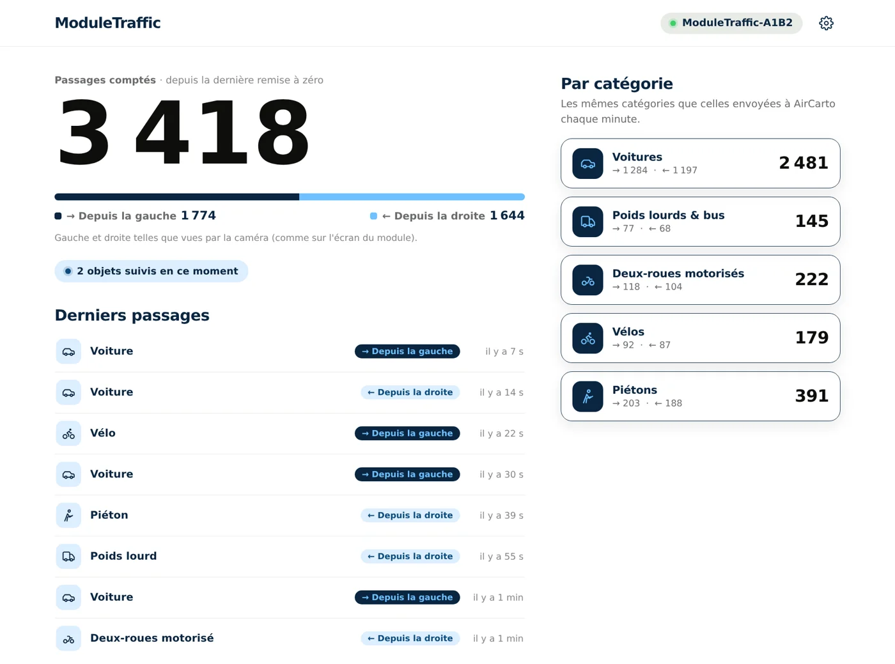
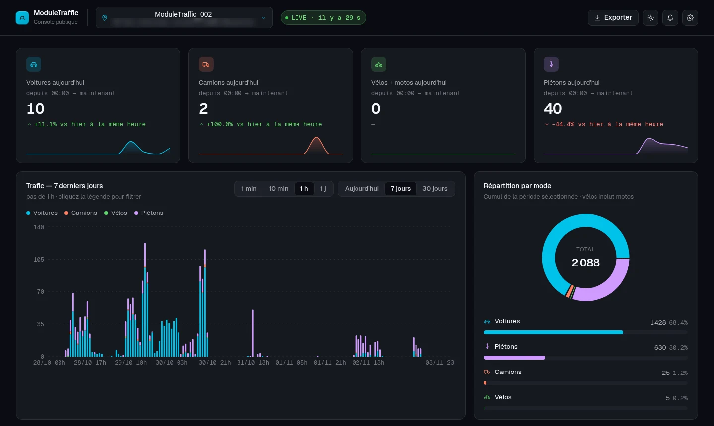
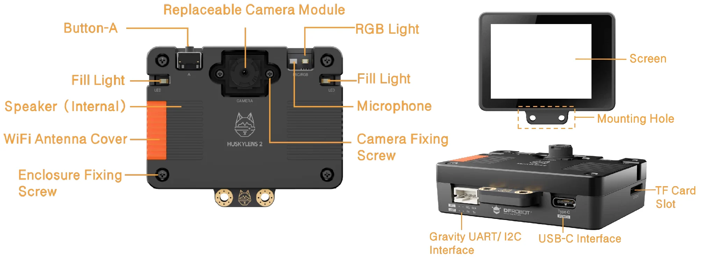

# ModuleTraffic

{ width="100%" }

## Présentation

Le **ModuleTraffic** est une caméra de comptage du trafic. Posée à l'intérieur, derrière une vitre, elle compte en continu les **voitures**, **poids lourds**, **motos**, **vélos** et **piétons** qui passent dans la rue, avec leur **sens de circulation**.

L'analyse d'image se fait **dans le boîtier**. Chaque image est traitée en mémoire puis effacée : aucune image n'est enregistrée ni envoyée. Le boîtier transmet seulement, une fois par minute, le nombre de passages par catégorie.

Page de présentation : [aircarto.fr/module-trafic](https://aircarto.fr/module-trafic/)

## Caractéristiques techniques

| | |
|---|---|
| Caméra | HuskyLens 2 (DFRobot), capteur d'image 2 Mpx |
| Processeur | Canaan K230 avec accélérateur d'intelligence artificielle |
| Analyse | Détection d'objets YOLOv8n, dans le boîtier, à environ 15 images par seconde |
| Catégories | Voitures, poids lourds (camions, bus), motos, vélos, piétons ; sens de circulation |
| Transmission | Un message de comptage par minute (HTTPS) ; mise en attente dans le boîtier en cas de coupure, jusqu'à 7 jours |
| Connectivité | WiFi, configuré depuis un téléphone |
| Alimentation | USB-C 5 V (adaptateur secteur et câble fournis) |
| Écran | Écran couleur intégré : détections en direct, état du WiFi |
| Installation | Intérieur uniquement, derrière une vitre (boîtier non étanche) |

### La caméra HuskyLens 2

{ width="420" }  
<small>HuskyLens 2, photo [DFRobot](https://www.dfrobot.com/product-2995.html)</small>

Le module est construit autour de la **HuskyLens 2** de DFRobot, une caméra équipée d'un processeur capable d'exécuter un réseau de neurones. Elle fonctionne avec un firmware développé par AirCarto et adapté au comptage du trafic : à l'allumage, le module démarre directement sur l'analyse de la rue.

### Plateforme

| | |
|---|---|
| Référence | DFRobot HuskyLens 2, SEN0638 |
| Processeur | Canaan **K230**, deux cœurs RISC-V T-Head C908 (1,6 GHz et 0,8 GHz) |
| Accélérateur IA | KPU intégré au K230, 6 TOPS annoncés par DFRobot |
| Mémoire vive | 1 Go LPDDR4 |
| Stockage | 8 Go eMMC |
| Système | ModuleTraffic OS, basé sur Linux 6.6 (voir [Firmware](#firmware)) |

### Capteur d'image

| | |
|---|---|
| Capteur | GalaxyCore **GC2093**, 2 Mpx, format 1/2,9 pouce |
| Résolution maximale | 1920 × 1080, jusqu'à 60 images par seconde |
| Liaison | MIPI CSI vers le K230 |
| Traitement d'image | ISP du K230 : exposition, balance des blancs, gamma |
| Objectif | Module caméra remplaçable |
| Image analysée | 864 × 486 pixels, réduite à 320 × 320 pour le réseau de neurones |

### Écran

| | |
|---|---|
| Dalle | 2,4 pouces IPS, 640 × 480 pixels |
| Liaison | MIPI DSI, 2 voies |
| Tactile | Hynitron CST328, présent mais non utilisé : le module ne propose aucun menu à l'écran |

### Connectivité

La radio est une puce **AIC8800D80** qui réunit le WiFi et le Bluetooth LE. Le Bluetooth ne sert qu'à la configuration du WiFi.

### Boîtier et connecteurs

Le module mesure **70 × 58 × 19 mm** pour **90 g**, hors support. Son boîtier n'est pas étanche.

| Élément | Usage sur le ModuleTraffic |
|---------|----------------------------|
| Port USB-C | Alimentation, et écriture du système en atelier |
| Bouton A | Allume ou éteint l'écran |
| Haut-parleur | Son de démarrage |
| Microphone | Non utilisé |
| LED d'éclairage et LED RGB | Non utilisées |
| Connecteur Gravity (I²C / UART) | Non utilisé |
| Lecteur de carte TF | Non utilisé |

### Alimentation et consommation

Le module s'alimente en **USB-C 5 V**. DFRobot annonce une consommation de **1,5 à 3 W**, soit **13 à 26 kWh par an** pour un fonctionnement continu.

### Contenu de la boîte

{ width="500" }

- le module ;
- un support ventouse à rotule ;
- un mini-trépied ;
- un câble USB-C et un adaptateur secteur.

## Comment ça marche

{ width="100%" }

### Détecter les usagers de la route

La caméra produit des images de 864 × 486 pixels. Chacune est réduite à 320 × 320 pixels et analysée par **YOLOv8n**, un réseau de neurones de détection d'objets exécuté sur l'accélérateur du K230. Il renvoie, pour chaque objet reconnu, un rectangle, une catégorie et un score de confiance.

Le module ne retient que six catégories : personne, vélo, voiture, moto, bus et camion. Une détection doit atteindre un score de **30 %** pour être prise en compte. Les autres objets connus du réseau, comme une chaise ou un téléviseur, sont ignorés dès cette étape : ils ne s'affichent pas et ne peuvent pas masquer un véhicule.

??? info "Le modèle de détection en détail"

    | | |
    |---|---|
    | Réseau | YOLOv8n, entraîné sur les 80 catégories du jeu de données COCO |
    | Fichier | `yolov8n_320.kmodel`, 3,6 Mo, compilé pour le K230 avec nncase |
    | Entrée | Image de 320 × 320 pixels, 3 canaux |
    | Sortie | 2 100 propositions de 84 valeurs (position et score par catégorie) |
    | Seuil de confiance | 0,30 |
    | Seuil de recouvrement (NMS) | 0,20 |

    Le modèle en 640 × 640 pixels est plus précis, mais environ trois fois plus lent. Le 320 × 320 permet de suivre les objets rapides à environ 15 images par seconde.

### Suivre chaque objet

Une détection isolée ne suffit pas à compter un passage : la même voiture apparaît sur des dizaines d'images successives. Le module relie donc les détections d'une image à l'autre pour reconstituer une **trajectoire** par objet. Quand un objet n'est plus détecté pendant 25 images (moins de 2 secondes), sa trajectoire est considérée comme terminée.

### Compter une seule fois

Le comptage a lieu **à la fin de la trajectoire**. Elle compte pour un passage si elle remplit trois conditions :

- l'objet a été vu sur un nombre minimal d'images ;
- il s'est suffisamment déplacé ;
- son mouvement est cohérent, c'est-à-dire qu'il va quelque part au lieu d'osciller sur place.

Ce mode de calcul ne nécessite aucune ligne à tracer dans l'image : il fonctionne même si la route n'occupe qu'une petite partie du champ.

Les **objets immobiles**, comme une voiture garée ou une fausse détection sur une façade, sont écartés : leur zone est ignorée pendant deux minutes.

??? info "Seuils de comptage par défaut"

    | Réglage | Véhicules | Piétons |
    |---------|-----------|---------|
    | Images minimales | 5 | 8 |
    | Déplacement minimal | 60 pixels | 40 pixels |
    | Cohérence minimale (déplacement net ÷ distance parcourue) | 0,55 | 0,50 |
    | Objet considéré immobile après | 60 images | 300 images |
    | Si son centre a bougé de moins de | 25 pixels | 20 pixels |

    Les piétons ont leurs propres seuils : plus lents et plus petits dans l'image, ils se déplacent de moins de pixels et peuvent marquer une pause sans être une fausse détection.

### Déterminer le sens de circulation

Le module observe les premières trajectoires pour trouver l'**axe de circulation** dans l'image, horizontal ou vertical. Le sens d'un passage est celui de son déplacement sur cet axe. Il s'affiche comme la caméra le voit :

| Axe | Sens `in` | Sens `out` |
|-----|-----------|------------|
| `x` (horizontal) | Depuis la gauche | Depuis la droite |
| `y` (vertical) | Depuis le haut | Depuis le bas |

## Première mise en service

### 1. Choisir l'emplacement

- Derrière une **vitre propre**, avec une **vue dégagée** sur la chaussée : pas d'arbre, de poteau ou de véhicule garé en permanence dans le champ.
- Visez de préférence un tronçon où les véhicules **traversent l'image**, plutôt qu'un carrefour où ils s'arrêtent.
- L'endroit doit capter le **WiFi** du bâtiment.

{ width="400" }

Fixez le module sur la vitre avec le support ventouse, ou posez-le sur le rebord avec le mini-trépied.

### 2. Brancher le module

Branchez le module sur le secteur avec le câble USB-C et l'adaptateur fournis. Il démarre tout seul.

S'il ne connaît pas encore votre WiFi, son écran affiche au bout d'une trentaine de secondes **« Configuration Bluetooth »** : il attend qu'on lui indique un réseau.

!!! warning "Ne pas maintenir le bouton A au branchement"
    Le bouton A maintenu pendant le branchement fait démarrer le module en mode d'écriture du système, écran éteint. Si cela arrive, débranchez puis rebranchez le module sans toucher au bouton.

### 3. Connecter le module au WiFi avec l'application Cyan Sensor

La configuration se fait avec l'application gratuite [Cyan Sensor](../cyan-sensor/index.md) :

[:material-apple: Télécharger sur l'App Store](https://apps.apple.com/app/cyansensor/id6757758735){ .md-button } [:material-google-play: Disponible sur Google Play](https://play.google.com/store/apps/details?id=fr.aircarto.app){ .md-button }

1. Ouvrez l'application. Vous pouvez créer un compte ou **continuer en invité**.
2. Activez le **Bluetooth** du téléphone (et la **localisation** sur Android, demandée par Android pour rechercher des appareils Bluetooth). Restez à côté du module.
3. Touchez **+**, puis **Ajouter mon capteur WiFi** : la recherche démarre seule.
4. Le module apparaît sous **CAPTEURS DÉTECTÉS**, sous le nom **ModuleTraffic-…**. Touchez-le.
5. L'application affiche les réseaux WiFi que voit le module. Choisissez le vôtre, tapez le **mot de passe**, puis **Connecter**.
6. Comptez **jusqu'à une minute**. L'écran du module affiche **« WiFi connecté »**, puis le comptage démarre.

!!! warning "Ne pas débrancher pendant la configuration"
    Tant que l'application affiche « Configuration en cours… », le module se connecte au WiFi : ne le débranchez pas.

!!! success "Le mot de passe WiFi reste chez vous"
    Le mot de passe est transmis directement au module par Bluetooth. Il n'est ni conservé dans l'application, ni envoyé aux serveurs AirCarto.

!!! warning "Réseaux non supportés"
    Le module se connecte à un réseau WiFi ouvert ou protégé par un mot de passe. Les réseaux à **portail captif** ou à **identifiant et mot de passe** (université, hôtel, certains bureaux) ne sont pas supportés.

### Sans l'application : la page de configuration

Le module crée aussi son propre réseau WiFi, dont le nom (**ModuleTraffic-…**) s'affiche sur son écran.

1. Connectez un téléphone ou un ordinateur à ce réseau (il est ouvert, sans mot de passe).
2. Ouvrez la page **http://192.168.4.1** dans le navigateur.
3. Choisissez votre réseau WiFi et tapez son mot de passe.

### 4. Vérifier le cadrage

{ width="320" }

L'écran du module affiche les détections en direct : vérifiez que la rue est bien dans le champ et que les passages sont repérés. Une fois orienté, **ne déplacez plus le module**, pour que les comptages restent comparables dans le temps.

Chaque objet reconnu est entouré d'un cadre, avec son nom en anglais (`car`, `person`…) et son score de confiance.

### Si le WiFi change

Si la box change ou si le mot de passe WiFi est modifié, le module ne trouve plus son réseau et réaffiche **« Configuration Bluetooth »** à son démarrage. Il suffit de refaire l'étape 3.

## L'écran et le bouton

Au démarrage, l'écran affiche successivement :

| Écran | Signification |
|-------|---------------|
| **Logo AirCarto** | Le module démarre |
| **Recherche du WiFi** | Il tente de rejoindre son réseau enregistré |
| **WiFi connecté** | Le réseau est trouvé ; le comptage démarre |
| **Configuration Bluetooth** | Aucun réseau joignable : le module attend une configuration |
| **Image de la rue** | Fonctionnement normal, avec les détections en direct |

Un appui sur le **bouton A** éteint l'écran ; un second appui le rallume. Écran éteint, le module continue de compter et d'envoyer ses données.

## L'interface locale

{ width="100%" }  
<small>Aperçu généré à partir de la page du module, avec des données d'exemple.</small>

Une fois le module connecté au WiFi, un ordinateur ou un téléphone **sur le même réseau** peut ouvrir sa page à l'adresse :

```
http://moduletraffic.local/
```

| Zone | Contenu |
|------|---------|
| **Passages comptés** | Total depuis la dernière remise à zéro, répartition par sens, objets suivis en ce moment |
| **Derniers passages** | Les huit derniers passages, avec catégorie, sens et heure |
| **Par catégorie** | Compteurs des cinq catégories, avec le détail par sens |
| **Connexion et envoi** | Réseau, signal, adresse IP, état de l'envoi, messages en attente |
| **Services** | État de la caméra, du comptage, de l'envoi et de l'accès de maintenance |
| **Système et mise à jour** | Identifiant (token), version, recherche d'une mise à jour |
| **Logs en direct** | Journaux des programmes du boîtier |

La roue crantée, en haut à droite, ouvre les réglages : **changer de réseau WiFi**, **remettre les compteurs à zéro** et **redémarrer**. La remise à zéro n'efface que les compteurs affichés sur cette page, pas les données déjà envoyées. Un redémarrage interrompt le comptage pendant 30 à 40 secondes.

Cette page n'affiche aucune image de la caméra. Elle n'est pas protégée par un mot de passe : toute personne connectée au même réseau peut l'ouvrir.

!!! tip "Si l'adresse ne répond pas"
    Le nom `moduletraffic.local` n'est visible que sur le réseau local du module, et il est identique pour tous les modules. Sur un réseau segmenté, ou avec plusieurs modules, utilisez l'adresse IP du module, visible dans la liste des appareils de votre box.

## Consulter les comptages

Les comptages arrivent toutes les minutes sur la plateforme AirCarto. On peut les consulter dans l'application, sur le tableau de bord en ligne, ou les récupérer par l'API.

### Dans l'application Cyan Sensor

Après la configuration WiFi, le module est **ajouté au tableau de bord** de l'application. Sa fiche montre :

- les passages **d'aujourd'hui**, **d'hier**, **des 7 derniers jours** et **des 30 derniers jours** ;
- la répartition par catégorie (voitures, poids lourds, motos, vélos, piétons) ;
- l'état de connexion et la qualité du signal WiFi.

Pour l'ajouter sur un **autre téléphone** (ou si le WiFi a été configuré sans l'application) : **+** → **Ajouter un capteur déjà connecté** → **ModuleTraffic**, puis saisissez l'identifiant inscrit sur l'étiquette du module (par exemple `ModuleTraffic_002`).

### Sur ordinateur : le tableau de bord ModuleTraffic

Le tableau de bord en ligne [moduleair.fr/monModuleTraffic](https://moduleair.fr/monModuleTraffic/) affiche les comptages sous forme de graphiques, avec l'historique.

{ width="100%" }

On y trouve :

- les passages **du jour** par catégorie, comparés à la veille à la même heure ;
- le **trafic** du jour, des 7 ou des 30 derniers jours, par pas de 1 min, 10 min, 1 h ou 1 jour ;
- la **répartition par mode** sur la période choisie ;
- le **profil journalier moyen** (heures de pointe du matin et du soir, heure creuse, volume moyen par jour) ;
- l'**activité minute par minute** des 30 dernières minutes ;
- la **localisation** du module, avec le **tronçon de rue** sur lequel il compte les passages, surligné sur la carte. Par défaut, c'est la rue la plus proche du module (environ 100 m de part et d'autre) ; on peut le tracer plus précisément avec **Changer** → **Tracer à la main** (deux clics, début puis fin : le tracé suit la rue), avec le token du module.

Pour ouvrir directement la page de son module, ajoutez son identifiant à l'adresse :

```
https://moduleair.fr/monModuleTraffic/?capteurID=ModuleTraffic_002
```

### Par l'API

Les comptages se récupèrent au format **JSON** ou **CSV**, sans authentification :

```
https://api.aircarto.fr/capteurs/dataModuleTraffic.php?capteurID=ModuleTraffic_002&start=-24h&freq=1h&format=CSV
```

| Paramètre | Rôle | Exemple |
|-----------|------|---------|
| `capteurID` | Identifiant du module | `ModuleTraffic_002` |
| `start` | Début de la période | `-24h` |
| `end` | Fin de la période (facultatif) | `now()` |
| `freq` | Pas d'agrégation (facultatif) ; sans ce paramètre, les messages bruts | `1h` |
| `format` | Format de sortie | `JSON` ou `CSV` |

Avec `freq`, les comptages sont additionnés sur chaque pas. Les champs `cars_in`, `cars_out`, etc. donnent le détail par sens, et `direction_axis` indique l'axe utilisé. Ces champs valent `null` pour les données envoyées par un logiciel antérieur à la version 1.1.0.

Documentation complète : [api.aircarto.fr](https://api.aircarto.fr/scalar.html)

## Mise à jour du logiciel

Le logiciel du module se met à jour **à distance** (*Over-The-Air*), depuis l'[interface locale](#linterface-locale) :

1. Ouvrez **Système et mise à jour** et touchez **Rechercher une mise à jour**.
2. Si une version plus récente existe, lancez son installation.
3. Le module télécharge la version, l'installe et redémarre.

La mise à jour remplace l'application : comptage, envoi, interface, configuration WiFi, détection et modèle d'IA. Les réglages et les compteurs sont conservés.

Chaque version est **signée** par AirCarto, et le module refuse un fichier modifié ou non signé. Après le redémarrage, la nouvelle version vérifie pendant environ 3 minutes que la caméra, le comptage, l'envoi et l'interface fonctionnent. Sinon, le module **revient seul à la version précédente**, au bout de 10 minutes sans validation ou après 2 démarrages ratés.

!!! warning "Pendant la mise à jour"
    Ne débranchez pas le module.

## Ce que mesure le module, et ses limites

- Le comptage donne une **tendance fiable sur la durée** ; ce n'est pas un comptage réglementaire.
- La précision est meilleure pour les voitures que pour les vélos, motos et piétons ; la répartition par catégorie est indicative.
- La caméra est optique, sans infrarouge : la nuit, le comptage dépend de l'**éclairage public**.
- Le module **ne mesure pas la vitesse**.
- La précision dépend surtout de l'**emplacement** (vue dégagée, distance à la chaussée, reflets sur la vitre). AirCarto peut vous aider à choisir l'emplacement et à vérifier les volumes des premiers jours.

## Vie privée

- Aucune image n'est enregistrée, transmise ou consultable à distance, ni par vous, ni par AirCarto. Les images ne se voient que sur l'écran du module, sur place, pour régler le cadrage.
- Aucune reconnaissance de visage ni lecture de plaque d'immatriculation.
- Seuls des comptages par minute et par catégorie quittent le boîtier.
- Le module dispose d'un accès de maintenance réservé à AirCarto, par un réseau privé chiffré, pour le dépannage. Son logiciel ne propose aucun flux ni aucune capture d'image.

Le module suit la position de la CNIL sur les caméras « augmentées » utilisées à des fins statistiques ([position du 19 juillet 2022](https://www.cnil.fr/fr/deploiement-de-cameras-augmentees-dans-les-espaces-publics-la-cnil-publie-sa-position)). Il suffit d'**informer les riverains**, par exemple avec un autocollant renvoyant vers la [page de présentation](https://aircarto.fr/module-trafic/). Pour une collectivité, le dispositif s'inscrit au registre des traitements.

## Dépannage

| Symptôme | Cause probable | Que faire |
|----------|----------------|-----------|
| L'écran est noir, le module compte toujours | L'écran a été éteint avec le bouton A | Appuyer une fois sur le bouton A |
| L'écran reste noir après le branchement | Le bouton A était maintenu au branchement, ou le câble ne fournit pas assez de courant | Débrancher, rebrancher sans toucher au bouton, avec le câble et l'adaptateur fournis |
| « Configuration Bluetooth » s'affiche | Le module ne trouve pas son réseau WiFi | Refaire l'[étape 3](#3-connecter-le-module-au-wifi-avec-lapplication-cyan-sensor) |
| Le module n'apparaît pas dans l'application | Il est déjà connecté au WiFi, ou le téléphone est trop loin | Il ne s'annonce en Bluetooth que sans WiFi. S'il est déjà connecté, l'[ajouter avec son identifiant](#dans-lapplication-cyan-sensor) |
| Les compteurs restent à zéro | Cadrage inadapté, ou mouvement trop faible dans l'image | Vérifier sur l'écran que les véhicules sont encadrés et traversent bien l'image |
| L'interface indique « Refusé par le serveur » | Le module n'est pas déclaré chez AirCarto | Écrire à AirCarto en indiquant le token du module |
| L'interface indique « En échec » | Pas d'accès internet, ou serveur injoignable | Vérifier la connexion : les comptages sont conservés 7 jours et renvoyés ensuite |
| Le sens de passage n'apparaît pas | Logiciel antérieur à la version 1.1.0 | [Mettre à jour le module](#mise-a-jour-du-logiciel) |

## Préparation d'un module en atelier

!!! info "Réservé à l'équipe AirCarto"
    Cette étape est réalisée avant la livraison. Elle efface entièrement le module : un utilisateur n'a jamais à la faire.

Pour préparer un module, on écrit sur sa mémoire eMMC l'**image ModuleTraffic OS**, le firmware complet d'AirCarto, de 7,6 Go.

### Ce que contient l'image

| Partie | Contenu | Se met à jour par |
|--------|---------|-------------------|
| **Système** | Linux, pilotes de la caméra et de l'accélérateur | Nouvelle image |
| **Démarrage** | Lancement du module et retour arrière automatique | Nouvelle image |
| **Application** | Détection, comptage, envoi, interface, configuration WiFi, modèle d'IA | [Mise à jour à distance](#mise-a-jour-du-logiciel) |
| **Maintenance** | Client d'accès à distance et clé de vérification des mises à jour | Nouvelle image |

L'image ne contient ni réseau WiFi, ni compteurs, ni identité propre à un module. Le token du module est son adresse MAC WiFi ; les clés de connexion sont créées au premier démarrage.

### Flasher un module

Le flash se lance depuis la page **Flash ModuleTraffic** de l'administration AirCarto, accessible uniquement depuis le réseau local, avec le module branché sur le serveur.

1. Cliquez sur **Lancer le flash**. La version la plus récente est sélectionnée par défaut.
2. **Maintenez le bouton A** et branchez le module sur un **port USB arrière** du serveur, avec un câble USB-C de données. La page l'attend pendant 10 minutes.
3. Attendez la fin de l'écriture, environ **5 min 30**, sans toucher au module.
4. **Débranchez, puis rebranchez le module sans le bouton A.** La page confirme qu'il a démarré et affiche son **token**.
5. Si le module n'est pas encore déclaré, cliquez sur **Ajouter dans gestion** : le formulaire s'ouvre prérempli. Sans cette déclaration, le serveur refuse ses comptages.

Au premier démarrage, le module attend sa configuration WiFi, comme décrit dans la [mise en service](#3-connecter-le-module-au-wifi-avec-lapplication-cyan-sensor).

### Versions

| Version | Date | Changements |
|---------|------|-------------|
| **1.1.0** | 30/09/2026 | Envoi du sens de passage ; détection limitée aux usagers de la route ; écran « Configuration Bluetooth » |
| **1.0.0** | 29/09/2026 | Première version de production : mises à jour à distance signées, configuration WiFi par Bluetooth |

## Documentation matérielle

??? note "Emplacement des connecteurs"

    { width="100%" }  
    <small>Schéma [DFRobot](https://wiki.dfrobot.com/sen0638/)</small>

??? note "Liaisons internes du K230"

    | Bus | Périphérique |
    |-----|--------------|
    | MIPI CSI 0 | Capteur d'image |
    | MIPI DSI, 2 voies | Écran |
    | I²C 1, adresse `0x1a` | Tactile CST328 |
    | SDHCI 0 | Mémoire eMMC |
    | SDHCI 1 | Lecteur de carte TF |
    | USB OTG 0 | Port USB-C |
    | USB OTG 1 | Puce radio AIC8800D80 |
    | UART 0, 115 200 bauds | Console système |

??? note "Broches GPIO utilisées"

    | Ligne | Rôle |
    |-------|------|
    | `gpiochip0` ligne 1 | Bouton A, actif à l'état bas |
    | `gpiochip0` ligne 16 | Activation de l'écran |
    | `gpiochip0` ligne 22 | Reset de la dalle |
    | `gpiochip0` ligne 23 | Interruption du tactile |

## Firmware

Le firmware du ModuleTraffic est développé par AirCarto et adapté au comptage du trafic. La version installée s'affiche dans l'[interface locale](#linterface-locale), rubrique **Système et mise à jour**.

### Architecture logicielle

| Couche | Composants |
|--------|------------|
| Application | Détection en C++, services en Python |
| Modèle | YOLOv8n au format `.kmodel` |
| Bibliothèques | OpenCV, nncase, Mosquitto, Flask, wpa_supplicant |
| Caméra et écran | Pilotes vvcam, serveur ISP, DRM |
| Système | Linux 6.6.36 riscv64, BusyBox, glibc |
| Amorçage | Boot ROM, OpenSBI, U-Boot |

La mémoire eMMC contient deux partitions ext4 : le **démarrage** (80 Mo : noyau, device tree, logo) et le **système** (7 Go).

### Les programmes du boîtier

| Programme | Rôle |
|-----------|------|
| `aircarto_app` (C++) | Caméra, détection sur l'accélérateur, affichage à l'écran |
| `vehicle_counter.py` | Suivi des trajectoires, comptage et sens de passage |
| `aircarto_uploader.py` | Calcul par minute, journal d'envoi, transmission |
| `huskylens_web.py` | Interface locale, sur le port 80 |
| `screen_toggle.py` | Allumage et extinction de l'écran par le bouton A |
| `wifi_setup/` | Configuration WiFi par Bluetooth (Improv) et par page web |
| `ota.py` | Mise à jour du logiciel et validation d'une nouvelle version |

### Séquence de démarrage

1. La ROM du K230 lance OpenSBI puis U-Boot, qui chargent le noyau Linux depuis la partition de démarrage.
2. Le script de démarrage charge les pilotes de la caméra, lance le serveur ISP, active l'écran et la radio, puis démarre le bus de messages local.
3. Il vérifie si une version en cours de validation doit être annulée.
4. La caméra et l'écran démarrent. Sans réseau WiFi joignable, le module passe en configuration.
5. Une fois le réseau disponible, les services de comptage, d'envoi, d'interface et de bouton démarrent.
6. Le client de maintenance rejoint le réseau privé d'AirCarto.

### Organisation sur le module

```
/opt/aircarto/
├── current    → releases/1.1.0     version active
├── previous   → releases/1.0.0     version de repli
├── releases/<version>/             programmes et modèle de chaque version
├── ota/                            état des mises à jour, clé publique
└── counter_config.json             réglages du comptage
/opt/user/mtp/                      compteurs et journal d'envoi
```

Le fichier `counter_config.json` contient les [seuils de comptage](#compter-une-seule-fois), l'axe de circulation (`auto`, `x` ou `y`) et se recharge sans redémarrer. Ni les réglages ni les compteurs ne sont modifiés par une mise à jour.

### Le paquet de mise à jour

Une version est un fichier unique qui contient :

| Fichier | Contenu |
|---------|---------|
| `manifest.json` | Produit, version, empreinte SHA-256 du contenu, version minimale du démarrage |
| `manifest.sig` | Signature **Ed25519** du manifeste |
| `payload.tar.gz` | Programmes, modèle et logo de la version |

La clé publique est stockée sur chaque module. La mise à jour remplace l'application uniquement : le module n'ayant qu'une partition système, un changement de Linux passe par une [nouvelle image](#preparation-dun-module-en-atelier).

??? info "Le bus de détection (MQTT)"

    `aircarto_app` publie chaque image analysée sur le topic `usr/result/2` d'un serveur Mosquitto interne, qui n'écoute que sur le boîtier. `vehicle_counter.py` s'y abonne.

    ```json
    {
      "2": [
        {
          "algo_id": 2,
          "bbox": { "x": 412, "y": 188, "width": 96, "height": 64 },
          "class_id": 2,
          "class_label": "",
          "conf": 0.6531,
          "content": "",
          "extended": [],
          "learned_id": 0,
          "name": "car"
        }
      ]
    }
    ```

??? info "L'API HTTP locale (avancé)"

    L'interface locale s'appuie sur une API accessible sur le réseau du module, sans authentification.

    | Route | Rôle |
    |-------|------|
    | `GET /api/stats` | Compteurs par catégorie et par sens, derniers passages |
    | `GET /api/status` | Identité, version, réseau, état des services et de l'envoi |
    | `GET /api/logs?source=…&since=…` | Journaux, à partir d'une position donnée |
    | `GET /api/ota` | État de la mise à jour |
    | `POST /api/ota/check` · `POST /api/ota/install` | Rechercher ou installer une mise à jour |
    | `GET /api/wifi/scan` · `POST /api/wifi/connect` | Lister les réseaux, changer de réseau |
    | `POST /api/reset` | Remettre les compteurs à zéro |
    | `POST /api/reboot` | Redémarrer |

    Sources de journaux : `uploader`, `app`, `web`, `counter`, `trajectories`, `wifi_setup`, `ble`.

??? info "La configuration WiFi (Improv et page web)"

    Quand le module n'a pas de réseau, il lance en même temps une annonce Bluetooth LE nommée `ModuleTraffic-<token>` et un point d'accès WiFi ouvert nommé `ModuleTraffic-<4 premiers caractères du token>`, à l'adresse `192.168.4.1`. Les deux s'arrêtent une fois la connexion établie.

    Le service Bluetooth suit le protocole **[Improv Wi-Fi](https://www.improv-wifi.com/)**, dans la variante commune aux capteurs AirCarto :

    | Caractéristique | UUID | Rôle |
    |-----------------|------|------|
    | Service | `00467768-6228-2272-4663-277478268000` | |
    | État | `…8001` | Prêt, connexion en cours, connecté |
    | Erreur | `…8002` | Commande invalide, inconnue, connexion impossible |
    | Commande | `…8003` | Envoi du réseau et du mot de passe |
    | Résultat | `…8004` | Adresse locale et token du module |
    | Capacités | `…8005` | Identification par clignotement de l'écran |
    | Réseaux WiFi | `…8010` | Liste des réseaux vus par le module |

    L'adresse Bluetooth de chaque module est dérivée de son adresse MAC WiFi, comme sur le ModuleAir.

??? info "Compiler et publier une version"

    Le programme `aircarto_app` se compile en C++17 avec CMake, en compilation croisée pour RISC-V, à partir du [SDK Linux K230](https://github.com/kendryte/k230_linux_sdk) et de sa chaîne d'outils Xuantie. Il reprend les exemples de détection de Canaan, sous licence BSD-2-Clause.

    La publication d'une version se fait en trois temps : numéro de version dans le fichier `VERSION`, création du paquet signé par `ota/make_release.py`, puis envoi sur le serveur de mises à jour par `ota/publish.py`. `images/make_golden.py` fabrique ensuite l'image complète à flasher.

## Besoin d'aide ?

Écrivez à [contact@aircarto.fr](mailto:contact@aircarto.fr).
