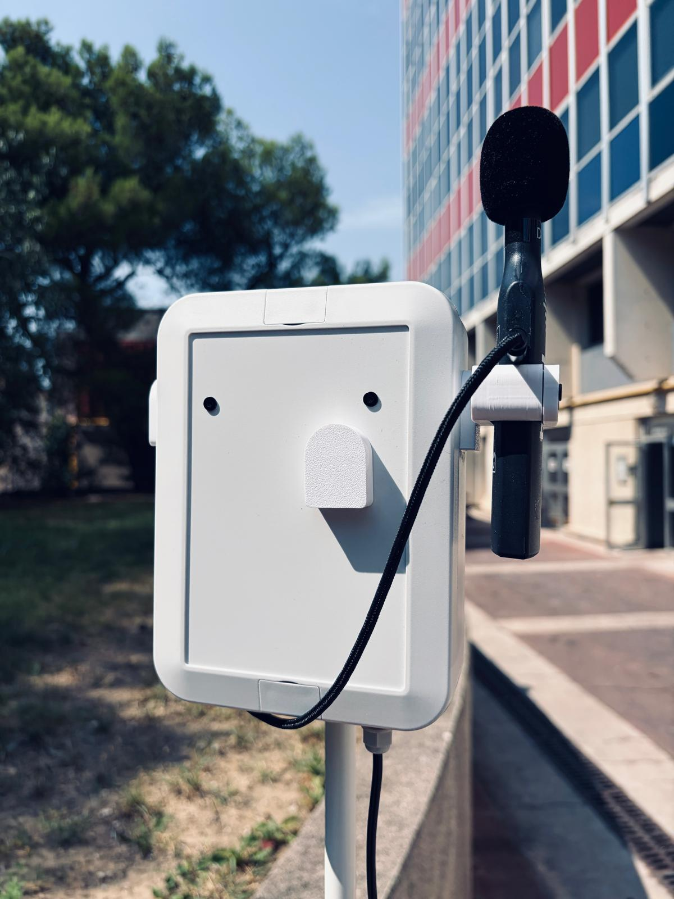
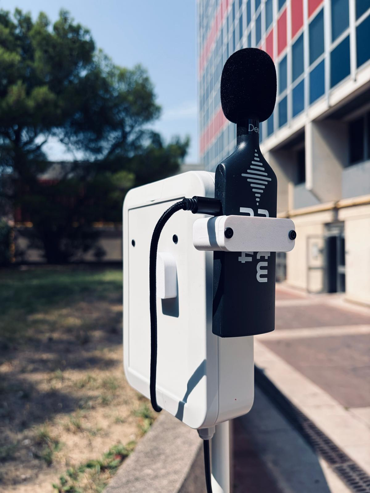

# NebuleAir Pro Bruit

{ width="450" }

## Présentation

Le NebuleAir Pro Bruit est un [NebuleAir Pro](index.md) équipé d'un **sonomètre numérique**. Une même station mesure, au même endroit et en continu :

- le **niveau sonore** (LAeq, en dB(A)) ;
- les **particules fines** PM1, PM2.5 et PM10 ;
- la température, l'humidité et la pression.

Les mesures sont envoyées en **4G**, sans WiFi ni installation réseau sur place, et consultables en ligne quelques minutes après leur acquisition.

!!! info "Compatibilité"
    Le sonomètre s'installe uniquement sur le **NebuleAir Pro**. Il n'est pas disponible sur le NebuleAir WiFi ni sur les ModuleAir.

## Le sonomètre

{ width="400" }

| | |
|---|---|
| **Modèle** | [NSRT_mk4_Dev](https://convergenceinstruments.com/fr/produit/sonometre-enregistreur-avec-microphone-de-type-1-nsrt_mk4_dev/) |
| **Fabricant** | Convergence Instruments (Canada) |
| **Classe de précision** | Type I |
| **Microphone** | MEMS numérique, protégé de la poussière et de l'eau par une membrane ePTFE |
| **Bande passante** | 20 Hz à 20 kHz |
| **Bruit de fond (typique)** | 30 dB(A) |
| **Niveau de saturation (typique, à 1 kHz)** | 120 dB(A) |
| **Pondérations disponibles** | A, C et Z (le NebuleAir Pro mesure en **dB(A)**) |
| **Erreur de température** | Meilleure que 0,6 dB entre -20 °C et 60 °C |
| **Sensibilité aux vibrations** | 60 dB SPL/g, 20 dB de moins qu'un microphone de mesure classique |
| **Étalonnage** | Certificat d'étalonnage individuel fourni ; recalibrage sur le terrain avec un calibrateur 94 dB ½ pouce, rarement nécessaire |
| **Plage de température** | -20 °C à 60 °C |
| **Dimensions et poids** | 19 × 42 × 160 mm, 50 g |
| **Boîtier** | Étanche, conçu pour l'extérieur sur le long terme |
| **Liaison avec la station** | USB, protocole ouvert, piloté par le firmware du NebuleAir Pro |
| **Protection contre le vent** | Petite bonnette fournie avec la sonde, ou grande bonnette anti-vent de 76 mm (voir [Bonnettes](#bonnettes)) |

Le sonomètre traite 100 % du signal acoustique, sans échantillon manqué, et garde ses réglages en mémoire après une coupure de courant.

*Source : fiche technique NSRT_mk4_Dev, Convergence Instruments, février 2023.*

### Bonnettes

Deux versions sont proposées :

| Version | Usage conseillé |
|---|---|
| **Sonde avec sa petite bonnette** | Intérieur, ou extérieur abrité du vent (cour, préau, test de courte durée) |
| **Sonde avec la grande bonnette anti-vent de 76 mm** | **Extérieur**, en particulier sur un site exposé (bord de route, toit, mât) |

La grande bonnette est la [boule anti-vent de 76 mm](https://convergenceinstruments.com/fr/produit/boule-anti-vent-de-90mm-3-5/) de Convergence Instruments, prévue pour la série NSRT_mk4 : 76 mm de diamètre (3 pouces), 15 g.

Le vent qui frappe la membrane du microphone crée un bruit qui s'ajoute au niveau mesuré. Plus la bonnette est grande, plus elle atténue ce bruit de vent : c'est la version recommandée pour une station installée durablement en extérieur.

## Ce qui est mesuré

### LAeq minute

La station calcule un **LAeq sur chaque minute** : le niveau sonore équivalent, pondéré A, sur 60 secondes.

- Les minutes se suivent **sans trou ni recouvrement** : chaque valeur couvre exactement la minute écoulée.
- Le LAeq minute est la **moyenne énergétique** des 60 secondes, 10·log10(moyenne(10^(L/10))), et non une moyenne arithmétique.
- Une minute dont moins de 30 secondes sont valides est marquée **absente**, plutôt que calculée sur trop peu de mesures.

### LAeq à la seconde (option)

En option, la station enregistre aussi le **LAeq de chaque seconde** et transmet les 60 valeurs de la minute en une seule fois.

- Résolution : 0,01 dB.
- Une seconde manquante (sonde muette quelques instants) est marquée absente, sans décaler les suivantes.
- Les secondes sont datées par le serveur à la réception : la dérive éventuelle de l'horloge du capteur n'a pas d'effet sur l'horodatage.
- Cette option demande une carte SIM avec un accès internet (1NCE ou Monogoto).

!!! note "Volume de données"
    Le LAeq à la seconde représente environ **6 Mo de données en plus par mois** et par station.

## Transmission et accès aux données

| | |
|---|---|
| **Fréquence d'envoi** | Une fois par minute |
| **Réseau** | 4G, carte SIM et 24 mois de données inclus |
| **Délai** | Données disponibles 1 à 2 minutes après la fin de la minute mesurée |
| **Stockage local** | Mémoire du capteur (secondes conservées 7 jours), récupérable en WiFi en cas de coupure réseau |

Les mesures de bruit se consultent comme les autres mesures du NebuleAir Pro :

- sur l'[interface web MonNebuleAir](index.md#2-interface-web-monnebuleair) et l'application mobile [Cyan Sensor](../cyan-sensor/index.md) ;
- par l'[API AirCarto](index.md#3-api-aircarto) : le champ **`NOISE`** contient le LAeq minute en dB(A) (`null` si la station n'a pas de sonomètre).

## Installation en extérieur

Quelques règles pour une mesure représentative :

- **Bonnette toujours en place**, de préférence la grande bonnette anti-vent de 76 mm : sans protection, le vent sur la membrane du microphone produit un bruit qui fausse la mesure.
- **Hauteur** : placer le microphone à au moins 1,5 m du sol.
- **Façades** : à proximité immédiate d'un mur, la réflexion du son augmente le niveau mesuré d'environ 3 dB. Éloigner le microphone des façades (idéalement 2 m), ou tenir compte de cet écart si la station est fixée en façade.
- **Sources parasites** : éviter les bouches de ventilation, climatiseurs, gouttières et branches qui frottent.
- **Microphone orienté vers la zone à caractériser** (rue, chantier, cour d'école…), sans obstacle entre les deux.

Pour le boîtier, l'alimentation (secteur ou solaire) et la connectivité, voir la page [NebuleAir Pro](index.md#caracteristiques-techniques).

## Validation

Nous avons mené avec **AtmoSud** une intercomparaison du NebuleAir Pro Bruit face à **deux sonomètres de référence de classe 1**. L'analyse est en cours de finalisation ; les résultats seront publiés sur cette page.

## En savoir plus

- [NebuleAir Pro](index.md) : caractéristiques communes, installation, configuration, mise à jour du firmware, récupération des données
- Pour un devis ou une présentation : [contact@aircarto.fr](mailto:contact@aircarto.fr)
