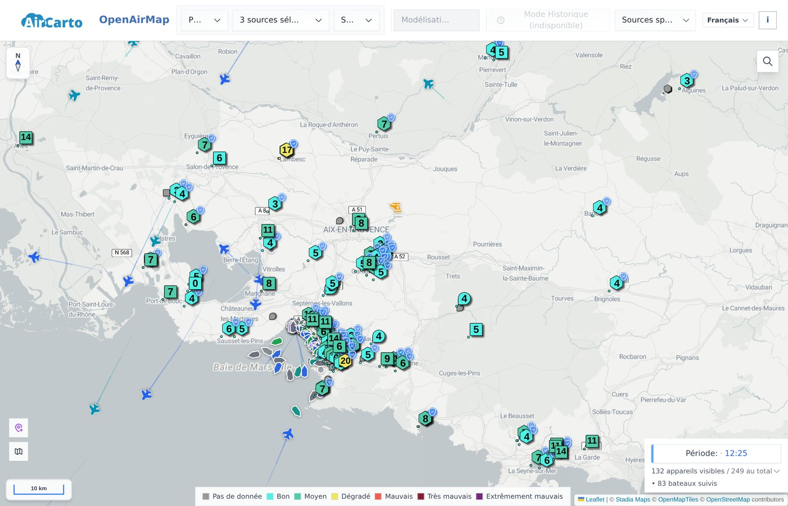
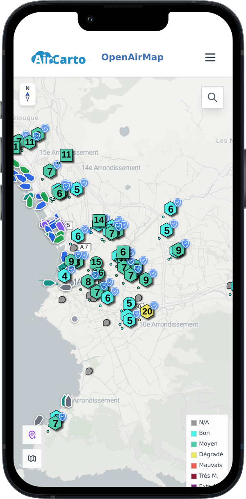

# OpenAirMap

{ width="100%" }

## Présentation

**[OpenAirMap](https://openairmap.fr)** est une carte web **open source** de la qualité de l'air, portée par **AirCarto** et **AtmoSud**. Elle affiche en temps réel, sur une même carte, les mesures des **stations de référence**, des **microcapteurs** et des **capteurs citoyens**, récupérées auprès de plusieurs plateformes de mise à disposition de données (API).

L'application fonctionne dans un navigateur, sur ordinateur comme sur téléphone, sans inscription ni installation.

| | |
|---|---|
| Adresse | [openairmap.fr](https://openairmap.fr) |
| Accès | libre, sans compte |
| Plateformes | navigateur web (ordinateur, tablette, téléphone) |
| Centrage par défaut | Nice, région Provence-Alpes-Côte d'Azur |
| Langues | français, anglais, espagnol, italien, allemand, arabe |
| Code | open source — React, TypeScript, Leaflet |

!!! info "Une carte, deux habillages"
    Le même code sert deux versions de la carte : sur **openairmap.fr**, le logo AirCarto est en tête et AtmoSud crédité en second ; la version AtmoSud inverse les deux. Le contenu et les fonctionnalités sont identiques.

{ width="300" }

## L'interface

La barre du haut regroupe les réglages de la carte :

| Contrôle | Rôle |
|----------|------|
| **Polluant** | La mesure affichée sur les marqueurs (une à la fois) |
| **Sources de données** | Les réseaux de capteurs à afficher |
| **Pas de temps** | Scan, ≤ 2 min, 15 min, heure ou jour |
| **Carte de modélisation** | Superpose la modélisation AtmoSud ou le champ de vent |
| **Mode Historique** | Rejoue une période passée sur la carte |
| **Sources spéciales** | SignalAir et MobileAir |
| **Langue** | Six langues au choix |
| **i** | Fenêtre d'information : liste des sources, aide |

Sur la carte : la **recherche** (en haut à droite), le **fond de carte**, la **légende** des couleurs (en bas) et un encart indiquant la **période** affichée et le **nombre d'appareils visibles**. Sur téléphone, les contrôles sont regroupés dans un menu.

Un clic sur un marqueur ouvre un **panneau latéral** propre à la source : dernière mesure, informations sur l'appareil et graphique d'évolution temporelle.

## Les sources de données

### Sources principales

| Source | Type | Description | Pas de temps disponibles |
|--------|------|-------------|--------------------------|
| **Stations de référence AtmoSud** | station de mesure | Stations installées dans le cadre de la mission de surveillance de la qualité de l'air d'AtmoSud | Scan, 15 min, heure, jour |
| **Microcapteurs qualifiés AtmoSud** | microcapteur | Microcapteurs déployés par AtmoSud ; les données horaires sont consolidées | Scan, ≤ 2 min, 15 min, heure |
| **[NebuleAir](../nebuleair-wifi/index.md)** | microcapteur | Microcapteurs open source co-développés par AirCarto et AtmoSud | Scan, ≤ 2 min, 15 min, heure, jour |
| **Sensor.Community** | microcapteur | Microcapteurs open source fabriqués par des citoyens bénévoles | Scan, ≤ 2 min |
| **PurpleAir** | microcapteur | Microcapteurs commercialisés par l'entreprise américaine PurpleAir Inc. | Scan, ≤ 2 min |

NebuleAir, Sensor.Community et PurpleAir sont regroupés sous « **Autres capteurs communautaires** ». À l'ouverture, la carte affiche les stations de référence, les microcapteurs AtmoSud et les NebuleAir ; Sensor.Community et PurpleAir s'activent dans le menu des sources.

!!! warning "Toutes les sources ne couvrent pas tous les pas de temps"
    Si une source sélectionnée n'est pas disponible au pas de temps choisi, l'application le signale et propose soit de changer de pas de temps, soit de désactiver les sources incompatibles. Dans la fenêtre d'information, l'icône d'une source est grisée pour les pas de temps qu'elle ne fournit pas.

Quelques particularités par source :

- **Microcapteurs AtmoSud** : le panneau peut afficher, en option, les **données brutes** (non corrigées) à côté des données corrigées.
- **PurpleAir** : le panneau affiche un indice de **confiance** (Excellente, Bonne, Faible), qui mesure la cohérence entre les deux capteurs internes A et B, ainsi que la température et l'humidité.
- **Sensor.Community** : l'historique est un graphique fourni directement par le Grafana de Sensor.Community ; les contrôles de période et de pas de temps d'OpenAirMap ne s'y appliquent pas.

### Sources spéciales

| Source | Contenu |
|--------|---------|
| **[MobileAir](../mobileair/index.md)** | Parcours GPS des capteurs mobiles, découpés en **sessions**. Un seul capteur MobileAir à la fois ; seuls PM₁, PM₂.₅ et PM₁₀ sont pris en charge. Le panneau donne la moyenne, le minimum et le maximum de la session. |
| **SignalAir** | Signalements de nuisances déposés par les habitants sur la plateforme SignalAir : **odeurs**, **bruits**, **brûlage**, **visuel** (brouillard, poussières). Disponibles sur un horizon glissant de **30 jours** maximum. Chaque signalement détaille l'origine déclarée, le niveau de gêne et les symptômes éventuels. |

### Modélisation et vent

Le menu **Carte de modélisation** superpose à la carte :

- **Modélisation** du polluant sélectionné (PM₁, PM₂.₅, PM₁₀, NO₂, O₃, SO₂) : la modélisation horaire **AZUR** d'AtmoSud sur la région Provence-Alpes-Côte d'Azur ;
- **Vent** : le champ de vent fourni par AtmoSud.

La modélisation n'est pas proposée au pas de temps **Scan**. Dans le panneau d'une station, l'option **Modélisation AZUR** ajoute la prévision modélisée au graphique ; elle n'est disponible qu'au pas de temps horaire.

### Autres couches

| Couche | Contenu |
|--------|---------|
| **Incendies** | Signalements de feux du jour, issus de feuxdeforet.fr |
| **Bateaux** | Navires suivis par AIS, avec leur trajet récent, leur type et leur fiche (pavillon, dimensions, compagnie, branchement à quai…) |
| **Avions** | Aéronefs suivis par ADS-B, avec leur sillage, leur altitude et leur route |
| **Zones** | Contours des **aéroports**, des **ports** et des **sites Seveso** |
| **Découpage communal** | Limites des communes |

Le fond de carte se choisit entre **Carte standard**, **Carte OSM** (OpenStreetMap) et **Satellite IGN**.

## Polluants et échelle de couleurs

### Mesures disponibles

| Mesure | Unité |
|--------|-------|
| PM₁ | µg/m³ |
| PM₂.₅ (par défaut) | µg/m³ |
| PM₁₀ | µg/m³ |
| NO₂ | µg/m³ |
| O₃ | µg/m³ |
| SO₂ | µg/m³ |
| Bruit | dB(A) |

!!! note "Le bruit"
    Le bruit n'est disponible qu'aux pas de temps **Scan** et **≤ 2 min**.

### Les six niveaux

Chaque marqueur prend la couleur du niveau atteint par la mesure. Les marqueurs gris signalent un appareil **sans donnée récente**.

=== "PM₁ et PM₂.₅"

    | Niveau | µg/m³ |
    |--------|-------|
    | **Bon** | 0 – 6 |
    | **Moyen** | 6 – 16 |
    | **Dégradé** | 16 – 51 |
    | **Mauvais** | 51 – 91 |
    | **Très mauvais** | 91 – 141 |
    | **Extrêmement mauvais** | > 141 |

=== "PM₁₀"

    | Niveau | µg/m³ |
    |--------|-------|
    | **Bon** | 0 – 16 |
    | **Moyen** | 16 – 46 |
    | **Dégradé** | 46 – 121 |
    | **Mauvais** | 121 – 196 |
    | **Très mauvais** | 196 – 271 |
    | **Extrêmement mauvais** | > 271 |

=== "NO₂"

    | Niveau | µg/m³ |
    |--------|-------|
    | **Bon** | 0 – 10 |
    | **Moyen** | 10 – 25 |
    | **Dégradé** | 25 – 60 |
    | **Mauvais** | 60 – 100 |
    | **Très mauvais** | 100 – 150 |
    | **Extrêmement mauvais** | > 150 |

=== "O₃"

    | Niveau | µg/m³ |
    |--------|-------|
    | **Bon** | 0 – 60 |
    | **Moyen** | 60 – 100 |
    | **Dégradé** | 100 – 120 |
    | **Mauvais** | 120 – 160 |
    | **Très mauvais** | 160 – 180 |
    | **Extrêmement mauvais** | > 180 |

=== "SO₂"

    | Niveau | µg/m³ |
    |--------|-------|
    | **Bon** | 0 – 20 |
    | **Moyen** | 20 – 40 |
    | **Dégradé** | 40 – 125 |
    | **Mauvais** | 125 – 190 |
    | **Très mauvais** | 190 – 275 |
    | **Extrêmement mauvais** | > 275 |

=== "Bruit"

    Seuils **indicatifs**.

    | Niveau | dB(A) |
    |--------|-------|
    | **Bon** | 0 – 55 |
    | **Moyen** | 55 – 65 |
    | **Dégradé** | 65 – 75 |
    | **Mauvais** | 75 – 85 |
    | **Très mauvais** | 85 – 95 |
    | **Extrêmement mauvais** | > 95 |

!!! tip "Daltonisme"
    Dans les graphiques, l'option **Désactivé seuils** (menu Options avancées) masque le fond coloré par seuil.

## Les pas de temps

| Pas de temps | Valeur affichée |
|--------------|-----------------|
| **Scan** (par défaut) | Dernière valeur transmise par chaque appareil |
| **≤ 2 min** | Moyenne sur 2 minutes |
| **15 min** | Moyenne quart-horaire |
| **Heure** | Moyenne horaire |
| **Jour** | Moyenne journalière |

!!! info "Le mode Scan mélange des résolutions différentes"
    En Scan, chaque source garde sa résolution réelle : les stations de référence publient toutes les 15 minutes, les microcapteurs toutes les 1 à 5 minutes selon le modèle. Les différences de densité de points dans les graphiques sont normales.

## Graphiques et export

Le panneau d'un appareil affiche l'**évolution temporelle** des mesures. On y choisit :

- les **polluants affichés** (plusieurs à la fois pour une station de référence) ;
- la **période** : 3 h, 24 h, 7 j, 30 j, ou une période personnalisée ;
- le **pas de temps** du graphique.

La période maximale dépend du pas de temps :

| Pas de temps du graphique | Période maximale |
|---------------------------|------------------|
| Scan | 2 mois |
| 15 min | 6 mois |
| Heure, jour | sans limite |

Si la période dépasse la limite, elle est ajustée automatiquement et un message l'indique.

Le menu d'export du graphique propose deux formats :

- **PNG** : l'image du graphique ;
- **CSV** : les données, à ouvrir dans un tableur.

## Le mode historique

Le mode historique **rejoue une période passée sur la carte** : les marqueurs sont remplacés par les mesures de la période choisie, que l'on fait défiler pas à pas.

1. Choisissez le pas de temps **15 min**, **heure** ou **jour** (le mode n'est pas disponible en Scan ni en ≤ 2 min).
2. Cliquez sur **Mode Historique**.
3. Sélectionnez une date de début et de fin dans le calendrier.
4. Cliquez sur **Charger les données**.
5. Utilisez **lecture / pause**, la frise temporelle et la **vitesse** (0,5×, 1×, 2×, 4×, 8×) pour naviguer dans le temps.

Pour quitter, cliquez à nouveau sur **Mode Historique**.

| Pas de temps | Période maximale |
|--------------|------------------|
| 15 min | 7 jours |
| Heure | 30 jours |
| Jour | 365 jours |

!!! info "Sources prises en charge"
    Le mode historique couvre les **stations de référence AtmoSud**, les **microcapteurs qualifiés AtmoSud** et les **NebuleAir**. Les signalements SignalAir sont chargés aussi si la source est activée.

### Les épisodes de pollution

Le calendrier du mode historique signale les **épisodes de pollution** publiés par AtmoSud pour le polluant sélectionné, avec leur niveau (**Information** ou **Alerte**) et les départements concernés. Le bouton **Dernier épisode** sélectionne directement le plus récent.

!!! note "Panneau de lecture"
    Le panneau de lecture est déplaçable. Pendant le mode historique, les panneaux latéraux sont fermés et un clic sur un marqueur n'en ouvre pas.

## La comparaison multi-capteurs

La comparaison affiche les mesures de **plusieurs appareils sur un même graphique**.

1. Ouvrez le panneau d'une station ou d'un capteur et cliquez sur **Activer comparaison**.
2. Cliquez sur les autres appareils à comparer, directement sur la carte : leurs données s'ajoutent au graphique.
3. Pour quitter, cliquez sur **Désactiver comparaison**.

| | |
|---|---|
| Sources comparables | stations de référence AtmoSud, microcapteurs AtmoSud, NebuleAir |
| Nombre d'appareils | **10** au maximum |
| Polluant | un seul à la fois, commun aux appareils sélectionnés |
| Pas de temps | seuls ceux que toutes les sources comparées fournissent |

## La recherche

La barre de recherche (en haut à droite) trouve à la fois :

- **un capteur ou une station**, par son nom, parmi les appareils affichés : la carte se centre dessus et ouvre son panneau ;
- **une adresse**, via la Base Adresse Nationale : la carte se centre dessus, avec un zoom adapté (adresse précise, rue, commune…).

Les flèches du clavier parcourent les résultats, **Entrée** sélectionne, **Échap** ferme la liste.

## Les statistiques de zone

Le panneau **Statistiques** porte sur les appareils **visibles à l'écran** : zoomer ou déplacer la carte change le calcul.

- nombre d'appareils visibles sur le total ;
- **moyenne**, **médiane**, **minimum** et **maximum** du polluant affiché ;
- **distribution par seuil** (nombre d'appareils dans chaque niveau) ;
- **détail par type d'appareil** de mesure.

Lorsque SignalAir est affiché, le panneau donne aussi les statistiques des signalements : total, répartition avec ou sans symptômes, par type et par niveau de gêne.

## Signalements et commentaires

OpenAirMap permet à chacun d'ajouter du contexte sur la carte :

- **Commenter** un capteur, un bateau ou une zone : un fil de commentaires est attaché au sujet. Le nom est facultatif.
- **Déposer un signalement** géolocalisé : bouton **Nouveau signalement**, puis toucher la carte à l'endroit de l'événement. On choisit un type (facultatif : **Incendie**, **Industriel**, **Trafic**, **Voisinage**), la date et l'heure de l'événement, et une description. D'autres utilisateurs peuvent y répondre.
- Un signalement peut être **marqué comme terminé** ; il reste possible de le commenter.

## Langues

L'interface est disponible en **français**, **anglais**, **espagnol**, **italien**, **allemand** et **arabe**. Au premier chargement, la langue du navigateur est utilisée si elle fait partie de la liste (sinon le français) ; le choix fait dans le menu est ensuite mémorisé.

## Partager une vue : les liens profonds

Une adresse de la forme suivante ouvre la carte centrée sur un point :

```
https://openairmap.fr/?lat=43.2965&lng=5.3698&zoom=14
```

| Paramètre | Rôle |
|-----------|------|
| `lat` | Latitude du centre |
| `lng` (ou `lon`) | Longitude du centre |
| `zoom` | Niveau de zoom ; **16** si absent |

`lat` et `lng` sont obligatoires : sans eux, la carte s'ouvre sur sa vue par défaut.

## Faire apparaître son NebuleAir sur la carte

Un [NebuleAir](../nebuleair-wifi/index.md) n'apparaît sur OpenAirMap que si son propriétaire **choisit de le publier**. Publier un capteur rend publique sa position exacte : la publication repose donc sur un **consentement explicite**, dont le texte est affiché avant validation.

1. **Connectez le capteur** à votre WiFi (voir [Configuration WiFi](../nebuleair-wifi/index.md#configuration-wifi)).
2. **Géolocalisez-le** : sur [Mon NebuleAir](https://nebuleair.fr/monNebuleAir.html), entrez une adresse ou déplacez le marqueur, puis validez (voir [Géolocalisation](../nebuleair-wifi/index.md#geolocalisation)).
3. **Activez la publication** :
    - sur Mon NebuleAir, section **Carte participative OpenAirMap** → **Afficher le capteur sur la carte OpenAirMap** ;
    - ou dans l'[application Cyan Sensor](../cyan-sensor/index.md#publier-sur-openairmap), qui propose la publication juste après l'ajout d'un NebuleAir.

!!! success "Retrait immédiat"
    La publication se retire à tout moment par le même interrupteur ; dans l'application Cyan Sensor, le retrait est immédiat, sans confirmation ni justification. Publier ou non ne change rien au fonctionnement du capteur : il continue de mesurer et d'envoyer ses données.
